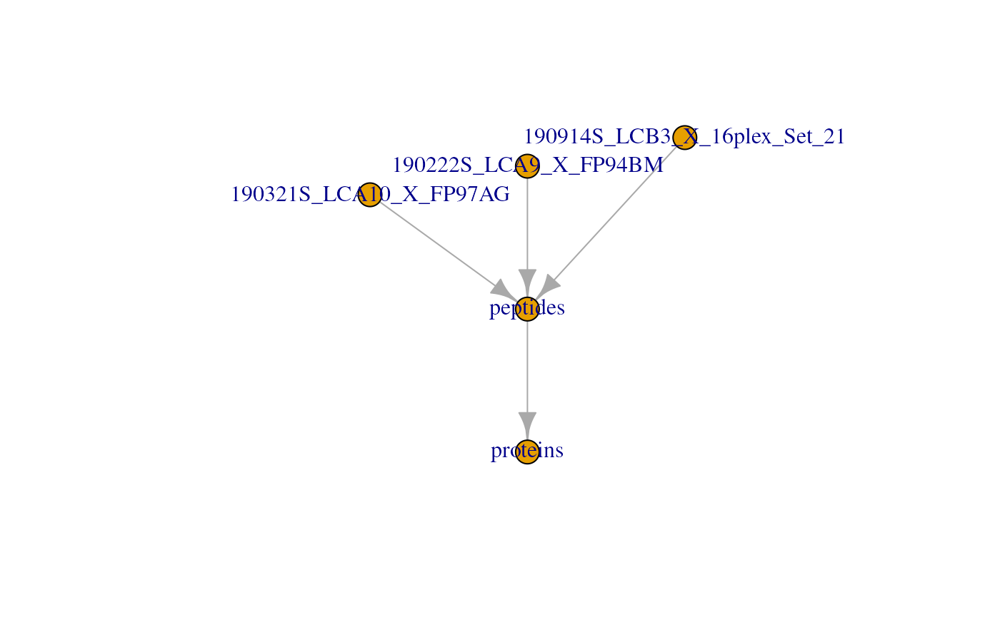
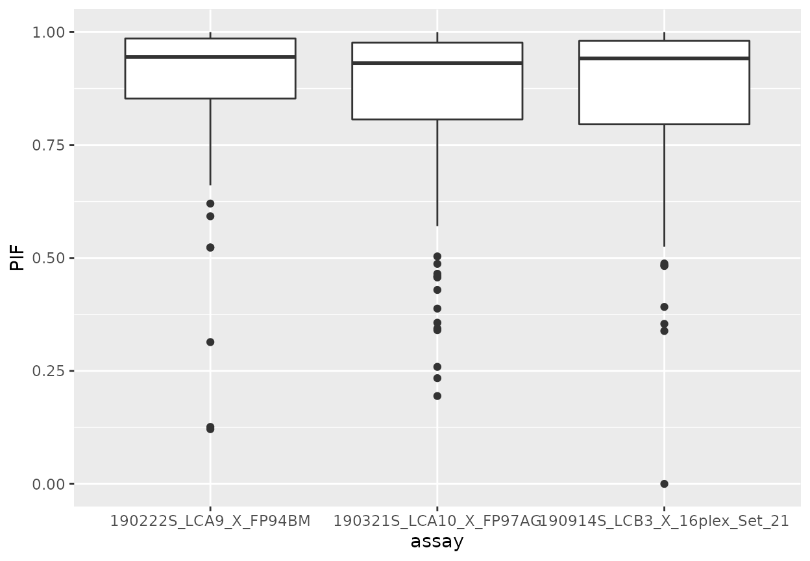
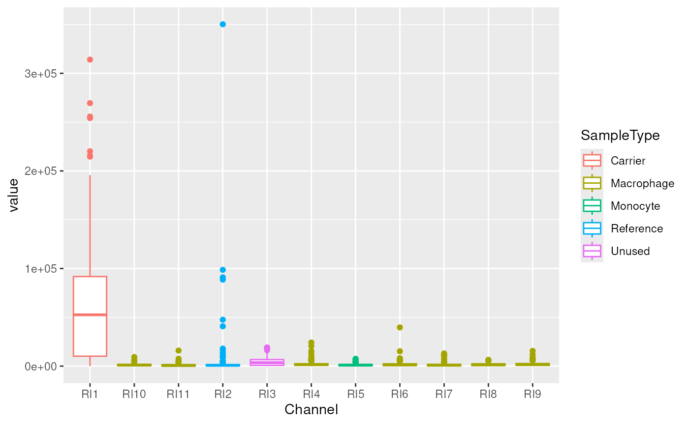

# QFeatures in a nutshell

This vignette briefly recaps the main concepts of `QFeatures` on which
`scp` relies. More in depth information is to be found in the
`QFeatures`
[vignettes](https://rformassspectrometry.github.io/QFeatures/articles/QFeatures.html).

## The `QFeatures` class

The `QFeatures` class (Gatto and Vanderaa (2023)) is based on the
`MultiAssayExperiment` class that holds a collection of
`SummarizedExperiment` (or other classes that inherits from it) objects
termed **assays**. The assays in a `QFeatures` object have a
hierarchical relation: proteins are composed of peptides, themselves
produced by spectra, as depicted in figure below.

A more technical representation is shown below, highlighting that each
assay is a `SummarizedExperiment` (containing the quantitative data, row
and column annotations for each individual assay), as well as a global
sample annotation table, that annotates cells across all assays.

Those links are stored as part as the `QFeatures` object and connect the
assays together. We load an example dataset from the `scp` package that
is formatted as an `QFeatures` object and plot those connection.

\
[`library`](https://rdrr.io/r/base/library.html)`(`[`scp`](https://UCLouvain-CBIO.github.io/scp)`)`\
[`data`](https://rdrr.io/r/utils/data.html)`(``"scp1"``)`\
[`plot`](https://rdrr.io/r/graphics/plot.default.html)`(``scp1``)`

## Accessing the data

The `QFeatures` class contains all the available and metadata. We here
show how to retrieve those different pieces of information.

### Quantitative data

The quantitative data, stored as matrix-like objects, can be accessed
using the `assay` function. For example, we here extract the
quantitative data for the first MS batch (and show a subset of it):

\
[`assay`](https://rdrr.io/pkg/SummarizedExperiment/man/SummarizedExperiment-class.html)`(``scp1``, ``"190321S_LCA10_X_FP97AG"``)``[``1``:``5``, ``]`\
`#>          190321S_LCA10_X_FP97AGRI1 190321S_LCA10_X_FP97AGRI2`\
`#> PSM3773                      57895                    603.73`\
`#> PSM9078                      64889                   1481.30`\
`#> PSM9858                      58993                    489.85`\
`#> PSM11744                     75711                    539.02`\
`#> PSM21752                         0                      0.00`\
`#>          190321S_LCA10_X_FP97AGRI3 190321S_LCA10_X_FP97AGRI4`\
`#> PSM3773                     2787.9                    757.17`\
`#> PSM9078                     4891.6                    597.53`\
`#> PSM9858                     2899.4                    882.37`\
`#> PSM11744                    7292.7                    357.90`\
`#> PSM21752                       0.0                      0.00`\
`#>          190321S_LCA10_X_FP97AGRI5 190321S_LCA10_X_FP97AGRI6`\
`#> PSM3773                     862.08                   1118.80`\
`#> PSM9078                    1140.30                   1300.10`\
`#> PSM9858                     296.60                    977.15`\
`#> PSM11744                   1091.30                    736.87`\
`#> PSM21752                      0.00                      0.00`\
`#>          190321S_LCA10_X_FP97AGRI7 190321S_LCA10_X_FP97AGRI8`\
`#> PSM3773                     640.10                   1446.10`\
`#> PSM9078                    1092.50                   1309.40`\
`#> PSM9858                     498.60                   1437.90`\
`#> PSM11744                    712.74                    590.75`\
`#> PSM21752                      0.00                      0.00`\
`#>          190321S_LCA10_X_FP97AGRI9 190321S_LCA10_X_FP97AGRI10`\
`#> PSM3773                     968.49                     648.56`\
`#> PSM9078                    1538.40                    1014.50`\
`#> PSM9858                     857.40                     888.01`\
`#> PSM11744                  15623.00                     298.60`\
`#> PSM21752                      0.00                       0.00`\
`#>          190321S_LCA10_X_FP97AGRI11`\
`#> PSM3773                      742.53`\
`#> PSM9078                     1062.80`\
`#> PSM9858                      768.61`\
`#> PSM11744                     481.38`\
`#> PSM21752                       0.00`

Note that you can retrieve the list of available assays in a `QFeatures`
object using the [`names()`](https://rdrr.io/r/base/names.html)
function.

\
[`names`](https://rdrr.io/r/base/names.html)`(``scp1``)`\
`#> [1] "190321S_LCA10_X_FP97AG"       "190222S_LCA9_X_FP94BM"       `\
`#> [3] "190914S_LCB3_X_16plex_Set_21" "peptides"                    `\
`#> [5] "proteins"`

### Feature metadata

For each individual assay, there is feature metadata available. We
extract the list of metadata tables by using
[`rowData()`](https://rdrr.io/pkg/SummarizedExperiment/man/SummarizedExperiment-class.html)
on the `QFeatures` object.

\
[`rowData`](https://rdrr.io/pkg/SummarizedExperiment/man/SummarizedExperiment-class.html)`(``scp1``)`\
`#> DataFrameList of length 5`\
`#> names(5): 190321S_LCA10_X_FP97AG 190222S_LCA9_X_FP94BM 190914S_LCB3_X_16plex_Set_21 peptides proteins`\
[`rowData`](https://rdrr.io/pkg/SummarizedExperiment/man/SummarizedExperiment-class.html)`(``scp1``)``[[``"proteins"``]``]`\
`#> DataFrame with 292 rows and 9 columns`\
`#>                                            protein Match.time.difference`\
`#>                                        <character>             <logical>`\
`#> A1A519                                      A1A519                    NA`\
`#> A5D8V6                                      A5D8V6                    NA`\
`#> A5PLK6                                      A5PLK6                    NA`\
`#> A5PLL1                                      A5PLL1                    NA`\
`#> A6NC97                                      A6NC97                    NA`\
`#> ...                                            ...                   ...`\
`#> REV__CON__ENSEMBL:ENSBTAP00000038253 REV__CON__...                    NA`\
`#> REV__CON__P06868                     REV__CON__...                    NA`\
`#> REV__CON__Q05443                     REV__CON__...                    NA`\
`#> REV__CON__Q32PI4                     REV__CON__...                    NA`\
`#> REV__CON__Q3MHN5                     REV__CON__...                    NA`\
`#>                                      Match.m.z.difference Match.q.value`\
`#>                                                 <logical>     <logical>`\
`#> A1A519                                                 NA            NA`\
`#> A5D8V6                                                 NA            NA`\
`#> A5PLK6                                                 NA            NA`\
`#> A5PLL1                                                 NA            NA`\
`#> A6NC97                                                 NA            NA`\
`#> ...                                                   ...           ...`\
`#> REV__CON__ENSEMBL:ENSBTAP00000038253                   NA            NA`\
`#> REV__CON__P06868                                       NA            NA`\
`#> REV__CON__Q05443                                       NA            NA`\
`#> REV__CON__Q32PI4                                       NA            NA`\
`#> REV__CON__Q3MHN5                                       NA            NA`\
`#>                                      Match.score Reporter.PIF Reporter.fraction`\
`#>                                        <logical>    <logical>         <logical>`\
`#> A1A519                                        NA           NA                NA`\
`#> A5D8V6                                        NA           NA                NA`\
`#> A5PLK6                                        NA           NA                NA`\
`#> A5PLL1                                        NA           NA                NA`\
`#> A6NC97                                        NA           NA                NA`\
`#> ...                                          ...          ...               ...`\
`#> REV__CON__ENSEMBL:ENSBTAP00000038253          NA           NA                NA`\
`#> REV__CON__P06868                              NA           NA                NA`\
`#> REV__CON__Q05443                              NA           NA                NA`\
`#> REV__CON__Q32PI4                              NA           NA                NA`\
`#> REV__CON__Q3MHN5                              NA           NA                NA`\
`#>                                      Potential.contaminant        .n`\
`#>                                                <character> <integer>`\
`#> A1A519                                                             1`\
`#> A5D8V6                                                             1`\
`#> A5PLK6                                                             1`\
`#> A5PLL1                                                             1`\
`#> A6NC97                                                             1`\
`#> ...                                                    ...       ...`\
`#> REV__CON__ENSEMBL:ENSBTAP00000038253                     +         1`\
`#> REV__CON__P06868                                         +         1`\
`#> REV__CON__Q05443                                         +         1`\
`#> REV__CON__Q32PI4                                         +         1`\
`#> REV__CON__Q3MHN5                                         +         1`

You can also retrieve the names of each `rowData` column for all assays
with `rowDataNames`.

\
[`rowDataNames`](https://rformassspectrometry.github.io/QFeatures/reference/QFeatures-class.html)`(``scp1``)`\
`#> CharacterList of length 5`\
`#> [["190321S_LCA10_X_FP97AG"]] uid Sequence ... peptide Leading.razor.protein`\
`#> [["190222S_LCA9_X_FP94BM"]] uid Sequence ... peptide Leading.razor.protein`\
`#> [["190914S_LCB3_X_16plex_Set_21"]] uid Sequence ... Leading.razor.protein`\
`#> [["peptides"]] Sequence Length Modifications ... .n Leading.razor.protein`\
`#> [["proteins"]] protein Match.time.difference ... Potential.contaminant .n`

You can also get the `rowData` from different assays in a single table
using the `rbindRowData` function. It will keep the common `rowData`
variables to all selected assays (provided through `i`).

\
[`rbindRowData`](https://rformassspectrometry.github.io/QFeatures/reference/QFeatures-class.html)`(``scp1``, i ``=`` ``1``:``5``)`\
`#> DataFrame with 1388 rows and 10 columns`\
`#>              assay       rowname       protein Match.time.difference`\
`#>        <character>   <character>   <character>             <logical>`\
`#> 1    190321S_LC...       PSM3773        P61981                    NA`\
`#> 2    190321S_LC...       PSM9078        Q8WVN8                    NA`\
`#> 3    190321S_LC...       PSM9858        P55084                    NA`\
`#> 4    190321S_LC...      PSM11744        P19099                    NA`\
`#> 5    190321S_LC...      PSM21752        P52952                    NA`\
`#> ...            ...           ...           ...                   ...`\
`#> 1384      proteins REV__CON__... REV__CON__...                    NA`\
`#> 1385      proteins REV__CON__... REV__CON__...                    NA`\
`#> 1386      proteins REV__CON__... REV__CON__...                    NA`\
`#> 1387      proteins REV__CON__... REV__CON__...                    NA`\
`#> 1388      proteins REV__CON__... REV__CON__...                    NA`\
`#>      Match.m.z.difference Match.q.value Match.score Reporter.PIF`\
`#>                 <logical>     <logical>   <logical>    <logical>`\
`#> 1                      NA            NA          NA           NA`\
`#> 2                      NA            NA          NA           NA`\
`#> 3                      NA            NA          NA           NA`\
`#> 4                      NA            NA          NA           NA`\
`#> 5                      NA            NA          NA           NA`\
`#> ...                   ...           ...         ...          ...`\
`#> 1384                   NA            NA          NA           NA`\
`#> 1385                   NA            NA          NA           NA`\
`#> 1386                   NA            NA          NA           NA`\
`#> 1387                   NA            NA          NA           NA`\
`#> 1388                   NA            NA          NA           NA`\
`#>      Reporter.fraction Potential.contaminant`\
`#>              <logical>           <character>`\
`#> 1                   NA                      `\
`#> 2                   NA                      `\
`#> 3                   NA                      `\
`#> 4                   NA                      `\
`#> 5                   NA                      `\
`#> ...                ...                   ...`\
`#> 1384                NA                     +`\
`#> 1385                NA                     +`\
`#> 1386                NA                     +`\
`#> 1387                NA                     +`\
`#> 1388                NA                     +`

### Sample metadata

The sample metadata is retrieved using `colData` on the `QFeatures`
object.

\
[`colData`](https://rdrr.io/pkg/SummarizedExperiment/man/SummarizedExperiment-class.html)`(``scp1``)`\
`#> DataFrame with 38 rows and 7 columns`\
`#>                                            Set     Channel SampleAnnotation`\
`#>                                    <character> <character>      <character>`\
`#> 190222S_LCA9_X_FP94BMRI1         190222S_LC...         RI1    carrier_mi...`\
`#> 190222S_LCA9_X_FP94BMRI2         190222S_LC...         RI2             norm`\
`#> 190222S_LCA9_X_FP94BMRI3         190222S_LC...         RI3           unused`\
`#> 190222S_LCA9_X_FP94BMRI4         190222S_LC...         RI4             sc_u`\
`#> 190222S_LCA9_X_FP94BMRI5         190222S_LC...         RI5             sc_0`\
`#> ...                                        ...         ...              ...`\
`#> 190914S_LCB3_X_16plex_Set_21RI12 190914S_LC...        RI12            sc_m0`\
`#> 190914S_LCB3_X_16plex_Set_21RI13 190914S_LC...        RI13            sc_m0`\
`#> 190914S_LCB3_X_16plex_Set_21RI14 190914S_LC...        RI14            sc_m0`\
`#> 190914S_LCB3_X_16plex_Set_21RI15 190914S_LC...        RI15            sc_m0`\
`#> 190914S_LCB3_X_16plex_Set_21RI16 190914S_LC...        RI16            sc_m0`\
`#>                                   SampleType     lcbatch     sortday`\
`#>                                  <character> <character> <character>`\
`#> 190222S_LCA9_X_FP94BMRI1             Carrier        LCA9          s8`\
`#> 190222S_LCA9_X_FP94BMRI2           Reference        LCA9          s8`\
`#> 190222S_LCA9_X_FP94BMRI3              Unused        LCA9          s8`\
`#> 190222S_LCA9_X_FP94BMRI4            Monocyte        LCA9          s8`\
`#> 190222S_LCA9_X_FP94BMRI5               Blank        LCA9          s8`\
`#> ...                                      ...         ...         ...`\
`#> 190914S_LCB3_X_16plex_Set_21RI12  Macrophage        LCB3          s9`\
`#> 190914S_LCB3_X_16plex_Set_21RI13  Macrophage        LCB3          s9`\
`#> 190914S_LCB3_X_16plex_Set_21RI14  Macrophage        LCB3          s9`\
`#> 190914S_LCB3_X_16plex_Set_21RI15  Macrophage        LCB3          s9`\
`#> 190914S_LCB3_X_16plex_Set_21RI16  Macrophage        LCB3          s9`\
`#>                                       digest`\
`#>                                  <character>`\
`#> 190222S_LCA9_X_FP94BMRI1                   N`\
`#> 190222S_LCA9_X_FP94BMRI2                   N`\
`#> 190222S_LCA9_X_FP94BMRI3                   N`\
`#> 190222S_LCA9_X_FP94BMRI4                   N`\
`#> 190222S_LCA9_X_FP94BMRI5                   N`\
`#> ...                                      ...`\
`#> 190914S_LCB3_X_16plex_Set_21RI12           R`\
`#> 190914S_LCB3_X_16plex_Set_21RI13           R`\
`#> 190914S_LCB3_X_16plex_Set_21RI14           R`\
`#> 190914S_LCB3_X_16plex_Set_21RI15           R`\
`#> 190914S_LCB3_X_16plex_Set_21RI16           R`

Note that you can easily access a `colData` column using the `$`
operator. See here how we extract the sample types from the `colData`.

\
`scp1``$``SampleType`\
`#>  [1] "Carrier"    "Reference"  "Unused"     "Monocyte"   "Blank"     `\
`#>  [6] "Monocyte"   "Macrophage" "Macrophage" "Macrophage" "Macrophage"`\
`#> [11] "Macrophage" "Carrier"    "Reference"  "Unused"     "Macrophage"`\
`#> [16] "Monocyte"   "Macrophage" "Macrophage" "Macrophage" "Macrophage"`\
`#> [21] "Macrophage" "Macrophage" "Carrier"    "Reference"  "Unused"    `\
`#> [26] "Unused"     "Macrophage" "Macrophage" "Blank"      "Monocyte"  `\
`#> [31] "Macrophage" "Monocyte"   "Blank"      "Macrophage" "Macrophage"`\
`#> [36] "Macrophage" "Macrophage" "Macrophage"`

## Subsetting the data

There are three dimensions we want to subset for:

- Assays
- Samples
- Features

Therefore, `QFeatures` support a three-index subsetting. This is
performed through the simple bracket method `[feature, sample, assay]`.

### Subset assays

Suppose that we want to focus only on the first MS batch
(`190321S_LCA10_X_FP97AG`) for separate processing of the data.
Subsetting the `QFeatures` object for that assay is simply:

\
`scp1``[``, , ``"190321S_LCA10_X_FP97AG"``]`\
`#> harmonizing input:`\
`#>   removing 103 sampleMap rows not in names(experiments)`\
`#>   removing 27 colData rownames not in sampleMap 'primary'`\
`#> An instance of class QFeatures (type: bulk) with 1 set:`\
`#> `\
`#>  [1] 190321S_LCA10_X_FP97AG: SummarizedExperiment with 166 rows and 11 columns`

An alternative that results in exactly the same output is using the
`subsetByAssay` method.

\
`subsetByAssay``(``scp1``, ``"190321S_LCA10_X_FP97AG"``)`\
`#> harmonizing input:`\
`#>   removing 103 sampleMap rows not in names(experiments)`\
`#>   removing 27 colData rownames not in sampleMap 'primary'`\
`#> An instance of class QFeatures (type: bulk) with 1 set:`\
`#> `\
`#>  [1] 190321S_LCA10_X_FP97AG: SummarizedExperiment with 166 rows and 11 columns`

### Subset samples

Subsetting samples is often performed after sample QC where we want to
keep only quality samples and sample of interest. In our example, the
different samples are either technical controls or single-cells
(macrophages and monocytes). Suppose we are only interested in
macrophages, we can subset the data as follows:

\
`scp1``[``, ``scp1``$``SampleType`` ``==`` ``"Macrophage"``, ``]`\
`#> An instance of class QFeatures (type: bulk) with 5 sets:`\
`#> `\
`#>  [1] 190321S_LCA10_X_FP97AG: SummarizedExperiment with 166 rows and 7 columns `\
`#>  [2] 190222S_LCA9_X_FP94BM: SummarizedExperiment with 176 rows and 5 columns `\
`#>  [3] 190914S_LCB3_X_16plex_Set_21: SummarizedExperiment with 215 rows and 8 columns `\
`#>  [4] peptides: SummarizedExperiment with 539 rows and 20 columns `\
`#>  [5] proteins: SummarizedExperiment with 292 rows and 20 columns`

An alternative that results in exactly the same output is using the
`subsetByColData` method.

\
`subsetByColData``(``scp1``, ``scp1``$``SampleType`` ``==`` ``"Macrophage"``)`\
`#> An instance of class QFeatures (type: bulk) with 5 sets:`\
`#> `\
`#>  [1] 190321S_LCA10_X_FP97AG: SummarizedExperiment with 166 rows and 7 columns `\
`#>  [2] 190222S_LCA9_X_FP94BM: SummarizedExperiment with 176 rows and 5 columns `\
`#>  [3] 190914S_LCB3_X_16plex_Set_21: SummarizedExperiment with 215 rows and 8 columns `\
`#>  [4] peptides: SummarizedExperiment with 539 rows and 20 columns `\
`#>  [5] proteins: SummarizedExperiment with 292 rows and 20 columns`

### Subset features

Subsetting for features does more than simply subsetting for the
features of interest, it will also take the features that are linked to
that feature. Here is an example, suppose we are interested in the
`Q02878` protein.

\
`scp1``[``"Q02878"``, , ``]`\
`#> An instance of class QFeatures (type: bulk) with 5 sets:`\
`#> `\
`#>  [1] 190321S_LCA10_X_FP97AG: SummarizedExperiment with 9 rows and 11 columns `\
`#>  [2] 190222S_LCA9_X_FP94BM: SummarizedExperiment with 10 rows and 11 columns `\
`#>  [3] 190914S_LCB3_X_16plex_Set_21: SummarizedExperiment with 0 rows and 16 columns `\
`#>  [4] peptides: SummarizedExperiment with 11 rows and 38 columns `\
`#>  [5] proteins: SummarizedExperiment with 1 rows and 38 columns`

You can see it indeed retrieved that protein from the `proteins` assay,
but it also retrieved 11 associated peptides in the `peptides` assay and
19 associated PSMs in 2 different MS runs.

An alternative that results in exactly the same output is using the
`subsetByColData` method.

\
[`subsetByFeature`](https://rformassspectrometry.github.io/QFeatures/reference/QFeatures-subsetBy.html)`(``scp1``, ``"Q02878"``)`\
`#> An instance of class QFeatures (type: bulk) with 5 sets:`\
`#> `\
`#>  [1] 190321S_LCA10_X_FP97AG: SummarizedExperiment with 9 rows and 11 columns `\
`#>  [2] 190222S_LCA9_X_FP94BM: SummarizedExperiment with 10 rows and 11 columns `\
`#>  [3] 190914S_LCB3_X_16plex_Set_21: SummarizedExperiment with 0 rows and 16 columns `\
`#>  [4] peptides: SummarizedExperiment with 11 rows and 38 columns `\
`#>  [5] proteins: SummarizedExperiment with 1 rows and 38 columns`

You can also subset features based on the `rowData`. This is performed
by `filterFeatures`. For example, we want to remove features that are
associated to reverse sequence hits.

\
[`filterFeatures`](https://rdrr.io/pkg/ProtGenerics/man/filterFeatures.html)`(``scp1``, ``~`` ``Reverse`` ``!=`` ``"+"``)`\
`#> 'Reverse' found in 4 out of 5 assay(s).`\
`#> No filter applied to the following assay(s) because one or more`\
`#> filtering variables are missing in the rowData: proteins. You can`\
`#> control whether to remove or keep the features using the 'keep'`\
`#> argument (see '?filterFeature').`\
`#> An instance of class QFeatures (type: bulk) with 5 sets:`\
`#> `\
`#>  [1] 190321S_LCA10_X_FP97AG: SummarizedExperiment with 126 rows and 11 columns `\
`#>  [2] 190222S_LCA9_X_FP94BM: SummarizedExperiment with 132 rows and 11 columns `\
`#>  [3] 190914S_LCB3_X_16plex_Set_21: SummarizedExperiment with 176 rows and 16 columns `\
`#>  [4] peptides: SummarizedExperiment with 422 rows and 38 columns `\
`#>  [5] proteins: SummarizedExperiment with 0 rows and 38 columns`

Note however that if an assay is missing the variable that is used to
filter the data (in this case the `proteins` assay), then all features
for that assay are removed.

You can also subset the data based on the feature missingness using
`filterNA`. In this example, we filter out proteins with more than 70 %
missing data.

\
[`filterNA`](https://rdrr.io/pkg/ProtGenerics/man/protgenerics.html)`(``scp1``, i ``=`` ``"proteins"``, pNA ``=`` ``0.7``)`\
`#> An instance of class QFeatures (type: bulk) with 5 sets:`\
`#> `\
`#>  [1] 190321S_LCA10_X_FP97AG: SummarizedExperiment with 166 rows and 11 columns `\
`#>  [2] 190222S_LCA9_X_FP94BM: SummarizedExperiment with 176 rows and 11 columns `\
`#>  [3] 190914S_LCB3_X_16plex_Set_21: SummarizedExperiment with 215 rows and 16 columns `\
`#>  [4] peptides: SummarizedExperiment with 539 rows and 38 columns `\
`#>  [5] proteins: SummarizedExperiment with 105 rows and 38 columns`

## Common processing steps

We here provide a list of common processing steps that are encountered
in single-cell proteomics data processing and that are already available
in the `QFeatures` package.

All functions below require the user to select one or more assays from
the `QFeatures` object. This is passed through the `i` argument. Note
that some datasets may contain hundreds of assays and providing the
assay selection manually can become cumbersome. We therefore suggest the
user to use regular expression (aka regex) to chose from the
[`names()`](https://rdrr.io/r/base/names.html) of the `QFeautres`
object. A detailed cheatsheet about regex in R can be found
[here](https://rstudio-pubs-static.s3.amazonaws.com/74603_76cd14d5983f47408fdf0b323550b846.html).

### Missing data assignment

It often occurs that in MS experiements, 0 values are not true zeros but
rather signal that is too weak to be detected. Therefore, it is advised
to consider 0 values as missing data (`NA`). You can use `zeroIsNa` to
automatically convert 0 values to `NA` in assays of interest. For
instance, we here replace missing data in the `peptides` assay.

\
[`table`](https://rdrr.io/r/base/table.html)`(`[`assay`](https://rdrr.io/pkg/SummarizedExperiment/man/SummarizedExperiment-class.html)`(``scp1``, ``"peptides"``)`` ``==`` ``0``)`\
`#> `\
`#> FALSE  TRUE `\
`#>  5611  1509`\
`scp1`` ``<-`[`zeroIsNA`](https://rformassspectrometry.github.io/QFeatures/reference/QFeatures-missing-data.html)`(``scp1``, ``"peptides"``)`\
[`table`](https://rdrr.io/r/base/table.html)`(`[`assay`](https://rdrr.io/pkg/SummarizedExperiment/man/SummarizedExperiment-class.html)`(``scp1``, ``"peptides"``)`` ``==`` ``0``)`\
`#> `\
`#> FALSE `\
`#>  5611`

### Feature aggregation

Shotgun proteomics analyses, bulk as well as single-cell, acquire and
quantify peptides. However, biological inference is often performed at
protein level. Protein quantitations can be estimated through feature
aggregation. This is performed by `aggregateFeatures`, a function that
takes an assay from the `Qfeatures` object and that aggregates its
features with respect to a grouping variable in the `rowData` (`fcol`)
and an aggregation function.

\
[`aggregateFeatures`](https://rdrr.io/pkg/ProtGenerics/man/protgenerics.html)`(``scp1``, i ``=`` ``"190321S_LCA10_X_FP97AG"``, fcol ``=`` ``"protein"``,`\
`                  name ``=`` ``"190321S_LCA10_X_FP97AG_aggr"``,`\
`                  fun ``=`` ``MsCoreUtils``::`[`robustSummary`](https://rdrr.io/pkg/MsCoreUtils/man/robustSummary.html)`)`\
`#>   |                                                                              |                                                                      |   0%`\
`#> Warning in rlm.default(X, expression, ...): 'rlm' failed to converge in 20`\
`#> steps`\
`#>   |                                                                              |======================================================================| 100%`\
`#> The following messages occurred during aggregation:`\
`#> `\
`#> Your row data contain missing values. Please read the relevant`\
`#> section(s) in the aggregateFeatures manual page regarding the effects`\
`#> of missing values on data aggregation.`\
`#> `\
`#> Occurred during the aggregation of set(s): 190321S_LCA10_X_FP97AG`\
`#> An instance of class QFeatures (type: bulk) with 6 sets:`\
`#> `\
`#>  [1] 190321S_LCA10_X_FP97AG: SummarizedExperiment with 166 rows and 11 columns `\
`#>  [2] 190222S_LCA9_X_FP94BM: SummarizedExperiment with 176 rows and 11 columns `\
`#>  [3] 190914S_LCB3_X_16plex_Set_21: SummarizedExperiment with 215 rows and 16 columns `\
`#>  [4] peptides: SummarizedExperiment with 539 rows and 38 columns `\
`#>  [5] proteins: SummarizedExperiment with 292 rows and 38 columns `\
`#>  [6] 190321S_LCA10_X_FP97AG_aggr: SummarizedExperiment with 100 rows and 11 columns`

You can see that the aggregated function is added as a new assay to the
`QFeatures` object. Note also that, under the hood, `aggregateFeatures`
keeps track of the relationship between the features of the newly
aggregated assay and its parent.

### Normalization

An ubiquituous step that is performed in biological data analysis is
normalization that is meant to remove undesired variability and to make
different samples comparable. The `normalize` function offers an
interface to a wide variety of normalization methods. See
[`?MsCoreUtils::normalize_matrix`](https://rdrr.io/pkg/MsCoreUtils/man/normalize.html)
for more details about the available normalization methods. Below, we
normalize the samples so that they are mean centered.

\
[`normalize`](https://rdrr.io/pkg/BiocGenerics/man/normalize.html)`(``scp1``, ``"proteins"``, method ``=`` ``"center.mean"``,`\
`          name ``=`` ``"proteins_mcenter"``)`\
`#> An instance of class QFeatures (type: bulk) with 6 sets:`\
`#> `\
`#>  [1] 190321S_LCA10_X_FP97AG: SummarizedExperiment with 166 rows and 11 columns `\
`#>  [2] 190222S_LCA9_X_FP94BM: SummarizedExperiment with 176 rows and 11 columns `\
`#>  [3] 190914S_LCB3_X_16plex_Set_21: SummarizedExperiment with 215 rows and 16 columns `\
`#>  [4] peptides: SummarizedExperiment with 539 rows and 38 columns `\
`#>  [5] proteins: SummarizedExperiment with 292 rows and 38 columns `\
`#>  [6] proteins_mcenter: SummarizedExperiment with 292 rows and 38 columns`

Other custom normalization can be applied using the `sweep` method,
where normalization factors have to be supplied manually. As an example,
we here normalize the samples using a scaled size factor.

\
`sf`` ``<-`` `[`colSums`](https://rdrr.io/pkg/MatrixGenerics/man/rowSums.html)`(`[`assay`](https://rdrr.io/pkg/SummarizedExperiment/man/SummarizedExperiment-class.html)`(``scp1``, ``"proteins"``)``, na.rm ``=`` ``TRUE``)`` ``/`` ``1E4`\
[`sweep`](https://rformassspectrometry.github.io/QFeatures/reference/QFeatures-processing.html)`(``scp1``, i ``=`` ``"proteins"``,`\
`      MARGIN ``=`` ``2``, ``## 1 = by feature; 2 = by sample`\
`      STATS ``=`` ``sf``, FUN ``=`` ``"/"``,`\
`      name ``=`` ``"proteins_sf"``)`\
`#> An instance of class QFeatures (type: bulk) with 6 sets:`\
`#> `\
`#>  [1] 190321S_LCA10_X_FP97AG: SummarizedExperiment with 166 rows and 11 columns `\
`#>  [2] 190222S_LCA9_X_FP94BM: SummarizedExperiment with 176 rows and 11 columns `\
`#>  [3] 190914S_LCB3_X_16plex_Set_21: SummarizedExperiment with 215 rows and 16 columns `\
`#>  [4] peptides: SummarizedExperiment with 539 rows and 38 columns `\
`#>  [5] proteins: SummarizedExperiment with 292 rows and 38 columns `\
`#>  [6] proteins_sf: SummarizedExperiment with 292 rows and 38 columns`

### Log transformation

The `QFeatures` package also provide the `logTransform` function to
facilitate the transformation of the quantitative data. We here show its
usage by transforming the protein data using a base 2 logarithm with a
pseudo-count of one.

\
[`logTransform`](https://rformassspectrometry.github.io/QFeatures/reference/QFeatures-processing.html)`(``scp1``, i ``=`` ``"proteins"``, base ``=`` ``2``, pc ``=`` ``1``,`\
`             name ``=`` ``"proteins_log"``)`\
`#> An instance of class QFeatures (type: bulk) with 6 sets:`\
`#> `\
`#>  [1] 190321S_LCA10_X_FP97AG: SummarizedExperiment with 166 rows and 11 columns `\
`#>  [2] 190222S_LCA9_X_FP94BM: SummarizedExperiment with 176 rows and 11 columns `\
`#>  [3] 190914S_LCB3_X_16plex_Set_21: SummarizedExperiment with 215 rows and 16 columns `\
`#>  [4] peptides: SummarizedExperiment with 539 rows and 38 columns `\
`#>  [5] proteins: SummarizedExperiment with 292 rows and 38 columns `\
`#>  [6] proteins_log: SummarizedExperiment with 292 rows and 38 columns`

### Imputation

Finally, `QFeatures` offers an interface to a wide variety of imputation
methods to replace missing data by estimated values. The list of
available methods is given by
[`?MsCoreUtils::impute_matrix`](https://rdrr.io/pkg/MsCoreUtils/man/imputation.html).
We demonstrate the use of this function by replacing missing data using
KNN imputation.

\
[`anyNA`](https://rdrr.io/r/base/NA.html)`(`[`assay`](https://rdrr.io/pkg/SummarizedExperiment/man/SummarizedExperiment-class.html)`(``scp1``, ``"proteins"``)``)`\
`#> [1] TRUE`\
`scp1`` ``<-`` `[`impute`](https://rdrr.io/pkg/ProtGenerics/man/protgenerics.html)`(``scp1``, i ``=`` ``"proteins"``, method ``=``"knn"``, k ``=`` ``3``)`\
`#> Loading required namespace: impute`\
`#> Imputing along margin 1 (features/rows).`\
`#> Warning in knnimp(x, k, maxmiss = rowmax, maxp = maxp): 284 rows with more than 50 % entries missing;`\
`#>  mean imputation used for these rows`\
[`anyNA`](https://rdrr.io/r/base/NA.html)`(`[`assay`](https://rdrr.io/pkg/SummarizedExperiment/man/SummarizedExperiment-class.html)`(``scp1``, ``"proteins"``)``)`\
`#> [1] TRUE`

## Data visualization

Visualization of the feature and sample metadata is rather
straightforward since those are stored as tables (see section *Accessing
the data*). From those tables, any visualization tool can be applied.
Note however that using `ggplot2` require `data.frame`s or `tibble`s but
`rowData` and `colData` are stored as `DFrames` objects. You can easily
convert one data format to another. For example, we plot the parental
ion fraction (measure of spectral purity) for each of the three MS
batches.

\
`rd`` ``<-`` `[`rbindRowData`](https://rformassspectrometry.github.io/QFeatures/reference/QFeatures-class.html)`(``scp1``, i ``=`` ``1``:``3``)`\
[`library`](https://rdrr.io/r/base/library.html)`(`[`"ggplot2"`](https://ggplot2.tidyverse.org)`)`\
[`ggplot`](https://ggplot2.tidyverse.org/reference/ggplot.html)`(`[`data.frame`](https://rdrr.io/r/base/data.frame.html)`(``rd``)``)`` ``+`\
`    `[`aes`](https://ggplot2.tidyverse.org/reference/aes.html)`(``y ``=`` ``PIF``,`\
`        x ``=`` ``assay``)`` ``+`\
`    `[`geom_boxplot`](https://ggplot2.tidyverse.org/reference/geom_boxplot.html)`(``)`\
`#> Warning: Removed 64 rows containing non-finite outside the scale range`\
`` #> (`stat_boxplot()`). ``

Combining the metadata and the quantitative data is more challenging
since the risk of data mismatch is increased. The `QFeatures` package
therefore provides th `longForm` function to transform a `QFeatures`
object in a long `DFrame` table. For instance, we plot the quantitative
data distribution for the first assay according to the acquisition
channel index and colour with respect to the sample type. Both pieces of
information are taken from the `colData`, so we provide them as
`colvars`.

\
`lf`` ``<-`` `[`longForm`](https://rdrr.io/pkg/BiocGenerics/man/longForm.html)`(``scp1``[``, , ``1``]``, colvars ``=`` `[`c`](https://rdrr.io/r/base/c.html)`(``"SampleType"``, ``"Channel"``)``)`\
`#> harmonizing input:`\
`#>   removing 141 sampleMap rows not in names(experiments)`\
`#>   removing 27 colData rownames not in sampleMap 'primary'`\
[`ggplot`](https://ggplot2.tidyverse.org/reference/ggplot.html)`(`[`data.frame`](https://rdrr.io/r/base/data.frame.html)`(``lf``)``)`` ``+`\
`    `[`aes`](https://ggplot2.tidyverse.org/reference/aes.html)`(``x ``=`` ``Channel``,`\
`        y ``=`` ``value``,`\
`        colour ``=`` ``SampleType``)`` ``+`\
`    `[`geom_boxplot`](https://ggplot2.tidyverse.org/reference/geom_boxplot.html)`(``)`

A more in-depth tutorial about data visualization from a `QFeatures`
object is provided in the `QFeautres` visualization
[vignette](https://rformassspectrometry.github.io/QFeatures/articles/Visualization.html).

## Session information

    R version 4.6.1 (2026-06-24)
    Platform: x86_64-pc-linux-gnu
    Running under: Ubuntu 24.04.5 LTS

    Matrix products: default
    BLAS:   /usr/lib/x86_64-linux-gnu/openblas-pthread/libblas.so.3 
    LAPACK: /usr/lib/x86_64-linux-gnu/openblas-pthread/libopenblasp-r0.3.26.so;  LAPACK version 3.12.0

    locale:
     [1] LC_CTYPE=en_US.UTF-8       LC_NUMERIC=C              
     [3] LC_TIME=en_US.UTF-8        LC_COLLATE=en_US.UTF-8    
     [5] LC_MONETARY=en_US.UTF-8    LC_MESSAGES=en_US.UTF-8   
     [7] LC_PAPER=en_US.UTF-8       LC_NAME=C                 
     [9] LC_ADDRESS=C               LC_TELEPHONE=C            
    [11] LC_MEASUREMENT=en_US.UTF-8 LC_IDENTIFICATION=C       

    time zone: UTC
    tzcode source: system (glibc)

    attached base packages:
    [1] stats4    stats     graphics  grDevices utils     datasets  methods  
    [8] base     

    other attached packages:
     [1] ggplot2_4.0.3               scp_1.23.3                 
     [3] QFeatures_1.23.2            MultiAssayExperiment_1.39.1
     [5] SummarizedExperiment_1.43.0 Biobase_2.73.2             
     [7] GenomicRanges_1.65.4        Seqinfo_1.3.2              
     [9] IRanges_2.47.5              S4Vectors_0.51.10          
    [11] BiocGenerics_0.59.12        generics_0.1.4             
    [13] MatrixGenerics_1.25.0       matrixStats_1.5.0          
    [15] BiocStyle_2.41.0           

    loaded via a namespace (and not attached):
     [1] tidyselect_1.2.1            dplyr_1.2.1                
     [3] farver_2.1.2                S7_0.2.2                   
     [5] fastmap_1.2.0               SingleCellExperiment_1.35.2
     [7] lazyeval_0.2.3              nipals_1.2                 
     [9] digest_0.6.39               lifecycle_1.0.5            
    [11] cluster_2.1.8.3             ProtGenerics_1.45.0        
    [13] magrittr_2.0.5              compiler_4.6.1             
    [15] rlang_1.3.0                 sass_0.4.10                
    [17] tools_4.6.1                 igraph_2.3.4               
    [19] yaml_2.3.12                 knitr_1.52                 
    [21] labeling_0.4.3              S4Arrays_1.13.2            
    [23] htmlwidgets_1.6.4           DelayedArray_0.39.8        
    [25] plyr_1.8.9                  RColorBrewer_1.1-3         
    [27] abind_1.4-8                 withr_3.0.3                
    [29] purrr_1.2.2                 desc_1.4.3                 
    [31] grid_4.6.1                  scales_1.4.0               
    [33] MASS_7.3-66                 cli_3.6.6                  
    [35] rmarkdown_2.32              ragg_1.5.2                 
    [37] otel_0.2.0                  metapod_1.21.0             
    [39] reshape2_1.4.5              BiocBaseUtils_1.15.1       
    [41] cachem_1.1.0                stringr_1.6.0              
    [43] impute_1.87.0               AnnotationFilter_1.37.0    
    [45] BiocManager_1.30.27         XVector_0.53.0             
    [47] vctrs_0.7.3                 Matrix_1.7-6               
    [49] jsonlite_2.0.0              slam_0.1-56                
    [51] bookdown_0.48               IHW_1.41.0                 
    [53] ggrepel_0.9.8               clue_0.3-68                
    [55] systemfonts_1.3.2           tidyr_1.3.2                
    [57] jquerylib_0.1.4             glue_1.8.1                 
    [59] pkgdown_2.2.1.9000          stringi_1.8.9              
    [61] gtable_0.3.6                lpsymphony_1.41.0          
    [63] tibble_3.3.1                pillar_1.11.1              
    [65] htmltools_0.5.9             R6_2.6.1                   
    [67] textshaping_1.0.5           evaluate_1.0.5             
    [69] lattice_0.23-1              bslib_0.12.0               
    [71] Rcpp_1.1.2                  fdrtool_1.2.18             
    [73] SparseArray_1.13.4          xfun_0.62                  
    [75] MsCoreUtils_1.25.4          fs_2.1.0                   
    [77] pkgconfig_2.0.3            

## License

This vignette is distributed under a [CC BY-SA
license](https://creativecommons.org/licenses/by-sa/2.0/) license.

## Reference

Gatto, Laurent, and Christophe Vanderaa. 2023. *QFeatures: Quantitative
Features for Mass Spectrometry Data*.
<https://doi.org/10.18129/B9.bioc.QFeatures>.
