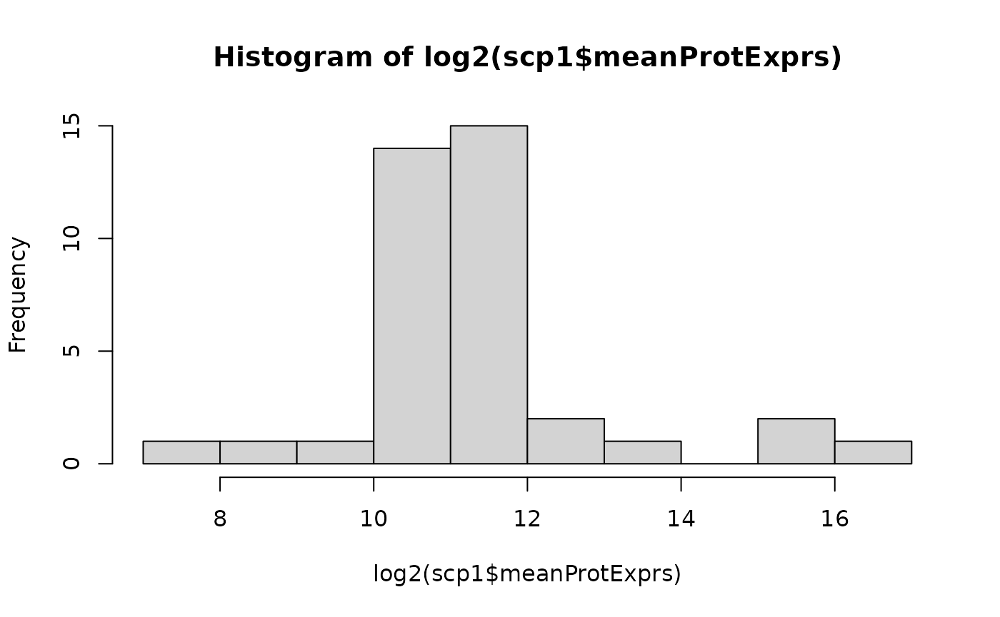
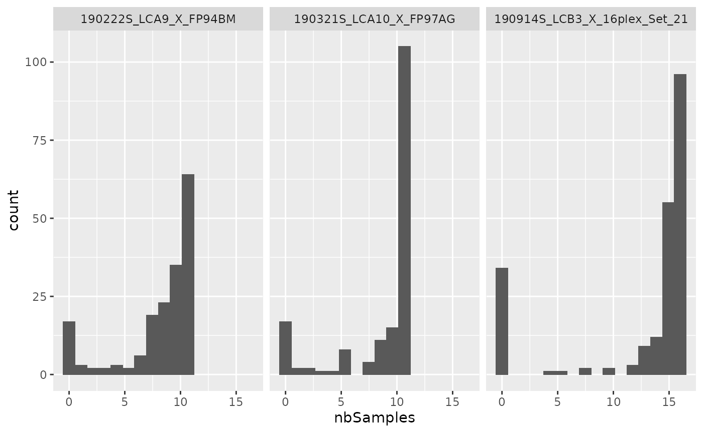

# Advanced usage of \`scp\`

## About this vignette

This vignette is dedicated to advanced users and to method developers.
It assumes that you are already familiar with `QFeatures` and `scp` and
that you are looking for more flexibility in the analysis of your
single-cell proteomics (SCP) data. In fact, `scp` provides wrapper
functions around generic functions and metrics. However, advanced users
may want to apply or develop their own features. The `QFeatures` class
offers a flexible data container while guaranteeing data consistency.

In this vignette, you will learn how to:

- Modify the quantitative data
- Modify the sample annotations
- Modify the feature annotations
- Create a new function for `scp`

As a general guideline, you can add/remove/update data in a `QFeatures`
in 4 main steps:

1.  Gather the data to change and other required data involved in the
    processing.
2.  Apply the transformation/computation.
3.  Insert the changes in the `QFeatures` object.
4.  Make sure the updated `QFeatures` object is still valid.

To illustrate the different topics, we will load the `scp1` example
data.

\
[`library`](https://rdrr.io/r/base/library.html)`(`[`scp`](https://UCLouvain-CBIO.github.io/scp)`)`\
[`data`](https://rdrr.io/r/utils/data.html)`(``"scp1"``)`\
`scp1`\
`#> An instance of class QFeatures (type: bulk) with 5 sets:`\
`#> `\
`#>  [1] 190321S_LCA10_X_FP97AG: SummarizedExperiment with 166 rows and 11 columns `\
`#>  [2] 190222S_LCA9_X_FP94BM: SummarizedExperiment with 176 rows and 11 columns `\
`#>  [3] 190914S_LCB3_X_16plex_Set_21: SummarizedExperiment with 215 rows and 16 columns `\
`#>  [4] peptides: SummarizedExperiment with 539 rows and 38 columns `\
`#>  [5] proteins: SummarizedExperiment with 292 rows and 38 columns`

## Modify the quantitative data

To illustrate how to modify quantitative data, we will implement a
`normByType` function that will normalize the feature (row) for each
cell type separately. This function is probably not relevant for a real
case analysis, but it provides a good example of a custom data
processing. The process presented in this section is applicable to any
custom function that takes at least a **matrix-like object** as input
and returns a matrix-like object as output.

\
`normByType`` ``<-`` ``function``(``x``, ``type``)`` ``{`\
`    ``## Check argument`\
`    `[`stopifnot`](https://rdrr.io/r/base/stopifnot.html)`(`[`length`](https://rdrr.io/r/base/length.html)`(``type``)`` ``==`` `[`ncol`](https://rdrr.io/r/base/nrow.html)`(``x``)``)`\
`    ``## Normalize for each type separately`\
`    ``for`` ``(``i`` ``in`` `[`unique`](https://rdrr.io/r/base/unique.html)`(``type``)``)`` ``{`\
`        ``## Get normalization factor`\
`        ``nf`` ``<-`` ``rowMedians``(``x``[``, ``type`` ``==`` ``i``]``, na.rm ``=`` ``TRUE``)`\
`        ``## Perform normalization`\
`        ``x``[``, ``type`` ``==`` ``i``]`` ``<-`` ``x``[``, ``type`` ``==`` ``i``]`` ``/`` ``nf`\
`    ``}`\
`    ``## Return normalized data`\
`    ``x`\
`}`

Suppose we want to apply the function to the `proteins` assay, we need
to first extract that assay. We here need to transfer the sample
annotations from the `QFeatures` object to the extracted
`SingleCellExperiment` in order to get the sample types required by the
`normByType` function. We therefore use `getWithColData`.

\
`sce`` ``<-`` ``getWithColData``(``scp1``, ``"proteins"``)`\
`sce`\
`#> class: SummarizedExperiment `\
`#> dim: 292 38 `\
`#> metadata(0):`\
`#> assays(2): assay aggcounts`\
`#> rownames(292): A1A519 A5D8V6 ... REV__CON__Q32PI4 REV__CON__Q3MHN5`\
`#> rowData names(9): protein Match.time.difference ...`\
`#>   Potential.contaminant .n`\
`#> colnames(38): 190321S_LCA10_X_FP97AGRI1 190321S_LCA10_X_FP97AGRI2 ...`\
`#>   190914S_LCB3_X_16plex_Set_21RI15 190914S_LCB3_X_16plex_Set_21RI16`\
`#> colData names(7): Set Channel ... sortday digest`

Next, we can apply the data transformation to the quantitative data. As
mentioned above, our function expects a matrix-like object as an input,
so we use the `assay` function. We then update the
`SingleCellExperiment` object.

\
`mnorm`` ``<-`` ``normByType``(`[`assay`](https://rdrr.io/pkg/SummarizedExperiment/man/SummarizedExperiment-class.html)`(``sce``)``, type ``=`` ``sce``$``SampleType``)`\
[`assay`](https://rdrr.io/pkg/SummarizedExperiment/man/SummarizedExperiment-class.html)`(``sce``)`` ``<-`` ``mnorm`

We are now faced with 2 possibilities: either we want to create a new
assay or we want to overwrite an existing assay. In both cases we need
to make sure your data is still valid after data transformation.

### Create a new assay

Creating a new assay has the advantage that you don’t modify an existing
assay and hence limit the risk of introducing inconsistency in the data
and avoid losing intermediate steps of the data processing.

We add the transformed assay using the `addAssay` function, then link
the parent assay to the transformed assay using `addAssayLinkOneToOne`.
Note that if each row name in the parent assay does not match exactly
one row in the child assay, you can also use `addAssayLink` that will
require a linking variable in the `rowData`.

\
`scp1`` ``<-`` `[`addAssay`](https://rformassspectrometry.github.io/QFeatures/reference/QFeatures-class.html)`(``scp1``, ``sce``, name ``=`` ``"proteinsNorm"``)`\
`scp1`` ``<-`` `[`addAssayLinkOneToOne`](https://rformassspectrometry.github.io/QFeatures/reference/AssayLinks.html)`(``scp1``, from ``=`` ``"proteins"``, to ``=`` ``"proteinsNorm"``)`\
`scp1`\
`#> An instance of class QFeatures (type: bulk) with 6 sets:`\
`#> `\
`#>  [1] 190321S_LCA10_X_FP97AG: SummarizedExperiment with 166 rows and 11 columns `\
`#>  [2] 190222S_LCA9_X_FP94BM: SummarizedExperiment with 176 rows and 11 columns `\
`#>  [3] 190914S_LCB3_X_16plex_Set_21: SummarizedExperiment with 215 rows and 16 columns `\
`#>  [4] peptides: SummarizedExperiment with 539 rows and 38 columns `\
`#>  [5] proteins: SummarizedExperiment with 292 rows and 38 columns `\
`#>  [6] proteinsNorm: SummarizedExperiment with 292 rows and 38 columns`

### Overwrite an existing assay

Overwriting an existing assay has the advantage to limit the memory
consumption as compared to adding a new assay. You can overwrite an
assay simply by replacing the target assay in its corresponding slot.

\
`scp1``[[``"proteins"``]``]`` ``<-`` ``sce`

### Check for validity

Applying custom changes to the data increases the risk for data
inconsistencies. You can however verify that a `QFeatures` object is
still valid after some processing thanks to the `validObject` function.

\
[`validObject`](https://rdrr.io/r/methods/validObject.html)`(``scp1``)`\
`#> [1] TRUE`

If the function detects no issues in the data, it will return `TRUE`.
Otherwise the function will throw an informative error that should guide
the user to identifying the issue.

## Modify the sample annotations

To illustrate how to modify the sample annotations, we will compute the
average expression in each sample and include to the `colData` of the
`QFeatures` object. This is typically performed when computing QC
metrics for sample filtering. So, we first extract the required data, in
this case the quantitative values, and compute the sample-wise average
protein expression.

\
`m`` ``<-`` `[`assay`](https://rdrr.io/pkg/SummarizedExperiment/man/SummarizedExperiment-class.html)`(``scp1``, ``"proteins"``)`\
`meanExprs`` ``<-`` `[`colMeans`](https://rdrr.io/pkg/MatrixGenerics/man/rowMeans.html)`(``m``, na.rm ``=`` ``TRUE``)`\
`meanExprs`\
`#>        190321S_LCA10_X_FP97AGRI1        190321S_LCA10_X_FP97AGRI2 `\
`#>                       45368.3628                        7566.8782 `\
`#>        190321S_LCA10_X_FP97AGRI3        190321S_LCA10_X_FP97AGRI4 `\
`#>                        3271.0402                        2158.4230 `\
`#>        190321S_LCA10_X_FP97AGRI5        190321S_LCA10_X_FP97AGRI6 `\
`#>                        1162.3936                        1835.7939 `\
`#>        190321S_LCA10_X_FP97AGRI7        190321S_LCA10_X_FP97AGRI8 `\
`#>                        1293.4738                        1415.4205 `\
`#>        190321S_LCA10_X_FP97AGRI9       190321S_LCA10_X_FP97AGRI10 `\
`#>                        1965.6531                        1264.4064 `\
`#>       190321S_LCA10_X_FP97AGRI11         190222S_LCA9_X_FP94BMRI1 `\
`#>                        1238.5979                       48901.4654 `\
`#>         190222S_LCA9_X_FP94BMRI2         190222S_LCA9_X_FP94BMRI3 `\
`#>                        5189.5912                        2802.1850 `\
`#>         190222S_LCA9_X_FP94BMRI4         190222S_LCA9_X_FP94BMRI5 `\
`#>                        1204.2350                         715.7667 `\
`#>         190222S_LCA9_X_FP94BMRI6         190222S_LCA9_X_FP94BMRI7 `\
`#>                        1032.7122                         403.8267 `\
`#>         190222S_LCA9_X_FP94BMRI8         190222S_LCA9_X_FP94BMRI9 `\
`#>                        1089.0548                        1076.2613 `\
`#>        190222S_LCA9_X_FP94BMRI10        190222S_LCA9_X_FP94BMRI11 `\
`#>                        1572.3337                        1186.4431 `\
`#>  190914S_LCB3_X_16plex_Set_21RI1  190914S_LCB3_X_16plex_Set_21RI2 `\
`#>                       96881.8350                        2731.9430 `\
`#>  190914S_LCB3_X_16plex_Set_21RI3  190914S_LCB3_X_16plex_Set_21RI4 `\
`#>                        8208.1958                         208.2857 `\
`#>  190914S_LCB3_X_16plex_Set_21RI5  190914S_LCB3_X_16plex_Set_21RI6 `\
`#>                        3209.7730                        2014.4889 `\
`#>  190914S_LCB3_X_16plex_Set_21RI7  190914S_LCB3_X_16plex_Set_21RI8 `\
`#>                        2897.1103                        3006.6741 `\
`#>  190914S_LCB3_X_16plex_Set_21RI9 190914S_LCB3_X_16plex_Set_21RI10 `\
`#>                        2760.8564                        2549.9348 `\
`#> 190914S_LCB3_X_16plex_Set_21RI11 190914S_LCB3_X_16plex_Set_21RI12 `\
`#>                        2388.5289                        2533.8006 `\
`#> 190914S_LCB3_X_16plex_Set_21RI13 190914S_LCB3_X_16plex_Set_21RI14 `\
`#>                        2134.5615                        3125.1980 `\
`#> 190914S_LCB3_X_16plex_Set_21RI15 190914S_LCB3_X_16plex_Set_21RI16 `\
`#>                        3276.5618                        3195.8827`

Next, we insert the computed averages into the `colData`. You need to
make sure to match sample names because an extracted assay may not
contain all samples and may be in a different order compared to the
`colData`.

\
[`colData`](https://rdrr.io/pkg/SummarizedExperiment/man/SummarizedExperiment-class.html)`(``scp1``)``[`[`names`](https://rdrr.io/r/base/names.html)`(``meanExprs``)``, ``"meanProtExprs"``]`` ``<-`` ``meanExprs`

The new sample variable `meanProtExprs` is now accessible for filtering
or plotting. The `$` operator makes it straightforward to access the new
data.

\
[`hist`](https://rdrr.io/r/graphics/hist.html)`(`[`log2`](https://rdrr.io/r/base/Log.html)`(``scp1``$``meanProtExprs``)``)`

To make sure that the process did not corrupt the `colData`, we advise
to verify the data is still valid.

\
[`validObject`](https://rdrr.io/r/methods/validObject.html)`(``scp1``)`\
`#> [1] TRUE`

## Modify the feature annotations

We will again illustrate how to modify the feature annotations with an
example. We here demonstrate how to add the number of samples in which
each feature is detected for the three first assays (PSM assays). The
challenge here is that the metric needs to be computed for each assay
separately and inserted in the corresponding assay.

We will take advantage of the replacement function for `rowData` as
implemented in `QFeatures`. It expects a list-like object where names
indicate in which assays we want to modify the `rowData` and each
element contains a table with the replacement values.

We therefore compute the metrics for each assay separately and store the
results in a named `List`.

\
`## Initialize the List object that will store the computed values`\
`res`` ``<-`` ``List``(``)`\
`## We compute the metric for the first 3 assays`\
`for`` ``(``i`` ``in`` ``1``:``3``)`` ``{`\
`    ``## We get the quantitative values for the current assay`\
`    ``m`` ``<-`` `[`assay`](https://rdrr.io/pkg/SummarizedExperiment/man/SummarizedExperiment-class.html)`(``scp1``[[``i``]``]``)`\
`    ``## We compute the number of samples in which each features is detected`\
`    ``n`` ``<-`` `[`rowSums`](https://rdrr.io/pkg/MatrixGenerics/man/rowSums.html)`(``!`[`is.na`](https://rdrr.io/r/base/NA.html)`(``m``)`` ``&`` ``m`` ``!=`` ``0``)`\
`    ``## We store the result as a DataFrame in the List`\
`    ``res``[[``i``]``]`` ``<-`` ``DataFrame``(``nbSamples ``=`` ``n``)`\
`}`\
[`names`](https://rdrr.io/r/base/names.html)`(``res``)`` ``<-`` `[`names`](https://rdrr.io/r/base/names.html)`(``scp1``)``[``1``:``3``]`\
`res`\
`#> List of length 3`\
`#> names(3): 190321S_LCA10_X_FP97AG 190222S_LCA9_X_FP94BM 190914S_LCB3_X_16plex_Set_21`\
`res``[[``1``]``]`\
`#> DataFrame with 166 rows and 1 column`\
`#>           nbSamples`\
`#>           <numeric>`\
`#> PSM3773          11`\
`#> PSM9078          11`\
`#> PSM9858          11`\
`#> PSM11744         11`\
`#> PSM21752          0`\
`#> ...             ...`\
`#> PSM732069        11`\
`#> PSM735396        11`\
`#> PSM744756        10`\
`#> PSM745037        11`\
`#> PSM745130        11`

Now that we have a `List` of `DataFrame`s, we can update the object.

\
[`rowData`](https://rdrr.io/pkg/SummarizedExperiment/man/SummarizedExperiment-class.html)`(``scp1``)`` ``<-`` ``res`

The new feature variable `nbSamples` is now accessible for filtering or
plotting. The `rbindRowData` function facilitates the access the new
data.

\
[`library`](https://rdrr.io/r/base/library.html)`(`[`"ggplot2"`](https://ggplot2.tidyverse.org)`)`\
`rd`` ``<-`` `[`rbindRowData`](https://rformassspectrometry.github.io/QFeatures/reference/QFeatures-class.html)`(``scp1``, i ``=`` ``1``:``3``)`\
[`ggplot`](https://ggplot2.tidyverse.org/reference/ggplot.html)`(`[`data.frame`](https://rdrr.io/r/base/data.frame.html)`(``rd``)``)`` ``+`\
`    `[`aes`](https://ggplot2.tidyverse.org/reference/aes.html)`(``x ``=`` ``nbSamples``)`` ``+`\
`    `[`geom_histogram`](https://ggplot2.tidyverse.org/reference/geom_histogram.html)`(``bins ``=`` ``16``)`` ``+`\
`    `[`facet_wrap`](https://ggplot2.tidyverse.org/reference/facet_wrap.html)`(``~`` ``assay``)`

To make sure that the process did not corrupt the `rowData` in any
assay, we advise to verify the data is still valid.

\
[`validObject`](https://rdrr.io/r/methods/validObject.html)`(``scp1``)`\
`#> [1] TRUE`

## Create a new function for `scp`

The modifying data in a `QFeatures` involves a multiple-step process.
Creating a wrapper function that would take care of those different
steps in a single line of code is a good habit to reduce the length of
analysis scripts and hence making it easier to understand and less
error-prone.

We will wrap the last example in a new function that we call
`computeNbDetectedSamples`.

\
`computeNbDetectedSamples`` ``<-`` ``function``(``object``, ``i``)`` ``{`\
`    ``res`` ``<-`` ``List``(``)`\
`    ``for`` ``(``ii`` ``in`` ``i``)`` ``{`\
`        ``m`` ``<-`` `[`assay`](https://rdrr.io/pkg/SummarizedExperiment/man/SummarizedExperiment-class.html)`(``object``[[``ii``]``]``)`\
`        ``n`` ``<-`` `[`rowSums`](https://rdrr.io/pkg/MatrixGenerics/man/rowSums.html)`(``!`[`is.na`](https://rdrr.io/r/base/NA.html)`(``m``)`` ``&`` ``m`` ``!=`` ``0``)`\
`        ``res``[[``ii``]``]`` ``<-`` ``DataFrame``(``nbSamples ``=`` ``n``)`\
`    ``}`\
`    `[`names`](https://rdrr.io/r/base/names.html)`(``res``)`` ``<-`` `[`names`](https://rdrr.io/r/base/names.html)`(``object``)``[``i``]`\
`    `[`rowData`](https://rdrr.io/pkg/SummarizedExperiment/man/SummarizedExperiment-class.html)`(``object``)`` ``<-`` ``res`\
`    `[`stopifnot`](https://rdrr.io/r/base/stopifnot.html)`(`[`validObject`](https://rdrr.io/r/methods/validObject.html)`(``object``)``)`\
`    ``object`\
`}`

Thanks to this new function, the previous section now simply boils down
to running:

\
`scp1`` ``<-`` ``computeNbDetectedSamples``(``scp1``, i ``=`` ``1``:``3``)`

Keep in mind a few recommendations when creating a new function for
`scp`:

- The function should take a `QFeatures` object as input (and more
  arguments if needed) and return a `QFeatures` object as output. This
  will make workflows much easier to understand.
- Allow user to select assays (if required) either as numeric,
  character, or logical.
- Use conventional argument names: when naming an argument, try to match
  the names that already exist. For instance, selecting assays is passed
  through the `i` argument, selecting `rowData` variables is passed
  through `rowvars` and selecting `colData` variables is passed through
  `colvars`.
- Follow the `rformassspectrometry` [coding
  style](https://rformassspectrometry.github.io/RforMassSpectrometry/articles/RforMassSpectrometry.html#coding-style)

## What’s next?

So you developed a new metric or method and believe it might benefit the
community? We would love to hear about your improvements and eventually
include your new functionality into `scp` or associate your new package
to our documentation. Please, raise an
[issue](https://github.com/UCLouvain-CBIO/scp/issues/new/choose) in our
Github repository to suggest your improvements or, better, submit your
code as a [pull request](https://github.com/UCLouvain-CBIO/scp/compare).

## Session information

    R version 4.6.1 (2026-06-24)
    Platform: x86_64-pc-linux-gnu
    Running under: Ubuntu 24.04.5 LTS

    Matrix products: default
    BLAS:   /usr/lib/x86_64-linux-gnu/openblas-pthread/libblas.so.3 
    LAPACK: /usr/lib/x86_64-linux-gnu/openblas-pthread/libopenblasp-r0.3.26.so;  LAPACK version 3.12.0

    locale:
     [1] LC_CTYPE=en_US.UTF-8       LC_NUMERIC=C              
     [3] LC_TIME=en_US.UTF-8        LC_COLLATE=en_US.UTF-8    
     [5] LC_MONETARY=en_US.UTF-8    LC_MESSAGES=en_US.UTF-8   
     [7] LC_PAPER=en_US.UTF-8       LC_NAME=C                 
     [9] LC_ADDRESS=C               LC_TELEPHONE=C            
    [11] LC_MEASUREMENT=en_US.UTF-8 LC_IDENTIFICATION=C       

    time zone: UTC
    tzcode source: system (glibc)

    attached base packages:
    [1] stats4    stats     graphics  grDevices utils     datasets  methods  
    [8] base     

    other attached packages:
     [1] ggplot2_4.0.3               scp_1.23.3                 
     [3] QFeatures_1.23.2            MultiAssayExperiment_1.39.1
     [5] SummarizedExperiment_1.43.0 Biobase_2.73.2             
     [7] GenomicRanges_1.65.4        Seqinfo_1.3.2              
     [9] IRanges_2.47.5              S4Vectors_0.51.10          
    [11] BiocGenerics_0.59.12        generics_0.1.4             
    [13] MatrixGenerics_1.25.0       matrixStats_1.5.0          
    [15] BiocStyle_2.41.0           

    loaded via a namespace (and not attached):
     [1] tidyselect_1.2.1            dplyr_1.2.1                
     [3] farver_2.1.2                S7_0.2.2                   
     [5] fastmap_1.2.0               SingleCellExperiment_1.35.2
     [7] lazyeval_0.2.3              nipals_1.2                 
     [9] digest_0.6.39               lifecycle_1.0.5            
    [11] cluster_2.1.8.3             ProtGenerics_1.45.0        
    [13] magrittr_2.0.5              compiler_4.6.1             
    [15] rlang_1.3.0                 sass_0.4.10                
    [17] tools_4.6.1                 igraph_2.3.4               
    [19] yaml_2.3.12                 knitr_1.52                 
    [21] labeling_0.4.3              S4Arrays_1.13.2            
    [23] htmlwidgets_1.6.4           DelayedArray_0.39.8        
    [25] plyr_1.8.9                  RColorBrewer_1.1-3         
    [27] abind_1.4-8                 withr_3.0.3                
    [29] purrr_1.2.2                 desc_1.4.3                 
    [31] grid_4.6.1                  scales_1.4.0               
    [33] MASS_7.3-66                 cli_3.6.6                  
    [35] rmarkdown_2.32              ragg_1.5.2                 
    [37] otel_0.2.0                  metapod_1.21.0             
    [39] reshape2_1.4.5              BiocBaseUtils_1.15.1       
    [41] cachem_1.1.0                stringr_1.6.0              
    [43] AnnotationFilter_1.37.0     BiocManager_1.30.27        
    [45] XVector_0.53.0              vctrs_0.7.3                
    [47] Matrix_1.7-6                jsonlite_2.0.0             
    [49] slam_0.1-56                 bookdown_0.48              
    [51] IHW_1.41.0                  ggrepel_0.9.8              
    [53] clue_0.3-68                 systemfonts_1.3.2          
    [55] tidyr_1.3.2                 jquerylib_0.1.4            
    [57] glue_1.8.1                  pkgdown_2.2.1.9000         
    [59] stringi_1.8.9               gtable_0.3.6               
    [61] lpsymphony_1.41.0           tibble_3.3.1               
    [63] pillar_1.11.1               htmltools_0.5.9            
    [65] R6_2.6.1                    textshaping_1.0.5          
    [67] evaluate_1.0.5              lattice_0.23-1             
    [69] bslib_0.12.0                Rcpp_1.1.2                 
    [71] fdrtool_1.2.18              SparseArray_1.13.4         
    [73] xfun_0.62                   MsCoreUtils_1.25.4         
    [75] fs_2.1.0                    pkgconfig_2.0.3            

## License

This vignette is distributed under a [CC BY-SA
license](https://creativecommons.org/licenses/by-sa/2.0/) license.
