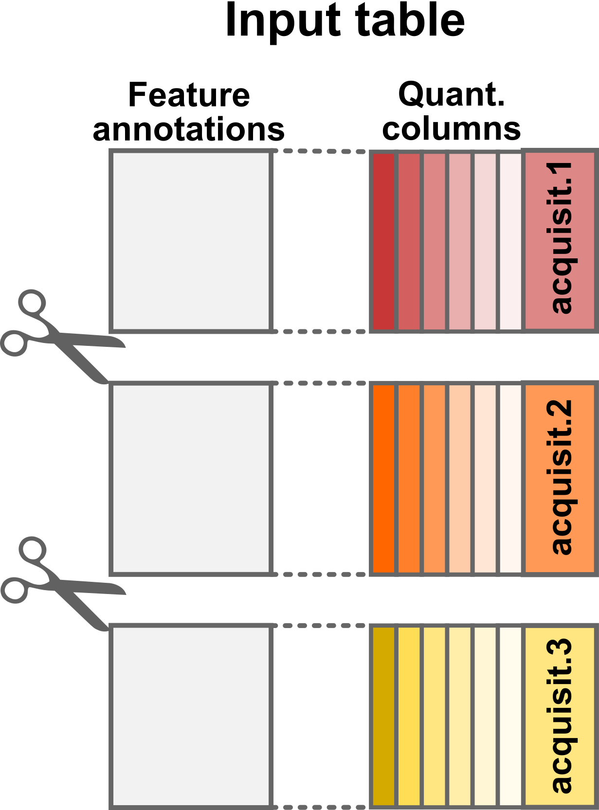

# Load Single-Cell Proteomics data using \`readSCP\`

## The `scp` data framework

Our data structure is relying on three curated data classes: `QFeatures`
(Gatto and Vanderaa (2023)),`SummarizedExperiment` and
`SingleCellExperiment` (Amezquita et al. (2020)). `QFeatures` is
dedicated to the manipulation and processing of MS-based quantitative
data. It explicitly records the successive steps to allow users to
navigate up and down the different MS levels. `SummarizedExperiment` is
a class designed to store and manipulate quantitative data. Its the base
building block of a QFeatures object. `SingleCellExperiment` is another
class designed as an efficient data container that serves as an
interface to state-of-the-art methods and algorithms for single-cell
data. This class is used in the context of data modeling (scplainer).

Our framework combines the three classes to inherit from their
respective advantages.

Because mass spectrometry (MS)-based single-cell proteomics (SCP) only
captures the proteome of between one and a few tens of single-cells in a
single run, the data is usually acquired across many MS batches.
Therefore, the data for each run should conceptually be stored in its
own container, that we here call a *set*. The expected input for working
with the `scp` package is quantification data of peptide to spectrum
matches (PSM). These data can then be processed to reconstruct peptide
and protein data. The links between related features across different
sets are stored to facilitate manipulation and visualization of of PSM,
peptide and protein data. This is conceptually shown below.

The `scp` framework relies on `SingleCellExperiment` and `QFeatures`
objects

The main input table required for starting an analysis with `scp` is
called the `assayData`.

## `assayData` table

The `assayData` table is generated after the identification and
quantification of the MS spectra by a pre-processing software such as
MaxQuant, ProteomeDiscoverer or MSFragger (the
[list](https://en.wikipedia.org/wiki/List_of_mass_spectrometry_software)
of available software is actually much longer). We will here use as an
example a data table that has been generated by MaxQuant. The table is
available from the `scp` package and is called `mqScpData` (for MaxQuant
generated SCP data).

\
[`library`](https://rdrr.io/r/base/library.html)`(`[`scp`](https://UCLouvain-CBIO.github.io/scp)`)`\
[`data`](https://rdrr.io/r/utils/data.html)`(``"mqScpData"``)`\
[`dim`](https://rdrr.io/r/base/dim.html)`(``mqScpData``)`\
`#> [1] 1361  149`

In this toy example, there are 1361 rows corresponding to features
(quantified PSMs) and 149 columns corresponding to different data fields
recorded by MaxQuant during the processing of the MS spectra. There are
three types of columns:

- Quantification columns (`quantCols`): 1 to n (depending on technology)
- Run identifier column (`runCol`): *e.g.* file name
- Feature annotations: *e.g.* peptide sequence, ion charge, protein name

Conceptual representation of the `assayData` input table

#### Quantification columns (`quantCols`)

The quantification data can be composed of one (in case of label-free
acquisition) or multiple columns (in case of multiplexing). In the
example data set, the columns holding the quantification, the
`quantCols`, start with `Reporter.intensity.` followed by a number.

\
`(``quantCols`` ``<-`` `[`grep`](https://rdrr.io/r/base/grep.html)`(``"Reporter.intensity.\\d"``, `[`colnames`](https://rdrr.io/r/base/colnames.html)`(``mqScpData``)``,`\
`                  value ``=`` ``TRUE``)``)`\
`#>  [1] "Reporter.intensity.1"  "Reporter.intensity.2"  "Reporter.intensity.3" `\
`#>  [4] "Reporter.intensity.4"  "Reporter.intensity.5"  "Reporter.intensity.6" `\
`#>  [7] "Reporter.intensity.7"  "Reporter.intensity.8"  "Reporter.intensity.9" `\
`#> [10] "Reporter.intensity.10" "Reporter.intensity.11" "Reporter.intensity.12"`\
`#> [13] "Reporter.intensity.13" "Reporter.intensity.14" "Reporter.intensity.15"`\
`#> [16] "Reporter.intensity.16"`

As you may notice, the example data was acquired using a TMT-16 protocol
since we retrieve 16 quantification columns. Actually, some runs were
acquired using a TMT-11 protocol (11 labels) but we will come back to
this later.

\
[`head`](https://rdrr.io/r/utils/head.html)`(``mqScpData``[``, ``quantCols``]``)`\
`#>   Reporter.intensity.1 Reporter.intensity.2 Reporter.intensity.3`\
`#> 1                61251               501.71               3731.3`\
`#> 2                58648              1099.80               2837.7`\
`#> 3               150350              3705.00               9361.0`\
`#> 4                27347               405.90               1525.2`\
`#> 5                84035               583.09               4092.3`\
`#> 6                44895               700.23               2283.0`\
`#>   Reporter.intensity.4 Reporter.intensity.5 Reporter.intensity.6`\
`#> 1              1643.30               871.84               981.87`\
`#> 2               494.32               349.26              1030.50`\
`#> 3                 0.00              1945.40              1188.60`\
`#> 4                 0.00                 0.00               318.74`\
`#> 5               530.13               718.13              2204.50`\
`#> 6              1109.60                 0.00               675.79`\
`#>   Reporter.intensity.7 Reporter.intensity.8 Reporter.intensity.9`\
`#> 1              1200.10               939.06              1457.50`\
`#> 2                 0.00              1214.10               800.58`\
`#> 3              1574.00              2302.10              2176.10`\
`#> 4                 0.00               519.81                 0.00`\
`#> 5               960.51               453.77              1188.40`\
`#> 6                 0.00               809.38               668.88`\
`#>   Reporter.intensity.10 Reporter.intensity.11 Reporter.intensity.12`\
`#> 1               1329.80                981.83                    NA`\
`#> 2                807.79                391.38                    NA`\
`#> 3               1399.50               1307.50                2192.4`\
`#> 4                507.23                370.79                    NA`\
`#> 5                740.99                  0.00                    NA`\
`#> 6               1467.50                901.38                    NA`\
`#>   Reporter.intensity.13 Reporter.intensity.14 Reporter.intensity.15`\
`#> 1                    NA                    NA                    NA`\
`#> 2                    NA                    NA                    NA`\
`#> 3                1791.4                1727.5                2157.3`\
`#> 4                    NA                    NA                    NA`\
`#> 5                    NA                    NA                    NA`\
`#> 6                    NA                    NA                    NA`\
`#>   Reporter.intensity.16`\
`#> 1                    NA`\
`#> 2                    NA`\
`#> 3                  1398`\
`#> 4                    NA`\
`#> 5                    NA`\
`#> 6                    NA`

#### Run identifier column (`runCol`)

This column provides the identifier of the MS runs in which each PSM was
acquired. MaxQuant uses the raw file name to identify the run.

\
[`unique`](https://rdrr.io/r/base/unique.html)`(``mqScpData``$``Raw.file``)`\
`#> [1] "190321S_LCA10_X_FP97AG"        "190222S_LCA9_X_FP94BM"        `\
`#> [3] "190914S_LCB3_X_16plex_Set_21"  "190321S_LCA10_X_FP97_blank_01"`

#### Feature annotations

The remaining columns in the `mqScpData` table contain information used
or generated during the identification of the MS spectra. For instance,
you may find the charge of the parent ion, the score and probability of
a correct match between the MS spectrum and a peptide sequence, the
sequence of the best matching peptide, its length, its modifications,
the retention time of the peptide on the LC, the protein(s) the peptide
originates from and much more.

\
[`head`](https://rdrr.io/r/utils/head.html)`(``mqScpData``[``, `[`c`](https://rdrr.io/r/base/c.html)`(``"Charge"``, ``"Score"``, ``"PEP"``, ``"Sequence"``, ``"Length"``,`\
`                   ``"Retention.time"``, ``"Proteins"``)``]``)`\
`#>   Charge  Score        PEP    Sequence Length Retention.time`\
`#> 1      2 41.029 5.2636e-04   ATNFLAHEK      9         65.781`\
`#> 2      2 44.349 5.8789e-04   ATNFLAHEK      9         63.787`\
`#> 3      2 51.066 4.0315e-24 SHTILLVQPTK     11         71.884`\
`#> 4      2 63.816 4.7622e-06 SHTILLVQPTK     11         68.633`\
`#> 5      2 74.464 6.8709e-09 SHTILLVQPTK     11         71.946`\
`#> 6      2 41.502 5.3705e-02     SLVIPEK      7         76.204`\
`#>               Proteins`\
`#> 1 sp|P29692|EF1D_HUMAN`\
`#> 2 sp|P29692|EF1D_HUMAN`\
`#> 3  sp|P84090|ERH_HUMAN`\
`#> 4  sp|P84090|ERH_HUMAN`\
`#> 5  sp|P84090|ERH_HUMAN`\
`#> 6 sp|P62269|RS18_HUMAN`

## `colData` table

The `colData` table contains the experimental design generated by the
researcher. The rows of the sample table correspond to a sample in the
experiment and the columns correspond to the available annotations about
the sample. We will here use the second example table:

\
[`data`](https://rdrr.io/r/utils/data.html)`(``"sampleAnnotation"``)`\
[`head`](https://rdrr.io/r/utils/head.html)`(``sampleAnnotation``)`\
`#>                  runCol            quantCols SampleType lcbatch sortday digest`\
`#> 1 190222S_LCA9_X_FP94BM Reporter.intensity.1    Carrier    LCA9      s8      N`\
`#> 2 190222S_LCA9_X_FP94BM Reporter.intensity.2  Reference    LCA9      s8      N`\
`#> 3 190222S_LCA9_X_FP94BM Reporter.intensity.3     Unused    LCA9      s8      N`\
`#> 4 190222S_LCA9_X_FP94BM Reporter.intensity.4   Monocyte    LCA9      s8      N`\
`#> 5 190222S_LCA9_X_FP94BM Reporter.intensity.5      Blank    LCA9      s8      N`\
`#> 6 190222S_LCA9_X_FP94BM Reporter.intensity.6   Monocyte    LCA9      s8      N`

The `colData` table may contain any information about the samples. For
example, useful information could be the type of sample that is
analysed, a phenotype known from the experimental design, the MS batch,
the acquisition date, MS settings used to acquire the sample, the LC
batch, the sample preparation batch, etc… However, `scp` **requires** 2
specific columns in the `colData` table:

1.  `runCol`: this column provides the MS run names (that match the
    `Raw.file` column in the `assayData` table).
2.  `quantCols`: this column tells `scp` the names of the columns in the
    feature data holds the quantification of the corresponding sample.

These two columns allow `scp` to correctly split and match data that
were acquired across multiple acquisition runs.

Conceptual representation of the sample table

## `readSCP()`

`readSCP` is the function that converts the `assayData` and the
`colData` into a `QFeatures` object following the data structure
described above, that is storing the data belonging to each MS batch in
a separate `SingleCellExperiment` object.

### Sample names

[`readSCP()`](https://UCLouvain-CBIO.github.io/scp/reference/readSCP.md)
automatically assigns names that are unique across all samples in all
sets. This is performed by appending the name of the MS run where a
given sample is found with the name of the quantification column for
that sample. Suppose a sample belongs to batch `190222S_LCA9_X_FP94BM`
and the quantification values in the `assayData` table are found in the
column called `Reporter.intensity.3`, then the sample name will become
`190222S_LCA9_X_FP94BM_Reporter.intensity.3`.

### Special case: empty samples

In some rare cases, it can be beneficial to remove empty samples (all
quantifications are `NA`) from the sets. Such samples can occur when
samples that were acquired with different multiplexing labels are merged
in a single table. For instance, the SCoPE2 data we provide as an
example contains runs that were acquired with two TMT protocols. The 3
first sets were acquired using the TMT-11 protocol and the last set was
acquired using a TMT-16 protocol. The missing label channels in the
TMT-11 data are filled with `NA`s. When setting
`removeEmptyCols = TRUE`,
[`readSCP()`](https://UCLouvain-CBIO.github.io/scp/reference/readSCP.md)
automatically detects and removes columns containing only `NA`s,

### Running `readSCP`

We convert the sample and the feature data into a `QFeatures` object in
a single command thanks to `readSCP`.

\
`(``scp`` ``<-`` `[`readSCP`](https://UCLouvain-CBIO.github.io/scp/reference/readSCP.md)`(``assayData ``=`` ``mqScpData``,`\
`                colData ``=`` ``sampleAnnotation``,`\
`                runCol ``=`` ``"Raw.file"``,`\
`                removeEmptyCols ``=`` ``TRUE``)``)`\
`#> Checking arguments.`\
`#> Loading data as a 'SummarizedExperiment' object.`\
`#> Splitting data in runs.`\
`#>   |                                                                              |                                                                      |   0%  |                                                                              |==================                                                    |  25%  |                                                                              |===================================                                   |  50%  |                                                                              |====================================================                  |  75%  |                                                                              |======================================================================| 100%`\
`#> Formatting sample annotations (colData).`\
`#> Formatting data as a 'QFeatures' object.`\
`#> An instance of class QFeatures (type: scp) with 4 sets:`\
`#> `\
`#>  [1] 190222S_LCA9_X_FP94BM: SummarizedExperiment with 395 rows and 11 columns `\
`#>  [2] 190321S_LCA10_X_FP97_blank_01: SummarizedExperiment with 109 rows and 11 columns `\
`#>  [3] 190321S_LCA10_X_FP97AG: SummarizedExperiment with 487 rows and 11 columns `\
`#>  [4] 190914S_LCB3_X_16plex_Set_21: SummarizedExperiment with 370 rows and 16 columns`

The object returned by
[`readSCP()`](https://UCLouvain-CBIO.github.io/scp/reference/readSCP.md)
is a `QFeatures` object containing 4 `SingleCellExperiment` sets that
have been named after the 4 MS batches. Each set contains either 11 or
16 columns (samples) depending on the TMT labelling strategy and a
variable number of rows (quantified PSMs). Each piece of information can
easily be retrieved thanks to the `QFeatures` architectures. As
mentioned in another
[vignette](https://uclouvain-cbio.github.io/scp/articles/QFeatures_nutshell.html),
the `colData` is retrieved using its dedicated function:

\
[`head`](https://rdrr.io/r/utils/head.html)`(`[`colData`](https://rdrr.io/pkg/SummarizedExperiment/man/SummarizedExperiment-class.html)`(``scp``)``)`\
`#> DataFrame with 6 rows and 6 columns`\
`#>                                                   runCol     quantCols`\
`#>                                              <character>   <character>`\
`#> 190222S_LCA9_X_FP94BM_Reporter.intensity.1 190222S_LC... Reporter.i...`\
`#> 190222S_LCA9_X_FP94BM_Reporter.intensity.2 190222S_LC... Reporter.i...`\
`#> 190222S_LCA9_X_FP94BM_Reporter.intensity.3 190222S_LC... Reporter.i...`\
`#> 190222S_LCA9_X_FP94BM_Reporter.intensity.4 190222S_LC... Reporter.i...`\
`#> 190222S_LCA9_X_FP94BM_Reporter.intensity.5 190222S_LC... Reporter.i...`\
`#> 190222S_LCA9_X_FP94BM_Reporter.intensity.6 190222S_LC... Reporter.i...`\
`#>                                             SampleType     lcbatch     sortday`\
`#>                                            <character> <character> <character>`\
`#> 190222S_LCA9_X_FP94BM_Reporter.intensity.1     Carrier        LCA9          s8`\
`#> 190222S_LCA9_X_FP94BM_Reporter.intensity.2   Reference        LCA9          s8`\
`#> 190222S_LCA9_X_FP94BM_Reporter.intensity.3      Unused        LCA9          s8`\
`#> 190222S_LCA9_X_FP94BM_Reporter.intensity.4    Monocyte        LCA9          s8`\
`#> 190222S_LCA9_X_FP94BM_Reporter.intensity.5       Blank        LCA9          s8`\
`#> 190222S_LCA9_X_FP94BM_Reporter.intensity.6    Monocyte        LCA9          s8`\
`#>                                                 digest`\
`#>                                            <character>`\
`#> 190222S_LCA9_X_FP94BM_Reporter.intensity.1           N`\
`#> 190222S_LCA9_X_FP94BM_Reporter.intensity.2           N`\
`#> 190222S_LCA9_X_FP94BM_Reporter.intensity.3           N`\
`#> 190222S_LCA9_X_FP94BM_Reporter.intensity.4           N`\
`#> 190222S_LCA9_X_FP94BM_Reporter.intensity.5           N`\
`#> 190222S_LCA9_X_FP94BM_Reporter.intensity.6           N`

The feature annotations are retrieved from the `rowData`. Since the
feature annotations are specific to each set, we need to tell from which
set we want to get the `rowData`:

\
[`head`](https://rdrr.io/r/utils/head.html)`(`[`rowData`](https://rdrr.io/pkg/SummarizedExperiment/man/SummarizedExperiment-class.html)`(``scp``[[``"190222S_LCA9_X_FP94BM"``]``]``)``)``[``, ``1``:``5``]`\
`#> DataFrame with 6 rows and 5 columns`\
`#>              uid      Sequence    Length Modifications Modified.sequence`\
`#>      <character>   <character> <integer>   <character>       <character>`\
`#> 2  _(Acetyl (...     ATNFLAHEK         9 Acetyl (Pr...     _(Acetyl (...`\
`#> 4  _(Acetyl (... SHTILLVQPT...        11 Acetyl (Pr...     _(Acetyl (...`\
`#> 6  _(Acetyl (...       SLVIPEK         7 Acetyl (Pr...     _(Acetyl (...`\
`#> 9  _AAGLALK_ ...       AAGLALK         7    Unmodified         _AAGLALK_`\
`#> 12 _AALSAGK_ ...       AALSAGK         7    Unmodified         _AALSAGK_`\
`#> 15 _AAPEASGTP... AAPEASGTPS...        16    Unmodified     _AAPEASGTP...`

Finally, we can also retrieve the quantification matrix for a set of
interest:

\
[`head`](https://rdrr.io/r/utils/head.html)`(`[`assay`](https://rdrr.io/pkg/SummarizedExperiment/man/SummarizedExperiment-class.html)`(``scp``, ``"190222S_LCA9_X_FP94BM"``)``)`\
`#>    190222S_LCA9_X_FP94BM_Reporter.intensity.1`\
`#> 2                                     58648.0`\
`#> 4                                     27347.0`\
`#> 6                                     44895.0`\
`#> 9                                    122070.0`\
`#> 12                                    58605.0`\
`#> 15                                     5006.5`\
`#>    190222S_LCA9_X_FP94BM_Reporter.intensity.2`\
`#> 2                                     1099.80`\
`#> 4                                      405.90`\
`#> 6                                      700.23`\
`#> 9                                     1153.50`\
`#> 12                                     895.25`\
`#> 15                                     517.86`\
`#>    190222S_LCA9_X_FP94BM_Reporter.intensity.3`\
`#> 2                                     2837.70`\
`#> 4                                     1525.20`\
`#> 6                                     2283.00`\
`#> 9                                     7361.90`\
`#> 12                                    2763.80`\
`#> 15                                     446.19`\
`#>    190222S_LCA9_X_FP94BM_Reporter.intensity.4`\
`#> 2                                      494.32`\
`#> 4                                        0.00`\
`#> 6                                     1109.60`\
`#> 9                                     1732.30`\
`#> 12                                     867.82`\
`#> 15                                     458.17`\
`#>    190222S_LCA9_X_FP94BM_Reporter.intensity.5`\
`#> 2                                      349.26`\
`#> 4                                        0.00`\
`#> 6                                        0.00`\
`#> 9                                     1515.60`\
`#> 12                                    1050.30`\
`#> 15                                     467.90`\
`#>    190222S_LCA9_X_FP94BM_Reporter.intensity.6`\
`#> 2                                     1030.50`\
`#> 4                                      318.74`\
`#> 6                                      675.79`\
`#> 9                                     2252.00`\
`#> 12                                    1268.70`\
`#> 15                                     649.50`\
`#>    190222S_LCA9_X_FP94BM_Reporter.intensity.7`\
`#> 2                                        0.00`\
`#> 4                                        0.00`\
`#> 6                                        0.00`\
`#> 9                                      444.48`\
`#> 12                                     532.30`\
`#> 15                                     259.84`\
`#>    190222S_LCA9_X_FP94BM_Reporter.intensity.8`\
`#> 2                                     1214.10`\
`#> 4                                      519.81`\
`#> 6                                      809.38`\
`#> 9                                     2343.80`\
`#> 12                                    1073.10`\
`#> 15                                     533.55`\
`#>    190222S_LCA9_X_FP94BM_Reporter.intensity.9`\
`#> 2                                      800.58`\
`#> 4                                        0.00`\
`#> 6                                      668.88`\
`#> 9                                     3100.20`\
`#> 12                                     911.30`\
`#> 15                                     393.53`\
`#>    190222S_LCA9_X_FP94BM_Reporter.intensity.10`\
`#> 2                                       807.79`\
`#> 4                                       507.23`\
`#> 6                                      1467.50`\
`#> 9                                      1825.20`\
`#> 12                                     1300.00`\
`#> 15                                      463.26`\
`#>    190222S_LCA9_X_FP94BM_Reporter.intensity.11`\
`#> 2                                       391.38`\
`#> 4                                       370.79`\
`#> 6                                       901.38`\
`#> 9                                      2372.50`\
`#> 12                                     1185.90`\
`#> 15                                      353.04`

### Under the hood

`readSCP` proceeds as follows:

1.  The `assayData` table must be provided as a `data.frame`.
    [`readSCP()`](https://UCLouvain-CBIO.github.io/scp/reference/readSCP.md)
    converts the table to a `SingleCellExperiment` object but it needs
    to know which column(s) store the quantitative data. Those column
    name(s) is/are provided by the `quantCols` field in the annotation
    table (`colData` argument).

Step1: Convert the input table to a `SingleCellExperiment` object

2.  The `SingleCellExperiment` object is then split according to the
    acquisition run. The split is performed depending on the `runCol`
    field in `assayData`. It is also indicated in the `runCol` argument.
    In this case, the data will be split according to the `Raw.file`
    column in `mqScpData`. `Raw.file` contains the names of the
    acquisition runs that was used by MaxQuant to retrieve the raw data
    files.

Step2: Split by acquisition run

3.  The sample annotations is generated from the supplied sample table
    (`colData` argument). Note that in order for
    [`readSCP()`](https://UCLouvain-CBIO.github.io/scp/reference/readSCP.md)
    to correctly match the feature data with the annotations, `colData`
    must contain a `runCol` column with run names and a `quantCols`
    column with the names of the quantitative columns in `assayData`.

Step3: Adding and matching the sample annotations

4.  Finally, the `SingleCellExperiment` sets and the `colData` are
    converted to a `QFeatures` object.

Step4: Converting to a `QFeatures`

## What about label-free SCP?

The `scp` package is meant for both label-free and multiplexed SCP data.
Like in the example above, the label-free data should contain the batch
names in both the feature data and the sample data. The sample data must
also contain a column that points to the columns of the feature data
that contains the quantifications. Since label-free SCP acquires one
single-cell per run, this sample data column should point the same
column for all samples. Moreover, this means that each PSM set will
contain a single column.

## What about other input formats?

[`readSCP()`](https://UCLouvain-CBIO.github.io/scp/reference/readSCP.md)
should work with any PSM quantification table that is output by a
pre-processing software. For instance, you can easily import the PSM
tables generated by ProteomeDiscoverer. The batch names are contained in
the `File ID` column (that should be supplied as the `batchCol` argument
to
[`readSCP()`](https://UCLouvain-CBIO.github.io/scp/reference/readSCP.md)).
The quantification columns are contained in the columns starting with
`Abundance`, eventually followed by a multiplexing tag name. These
columns should be stored in a dedicated column of the sample data to be
supplied as `runCol` to
[`readSCP()`](https://UCLouvain-CBIO.github.io/scp/reference/readSCP.md).

If your input cannot be loaded using the procedure described in this
vignette, you can submit a feature request (see next section).

The
[`readSCPfromDIANN()`](https://UCLouvain-CBIO.github.io/scp/reference/readSCP.md)
function is adapted to import label-free and plexDIA/mTRAQ `Report.tsv`
files generated by DIA-NN.

For more information, see the
[`readQFeatures()`](https://rformassspectrometry.github.io/QFeatures/reference/readQFeatures.html)
and
[`readQFeaturesFromDIANN()`](https://rformassspectrometry.github.io/QFeatures/reference/readQFeaturesFromDIANN.html)
manual pages, that described the main principle that concern the data
import and formatting.

## Need help?

You can open an issue on the [GitHub
repository](https://github.com/UCLouvain-CBIO/scp/issues) in case of
troubles when loading your SCP data with
[`readSCP()`](https://UCLouvain-CBIO.github.io/scp/reference/readSCP.md).
Any suggestion or feature request about the function or the
documentation are also warmly welcome.

## Session information

    R version 4.6.1 (2026-06-24)
    Platform: x86_64-pc-linux-gnu
    Running under: Ubuntu 24.04.5 LTS

    Matrix products: default
    BLAS:   /usr/lib/x86_64-linux-gnu/openblas-pthread/libblas.so.3 
    LAPACK: /usr/lib/x86_64-linux-gnu/openblas-pthread/libopenblasp-r0.3.26.so;  LAPACK version 3.12.0

    locale:
     [1] LC_CTYPE=en_US.UTF-8       LC_NUMERIC=C              
     [3] LC_TIME=en_US.UTF-8        LC_COLLATE=en_US.UTF-8    
     [5] LC_MONETARY=en_US.UTF-8    LC_MESSAGES=en_US.UTF-8   
     [7] LC_PAPER=en_US.UTF-8       LC_NAME=C                 
     [9] LC_ADDRESS=C               LC_TELEPHONE=C            
    [11] LC_MEASUREMENT=en_US.UTF-8 LC_IDENTIFICATION=C       

    time zone: UTC
    tzcode source: system (glibc)

    attached base packages:
    [1] stats4    stats     graphics  grDevices utils     datasets  methods  
    [8] base     

    other attached packages:
     [1] scp_1.23.4                  QFeatures_1.23.2           
     [3] MultiAssayExperiment_1.39.1 SummarizedExperiment_1.43.0
     [5] Biobase_2.73.2              GenomicRanges_1.65.4       
     [7] Seqinfo_1.3.2               IRanges_2.47.5             
     [9] S4Vectors_0.51.10           BiocGenerics_0.59.12       
    [11] generics_0.1.4              MatrixGenerics_1.25.0      
    [13] matrixStats_1.5.0           BiocStyle_2.41.0           

    loaded via a namespace (and not attached):
     [1] gtable_0.3.6                ggplot2_4.0.3              
     [3] xfun_0.62                   bslib_0.12.0               
     [5] htmlwidgets_1.6.4           ggrepel_0.9.8              
     [7] lattice_0.23-1              vctrs_0.7.3                
     [9] tools_4.6.1                 tibble_3.3.1               
    [11] cluster_2.1.8.3             nipals_1.2                 
    [13] pkgconfig_2.0.3             Matrix_1.7-6               
    [15] RColorBrewer_1.1-3          IHW_1.41.0                 
    [17] S7_0.2.2                    desc_1.4.3                 
    [19] lpsymphony_1.41.0           lifecycle_1.0.5            
    [21] farver_2.1.2                compiler_4.6.1             
    [23] stringr_1.6.0               textshaping_1.0.5          
    [25] clue_0.3-68                 htmltools_0.5.9            
    [27] sass_0.4.10                 fdrtool_1.2.18             
    [29] yaml_2.3.12                 lazyeval_0.2.3             
    [31] pkgdown_2.2.1.9000          pillar_1.11.1              
    [33] jquerylib_0.1.4             tidyr_1.3.2                
    [35] MASS_7.3-66                 SingleCellExperiment_1.35.2
    [37] DelayedArray_0.39.8         cachem_1.1.0               
    [39] abind_1.4-8                 metapod_1.21.0             
    [41] tidyselect_1.2.1            digest_0.6.39              
    [43] slam_0.1-56                 stringi_1.8.9              
    [45] purrr_1.2.2                 dplyr_1.2.1                
    [47] reshape2_1.4.5              bookdown_0.48              
    [49] fastmap_1.2.0               grid_4.6.1                 
    [51] cli_3.6.6                   SparseArray_1.13.4         
    [53] magrittr_2.0.5              S4Arrays_1.13.2            
    [55] scales_1.4.0                rmarkdown_2.32             
    [57] XVector_0.53.0              igraph_2.3.4               
    [59] otel_0.2.0                  ragg_1.5.2                 
    [61] evaluate_1.0.5              knitr_1.52                 
    [63] rlang_1.3.0                 Rcpp_1.1.2                 
    [65] glue_1.8.1                  BiocManager_1.30.27        
    [67] jsonlite_2.0.0              AnnotationFilter_1.37.0    
    [69] R6_2.6.1                    plyr_1.8.9                 
    [71] systemfonts_1.3.2           fs_2.1.0                   
    [73] ProtGenerics_1.45.0         MsCoreUtils_1.25.4         

## License

This vignette is distributed under a [CC BY-SA
license](https://creativecommons.org/licenses/by-sa/4.0/).

## Reference

Amezquita, Robert A, Aaron T L Lun, Etienne Becht, et al. 2020.
“Orchestrating Single-Cell Analysis with Bioconductor.” *Nat. Methods*
17 (2): 137–45.

Gatto, Laurent, and Christophe Vanderaa. 2023. *QFeatures: Quantitative
Features for Mass Spectrometry Data*.
<https://doi.org/10.18129/B9.bioc.QFeatures>.
