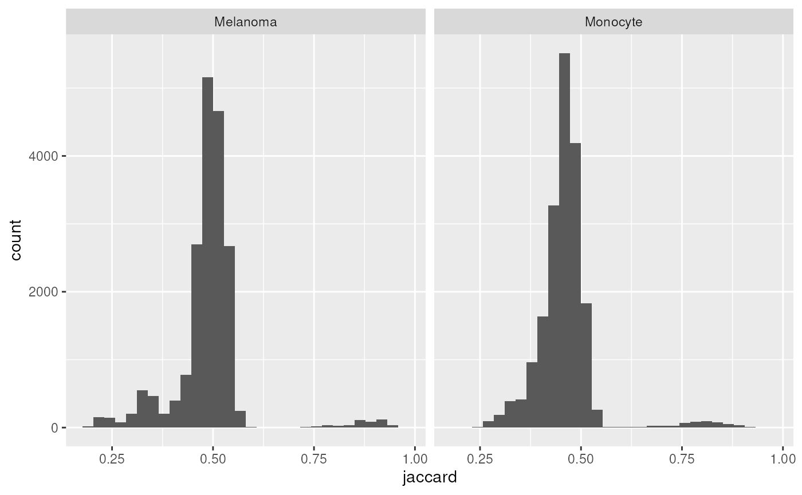
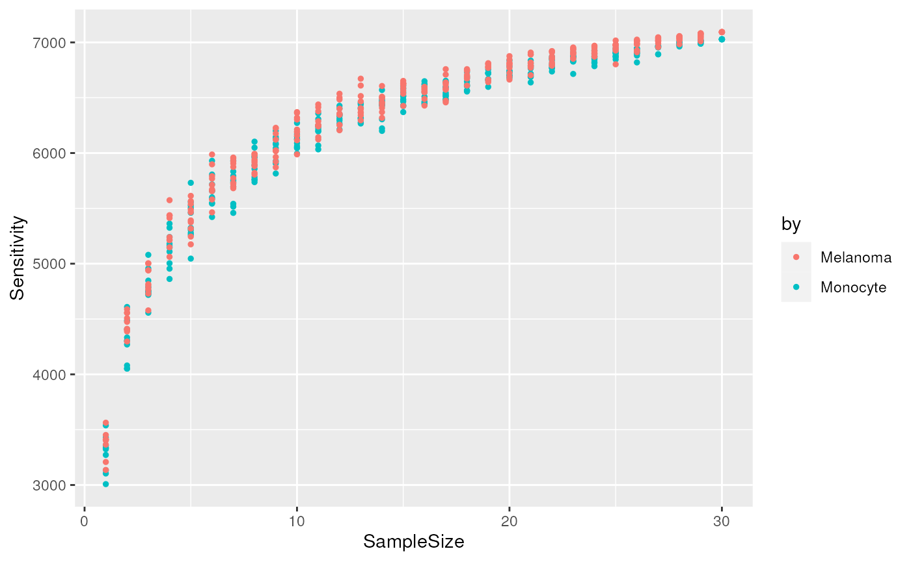
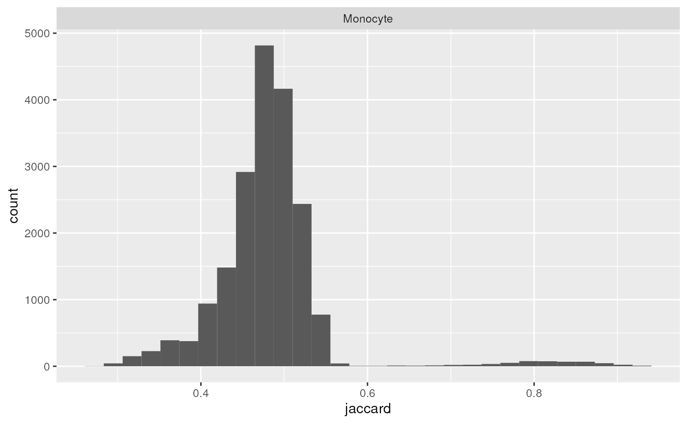

# Reporting missing values for Single Cell Proteomics

## Introduction

This vignette demonstrates how to use `scp` to report missing values,
following our recommendations in Vanderaa and Gatto (2023). Briefly, we
recommend reporting at least 4 metrics:

- Total sensitivity, i.e. the total number of features found in the
  dataset
- Local sensitivity, i.e. the number of features per cell
- Data completeness, i.e. the proportion of values that are not missing
- Number of samples

We will also demonstrate how to estimate total sensitivity when the
number of samples is too low and how to report data consistency using
the distribution of the Jaccard indices.

In this vignette, we will assume you are familiar with the `scp`
framework. If this is not the case, we suggest you first read the
[introduction
vignette](https://uclouvain-cbio.github.io/scp/articles/scp.html).

## Minimal data processing

First, we load the `scp` package and retrieve a real-life dataset from
the `scpdata` package.

\
[`library`](https://rdrr.io/r/base/library.html)`(`[`"scp"`](https://UCLouvain-CBIO.github.io/scp)`)`\
[`library`](https://rdrr.io/r/base/library.html)`(``"scpdata"``)`\
`leduc`` ``<-`` `[`leduc2022`](https://rdrr.io/pkg/scpdata/man/leduc2022.html)`(``)`

Next, we reduce the size of the dataset to the 30 first acquisitions.
This allows for a fast execution of the code for this vignette while
still being a representative demonstration on a real dataset. We also
keep only the feature annotations that will be used later in the
vignette.

\
`leduc`` ``<-`` ``leduc``[``, , ``1``:``30``]`\
`#> Warning: 'experiments' dropped; see 'drops()'`\
`#> harmonizing input:`\
`#>   removing 8057 sampleMap rows not in names(experiments)`\
`#>   removing 1872 colData rownames not in sampleMap 'primary'`\
`leduc`` ``<-`` `[`selectRowData`](https://rformassspectrometry.github.io/QFeatures/reference/QFeatures-class.html)`(``leduc``, `[`c`](https://rdrr.io/r/base/c.html)`(`\
`    ``"Sequence"``, ``"Leading.razor.protein"``, ``"Reverse"``,`\
`    ``"Potential.contaminant"``, ``"PEP"`\
`)``)`

This is the actual minimal processing: 1. filtering contaminant and
low-quality features 2. replacing zeros by missing values 3. keep only
samples that correspond to single cells 4. remove the feature absent in
all samples 5. aggregate PSMs to peptides 6. join all runs in a single
large assay

\
`## 1.`\
`leduc`` ``<-`` `[`filterFeatures`](https://rdrr.io/pkg/ProtGenerics/man/filterFeatures.html)`(``leduc``, ``~`` ``Reverse`` ``!=`` ``"+"`` ``&`\
`                           ``Potential.contaminant`` ``!=`` ``"+"`` ``&`\
`                           ``PEP`` ``<`` ``0.01``)`\
`## 2.`\
`leduc`` ``<-`` `[`zeroIsNA`](https://rformassspectrometry.github.io/QFeatures/reference/QFeatures-missing-data.html)`(``leduc``, i ``=`` `[`names`](https://rdrr.io/r/base/names.html)`(``leduc``)``)`\
`## 3.`\
`leduc`` ``<-`` ``subsetByColData``(`\
`    ``leduc``, ``leduc``$``SampleType`` `[`%in%`](https://rdrr.io/r/base/match.html)` `[`c`](https://rdrr.io/r/base/c.html)`(``"Monocyte"``, ``"Melanoma"``)`\
`)`\
`## 4.`\
`leduc`` ``<-`` `[`filterNA`](https://rdrr.io/pkg/ProtGenerics/man/protgenerics.html)`(``leduc``, i ``=`` `[`names`](https://rdrr.io/r/base/names.html)`(``leduc``)``, pNA ``=`` ``0.9999``)`\
`leduc`` ``<-`` `[`dropEmptyAssays`](https://rformassspectrometry.github.io/QFeatures/reference/QFeatures-class.html)`(``leduc``)`\
`## 5.`\
`leduc`` ``<-`` `[`aggregateFeatures`](https://rdrr.io/pkg/ProtGenerics/man/protgenerics.html)`(`\
`    ``leduc``, i ``=`` `[`names`](https://rdrr.io/r/base/names.html)`(``leduc``)``, name ``=`` `[`paste0`](https://rdrr.io/r/base/paste.html)`(``"peptides_"``, `[`names`](https://rdrr.io/r/base/names.html)`(``leduc``)``)``,`\
`    fcol ``=`` ``"Sequence"``, fun ``=`` ``colMedians`\
`)`\
`#>   |                                                                              |                                                                      |   0%  |                                                                              |==                                                                    |   3%  |                                                                              |=====                                                                 |   7%  |                                                                              |=======                                                               |  10%  |                                                                              |=========                                                             |  13%  |                                                                              |============                                                          |  17%  |                                                                              |==============                                                        |  20%  |                                                                              |================                                                      |  23%  |                                                                              |===================                                                   |  27%  |                                                                              |=====================                                                 |  30%  |                                                                              |=======================                                               |  33%  |                                                                              |==========================                                            |  37%  |                                                                              |============================                                          |  40%  |                                                                              |==============================                                        |  43%  |                                                                              |=================================                                     |  47%  |                                                                              |===================================                                   |  50%  |                                                                              |=====================================                                 |  53%  |                                                                              |========================================                              |  57%  |                                                                              |==========================================                            |  60%  |                                                                              |============================================                          |  63%  |                                                                              |===============================================                       |  67%  |                                                                              |=================================================                     |  70%  |                                                                              |===================================================                   |  73%  |                                                                              |======================================================                |  77%  |                                                                              |========================================================              |  80%  |                                                                              |==========================================================            |  83%  |                                                                              |=============================================================         |  87%  |                                                                              |===============================================================       |  90%  |                                                                              |=================================================================     |  93%  |                                                                              |====================================================================  |  97%  |                                                                              |======================================================================| 100%`\
`## 6.`\
`leduc`` ``<-`` `[`joinAssays`](https://rformassspectrometry.github.io/QFeatures/reference/joinAssays.html)`(`\
`    ``leduc``, i ``=`` `[`grep`](https://rdrr.io/r/base/grep.html)`(``"^peptides_"``, `[`names`](https://rdrr.io/r/base/names.html)`(``leduc``)``)``, name ``=`` ``"peptides"`\
`)`

**What about proteins?** if we were interested in reporting missing
values at the protein level, we simply need to change
`fcol = "Sequence"` to `fcol = "Leading.razor.protein"` in
[`aggregateFeatures()`](https://rdrr.io/pkg/ProtGenerics/man/protgenerics.html).

## Report missing values

We can now compute the metrics of interest. We recommend computing these
for each cell type separately, since biological properties specific to
the cell type could influence the outcome. You can perform this using
[`reportMissingValues()`](https://UCLouvain-CBIO.github.io/scp/reference/reportMissingValues.md).
We provide the dataset and point towards the assay with the peptide
quantification matrix (`peptides`). The metrics are computed based on
the cell annotation `SampleType` that is available in the `colData`.

\
[`reportMissingValues`](https://UCLouvain-CBIO.github.io/scp/reference/reportMissingValues.md)`(``leduc``, ``"peptides"``, by ``=`` ``leduc``$``SampleType``)`\
`#>          LocalSensitivityMean LocalSensitivitySd TotalSensitivity Completeness`\
`#> Monocyte             2664.213           367.7552             7028    0.3751356`\
`#> Melanoma             2958.851           430.9701             7093    0.4166223`\
`#>          NumberCells`\
`#> Monocyte         197`\
`#> Melanoma         195`

## Advanced criteria

### Jaccard index distribution

The Jaccard index between a pair of cells is the number of features
shared by the two cells divided by the number of features identified in
any of the two columns. This provides a good measure of how consistent
the identifications are across single-cells. Again, biological
differences between cell types may decrease the consistency between
single cells and we therefore suggest to compute the Jaccard index for
each cell type separately. We compute the Jaccard index using
[`jaccardIndex()`](https://UCLouvain-CBIO.github.io/scp/reference/jaccardIndex.md).

\
`ji`` ``<-`` `[`jaccardIndex`](https://UCLouvain-CBIO.github.io/scp/reference/jaccardIndex.md)`(``leduc``, ``"peptides"``, by ``=`` ``leduc``$``SampleType``)`

The function returns a `data.frame` that we visualize using the
`ggplot2` package.

\
[`library`](https://rdrr.io/r/base/library.html)`(`[`"ggplot2"`](https://ggplot2.tidyverse.org)`)`\
[`ggplot`](https://ggplot2.tidyverse.org/reference/ggplot.html)`(``ji``)`` ``+`\
`    `[`aes`](https://ggplot2.tidyverse.org/reference/aes.html)`(``x ``=`` ``jaccard``)`` ``+`\
`    `[`geom_histogram`](https://ggplot2.tidyverse.org/reference/geom_histogram.html)`(``)`` ``+`\
`    `[`facet_grid`](https://ggplot2.tidyverse.org/reference/facet_grid.html)`(``~`` ``by``)`\
`` #> `stat_bin()` using `bins = 30`. Pick better value `binwidth`. ``

The Jaccard indices peak around 50 %, meaning that about half of the
features are consistently found across single-cells within the same cell
type. Note also that some pairs of cells have consistency above 75 %.
These are pairs of cells from the same acquisition runs that were
multiplexed together with TMT labelling.

### Assessing the total sensitivity

To assess whether we can accurately estimate the total sensitivity, we
generate a cumulative sensitivity curve (CSC). More precisely, we sample
the identification matrix for an increasing number of cells (or runs)
and count the number of distinct features found across the sampled
cells. We repeat each sampling multiple times to account for the
stochasticity of the approach. The approach is implemented in
[`cumulativeSensitivityCurve()`](https://UCLouvain-CBIO.github.io/scp/reference/cumulativeSensitivityCurve.md).
Again, we compute the curve for each cell type separately. In the
`leduc` dataset, several cells are acquired in an MS run. When a
features is identified in a cell, it is most of the time also identified
in all other cells of that run, and this will distort the cumulative
sensitivity curve. Therefore, the function provides a `batch` argument
to account for this. Finally, `nSteps` defines the number of random
draws with increasing sample size, and `niters` defines how many times
each draw must be iterated.

\
`csc`` ``<-`` `[`cumulativeSensitivityCurve`](https://UCLouvain-CBIO.github.io/scp/reference/cumulativeSensitivityCurve.md)`(``leduc``, ``"peptides"``, by ``=`` ``leduc``$``SampleType``,`\
`                                  batch ``=`` ``leduc``$``Set``, niters ``=`` ``10``,`\
`                                  nsteps ``=`` ``30``)`

The function returns a `data.frame` that we visualize using the
`ggplot2` package.

\
`(``plCSC`` ``<-`` `[`ggplot`](https://ggplot2.tidyverse.org/reference/ggplot.html)`(``csc``)`` ``+`\
`    `[`aes`](https://ggplot2.tidyverse.org/reference/aes.html)`(``x ``=`` ``SampleSize``, y ``=`` ``Sensitivity``, colour ``=`` ``by``)`` ``+`\
`    `[`geom_point`](https://ggplot2.tidyverse.org/reference/geom_point.html)`(``size ``=`` ``1``)``)`

The cumulative sensitivity does not reach a plateau. This means that we
underestimated the total sensitivity in the previous section. We use
[`predictSensitivity()`](https://UCLouvain-CBIO.github.io/scp/reference/cumulativeSensitivityCurve.md)
to predict the total sensitivity from these curves. The function fits an
asymptotic regression model to assess the relationship between the
sensitivity and the sample size. Then, it uses the model to predict the
sensitivity for any sample size. (supplied through `nSamples`). The
function requires the `data.frame` generated by
[`cumulativeSensitivityCurve()`](https://UCLouvain-CBIO.github.io/scp/reference/cumulativeSensitivityCurve.md).
To assess the quality of the fit, we first predict the sensitivity for
the range of sample size.

\
`predCSC`` ``<-`` `[`predictSensitivity`](https://UCLouvain-CBIO.github.io/scp/reference/cumulativeSensitivityCurve.md)`(``csc``, nSample ``=`` ``1``:``30``)`\
`plCSC`` ``+`` `[`geom_line`](https://ggplot2.tidyverse.org/reference/geom_path.html)`(``data ``=`` ``predCSC``)`

We finally predict the total sensitivity, that is the sensitivity if we
had an infinite number of samples.

\
[`predictSensitivity`](https://UCLouvain-CBIO.github.io/scp/reference/cumulativeSensitivityCurve.md)`(``csc``, nSamples ``=`` ``Inf``)`\
`#>   SampleSize Sensitivity       by`\
`#> 1        Inf    7199.206 Monocyte`\
`#> 2        Inf    7271.888 Melanoma`

The total sensitivity is predicted to be about 7200 peptides for both
cell types. So in the previous section, we underestimated the total
sensitivity by about 150 peptides.

## License

This vignette is distributed under a [CC BY-SA
license](https://creativecommons.org/licenses/by-sa/2.0/) license.

## Reference

Vanderaa, Christophe, and Laurent Gatto. 2023. *Revisiting the Thorny
Issue of Missing Values in Single-Cell Proteomics*. April.
<https://arxiv.org/abs/2304.06654>.
