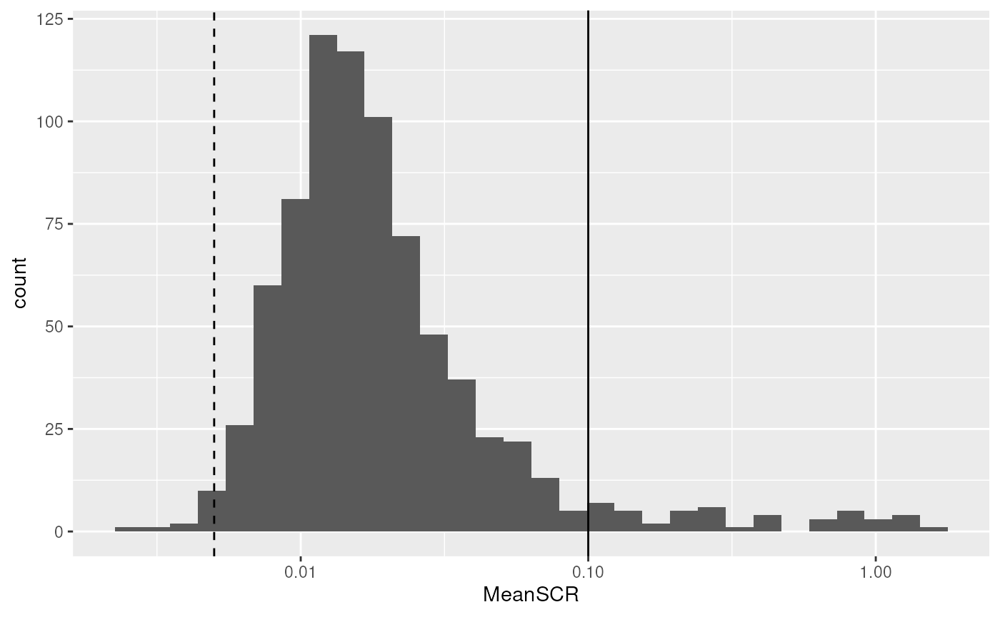
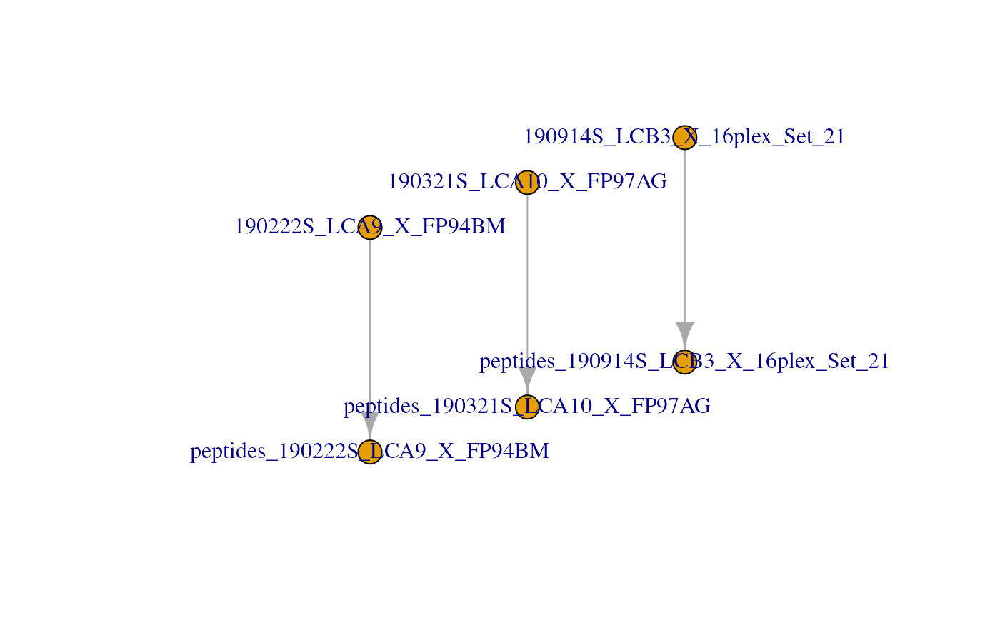
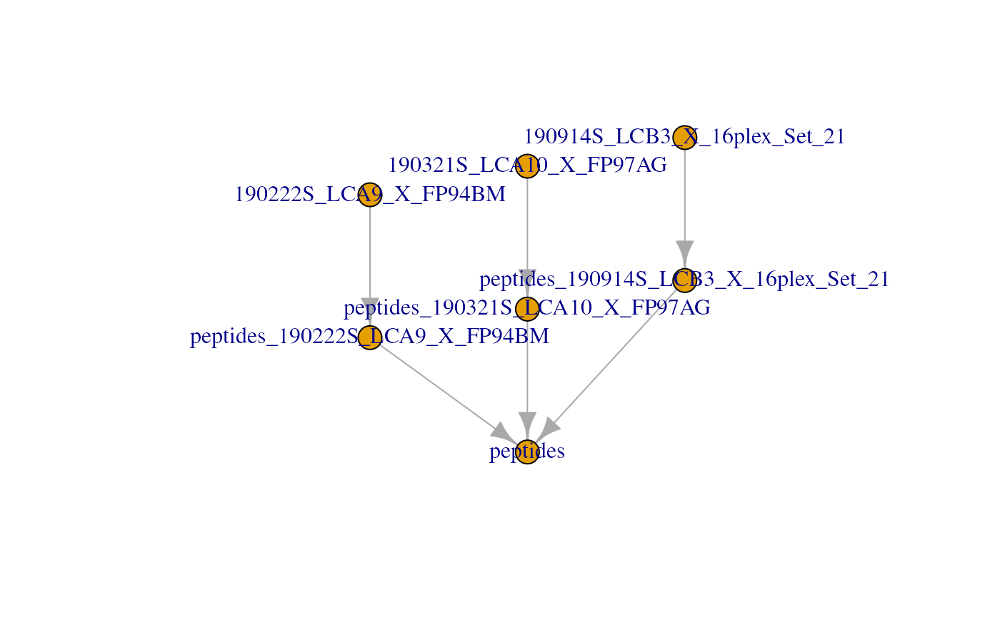
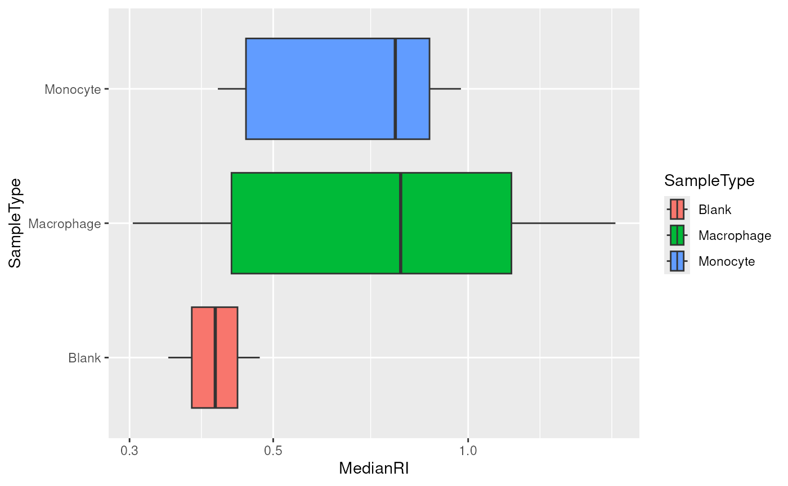
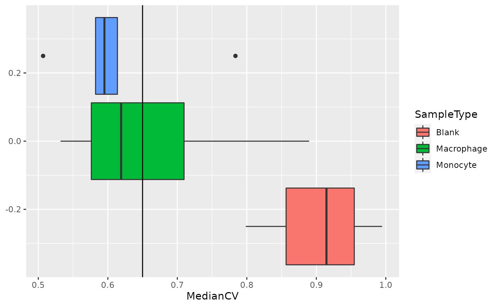
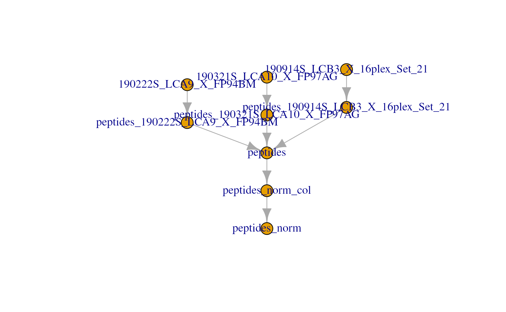
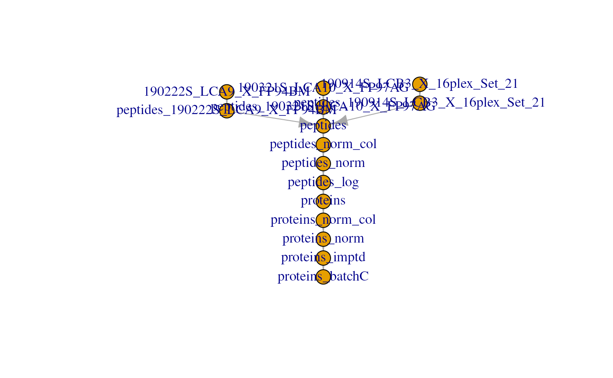
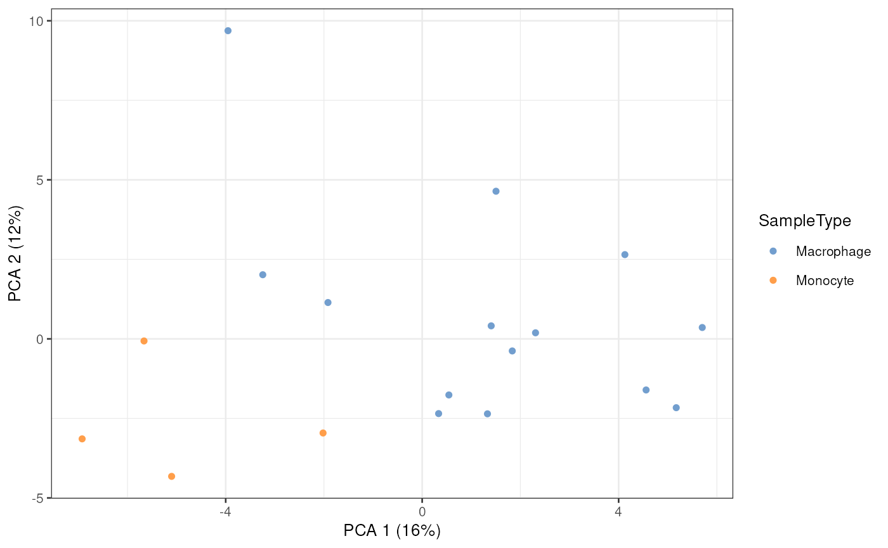
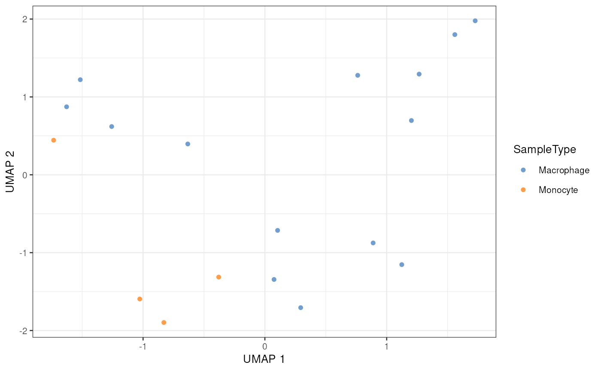
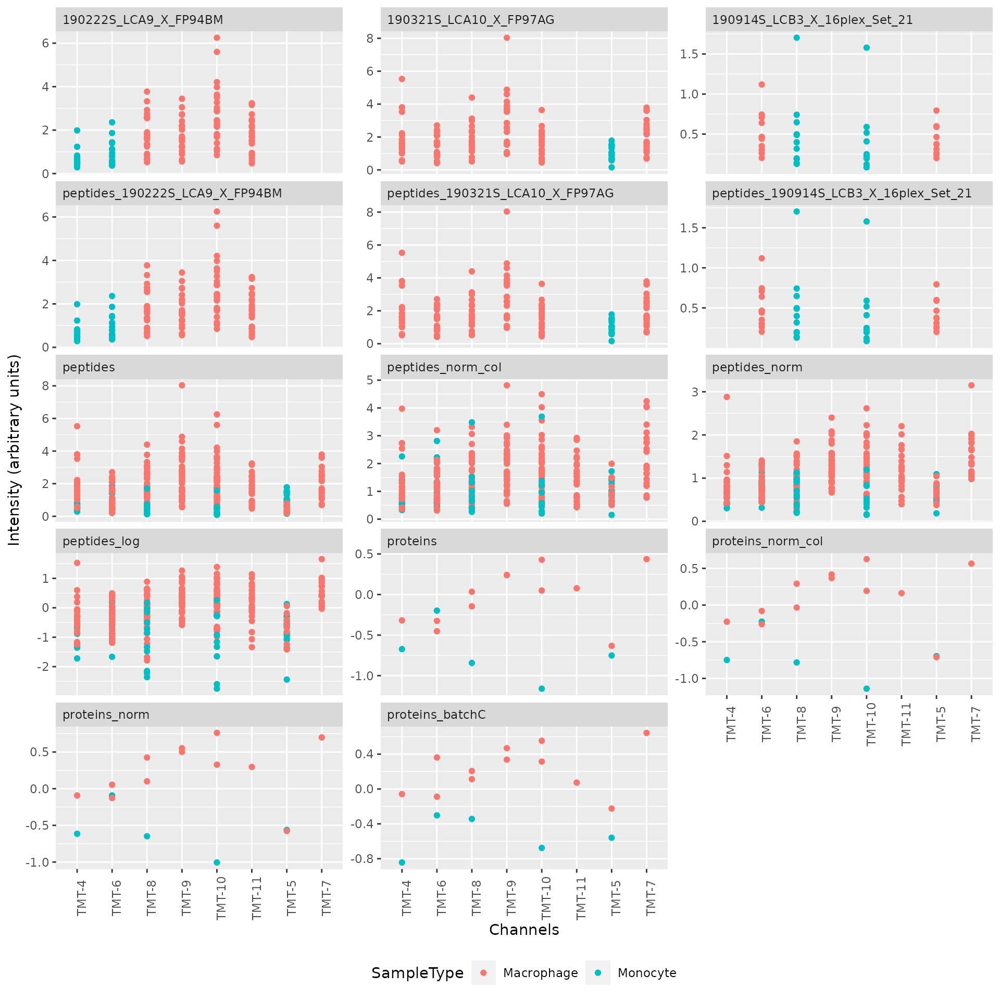

# Single Cell Proteomics data processing and analysis

## The `scp` package

The `scp` package is used to process and analyse mass spectrometry
(MS)-based single cell proteomics (SCP) data. The functions rely on a
specific data structure that wraps
[`QFeatures`](https://rformassspectrometry.github.io/QFeatures/) objects
(Gatto and Vanderaa (2023)) around
[`SingleCellExperiment`](http://bioconductor.org/packages/release/bioc/html/SingleCellExperiment.md)
(Amezquita et al. (2020)) or
[`SummarizedExperiment`](http://bioconductor.org/packages/release/bioc/html/SummarizedExperiment.md)
objects. This data structure could be seen as Matryoshka dolls were the
`SingleCellExperiment` or `SummarizedExperiment` objects are small dolls
contained in the bigger `QFeatures` doll.

The `SingleCellExperiment` class provides a dedicated framework for
single-cell data. The `SingleCellExperiment` serves as an interface to
many cutting-edge methods for processing, visualizing and analysis
single-cell data. More information about the `SingleCellExperiment`
class and associated methods can be found in the [OSCA
book](http://bioconductor.org/books/release/OSCA/).

The `QFeatures` class is a data framework dedicated to manipulate and
process MS-based quantitative data. It preserves the relationship
between the different levels of information: peptide to spectrum match
(PSM) data, peptide data and protein data. The `QFeatures` package also
provides an interface to many utility functions to streamline the
processing MS data. More information about MS data analysis tools can be
found in the [RforMassSpectrometry
project](https://www.rformassspectrometry.org/).


`scp` relies on `SingleCellExperiment` and `QFeatures` objects.

Before running the vignette we need to load the `scp` package.

\
[`library`](https://rdrr.io/r/base/library.html)`(`[`"scp"`](https://UCLouvain-CBIO.github.io/scp)`)`

We also load `ggplot2` and `dplyr` for convenient data manipulation and
plotting.

\
[`library`](https://rdrr.io/r/base/library.html)`(`[`"ggplot2"`](https://ggplot2.tidyverse.org)`)`\
[`library`](https://rdrr.io/r/base/library.html)`(`[`"dplyr"`](https://dplyr.tidyverse.org)`)`

## Before you start

This vignette will guide you through some common steps of mass
spectrometry-based single-cell proteomics (SCP) data analysis. SCP is an
emerging field and further research is required to develop a principled
analysis workflow. Therefore, we **do not guarantee** that the steps
presented here are the best steps for this type of data analysis. This
vignette performs the steps that were described in the SCoPE2 landmark
paper (Specht et al. (2021)) and that were reproduced in another work
using the `scp` package (Vanderaa and Gatto (2021)). The replication on
the full SCoPE2 dataset using `scp` is available in [this
vignette](https://uclouvain-cbio.github.io/SCP.replication/articles/SCoPE2.html).
We hope to convince the reader that, although the workflow is probably
not optimal, `scp` has the full potential to perform standardized and
principled data analysis. All functions presented here are
comprehensively documented, highly modular, can easily be extended with
new algorithms. Suggestions, feature requests or bug reports are warmly
welcome. Feel free to open an issue in the [GitHub
repository](https://github.com/UCLouvain-CBIO/scp/issues).

This workflow can be applied to any MS-based SCP data. The minimal
requirement to follow this workflow is that the data should contain the
following information:

- `runCol`/`Raw.file`: field in the feature data and the sample data
  that gives the names of MS acquisition runs or files.
- `quantCols`: field in the sample data that links to columns in the
  quantification data and that allows to link samples to MS channels
  (more details in another
  [vignette](https://uclouvain-cbio.github.io/scp/articles/read_scp.html)).
- `SampleType`: field in the sample data that provides the type of
  sample that is acquired (carrier, reference, single-cell,…). Only
  needed for multiplexing experiments.
- `Potential.contaminant`: field in the feature data that marks
  contaminant peptides.
- `Reverse`: field in the feature data that marks reverse peptides.
- `PIF`: field in the feature data that provides spectral purity.
- `PEP` or `dart_PEP`: field in the feature data that provides peptide
  posterior error probabilities.
- `Modified.sequence`: field in the feature data that provides the
  peptide identifiers.
- `Leading.razor.protein`: field in the feature data that provides the
  protein identifiers.
- At least one field in the feature data that contains quantification
  values. In this case, there are 16 quantification columns named as
  `Reporter.intensity.` followed by an index (`1` to `16`).

Each required field will be described more in detail in the
corresponding sections. Names can be adapted by the user to more
meaningful ones or adapted to other output tables.

## Read in SCP data

The first step is to read in the PSM quantification table generated by,
for example, MaxQuant (Tyanova et al. (2016)). We created a small
example data by subsetting the MaxQuant `evidence.txt` table provided in
the SCoPE2 landmark paper (Specht et al. (2021)). The `mqScpData` table
is a typical example of what you would get after reading in a CSV file
using `read.csv` or `read.table`. See
[`?mqScpData`](https://UCLouvain-CBIO.github.io/scp/reference/mqScpData.md)
for more information about the table content.

\
[`data`](https://rdrr.io/r/utils/data.html)`(``"mqScpData"``)`

We also provide an example of a sample annotation table that provides
useful information about the samples that are present in the example
data. See
[`?sampleAnnotation`](https://UCLouvain-CBIO.github.io/scp/reference/sampleAnnotation.md)
for more information about the table content.

\
[`data`](https://rdrr.io/r/utils/data.html)`(``"sampleAnnotation"``)`

As a note, the example sample data contains 5 different types of samples
(`SampleType`) that can be found in a TMT-based SCP data set:

\
[`table`](https://rdrr.io/r/base/table.html)`(``sampleAnnotation``$``SampleType``)`\
`#> `\
`#>      Blank    Carrier Macrophage   Monocyte  Reference     Unused `\
`#>         19          3         20          5          3         14`

- The carrier channels (`Carrier`) contain 200 cell equivalents and are
  meant to boost the peptide identification rate.
- The normalization channels (`Reference`) contain 5 cell equivalents
  and are used to partially correct for between-run variation.
- The unused channels (`Unused`) are channels that are left empty due to
  isotopic cross-contamination by the carrier channel.
- The negative control channels (`Blank`) contain samples that do not
  contain any cell but are processed as single-cell samples.
- The single-cell sample channels contain the single-cell samples of
  interest, that are macrophage (`Macrophage`) or monocyte (`Monocyte`).

Using `readSCP`, we combine both tables in a `QFeatures` object
formatted as described above.

\
`scp`` ``<-`` `[`readSCP`](https://UCLouvain-CBIO.github.io/scp/reference/readSCP.md)`(``assayData ``=`` ``mqScpData``,`\
`               colData ``=`` ``sampleAnnotation``,`\
`               runCol ``=`` ``"Raw.file"``,`\
`               removeEmptyCols ``=`` ``TRUE``)`\
`#> Checking arguments.`\
`#> Loading data as a 'SummarizedExperiment' object.`\
`#> Splitting data in runs.`\
`#>   |                                                                              |                                                                      |   0%  |                                                                              |==================                                                    |  25%  |                                                                              |===================================                                   |  50%  |                                                                              |====================================================                  |  75%  |                                                                              |======================================================================| 100%`\
`#> Formatting sample annotations (colData).`\
`#> Formatting data as a 'QFeatures' object.`\
`scp`\
`#> An instance of class QFeatures (type: scp) with 4 sets:`\
`#> `\
`#>  [1] 190222S_LCA9_X_FP94BM: SummarizedExperiment with 395 rows and 11 columns `\
`#>  [2] 190321S_LCA10_X_FP97_blank_01: SummarizedExperiment with 109 rows and 11 columns `\
`#>  [3] 190321S_LCA10_X_FP97AG: SummarizedExperiment with 487 rows and 11 columns `\
`#>  [4] 190914S_LCB3_X_16plex_Set_21: SummarizedExperiment with 370 rows and 16 columns`

See here that the 3 first assays contain 11 columns that correspond to
the TMT-11 labels and the last assay contains 16 columns that correspond
to the TMT-16 labels.

**Important**: More details about the usage of
[`readSCP()`](https://UCLouvain-CBIO.github.io/scp/reference/readSCP.md)
and how to read your own data set are provided in the
`Load data using readSCP`
[vignette](https://uclouvain-cbio.github.io/scp/articles/read_scp.html).

Another way to get an overview of the scp object is to plot the
`QFeatures` object. This will create a graph where each node is an assay
and links between assays are denoted as edges.

\
[`plot`](https://rdrr.io/r/graphics/plot.default.html)`(``scp``)`


## Clean missing data

All single-cell data contain many zeros. The zeros can be biological
zeros or technical zeros and differentiating between the two types is
not a trivial task. To avoid artefacts in downstream steps, we replace
the zeros by the missing value `NA`. The `zeroIsNA` function takes the
`QFeatures` object and the name(s) or index/indices of the assay(s) to
clean and automatically replaces any zero in the selected quantitative
data by `NA`.

\
`scp`` ``<-`` `[`zeroIsNA`](https://rformassspectrometry.github.io/QFeatures/reference/QFeatures-missing-data.html)`(``scp``, i ``=`` ``1``:``4``)`

## Filter PSMs

A common steps in SCP is to filter out low-confidence PSMs. Each PSM
assay contains feature meta-information that are stored in the `rowData`
of the assays. The `QFeatures` package allows to quickly filter the rows
of an assay by using these information. The available variables in the
`rowData` are listed below for each assay.

\
[`rowDataNames`](https://rformassspectrometry.github.io/QFeatures/reference/QFeatures-class.html)`(``scp``)`\
`#> CharacterList of length 4`\
`#> [["190222S_LCA9_X_FP94BM"]] uid Sequence Length ... residual participated`\
`#> [["190321S_LCA10_X_FP97_blank_01"]] uid Sequence ... residual participated`\
`#> [["190321S_LCA10_X_FP97AG"]] uid Sequence Length ... residual participated`\
`#> [["190914S_LCB3_X_16plex_Set_21"]] uid Sequence ... residual participated`

### Filter features based on feature annotations

Below are some examples of criteria that are used to identify
low-confidence. The information is readily available since this was
computed by MaxQuant:

- Remove PSMs that are matched to contaminants
- Remove PSMs that are matched to the decoy database
- Keep PSMs that exhibit a high PIF (parental ion fraction), indicative
  of the purity of a spectrum

We can perform this filtering using the `filterFeatures` function from
`QFeatures`. `filterFeatures` automatically accesses the feature
annotations and selects the rows that meet the provided condition(s).
For instance, `Reverse != "+"` keeps the rows for which the `Reverse`
variable in the `rowData` is not `"+"` (*i.e.* the PSM is not matched to
the decoy database).

\
`scp`` ``<-`` `[`filterFeatures`](https://rdrr.io/pkg/ProtGenerics/man/filterFeatures.html)`(``scp``,`\
`                      ``~`` ``Reverse`` ``!=`` ``"+"`` ``&`\
`                          ``Potential.contaminant`` ``!=`` ``"+"`` ``&`\
`                          ``!`[`is.na`](https://rdrr.io/r/base/NA.html)`(``PIF``)`` ``&`` ``PIF`` ``>`` ``0.8``)`\
`#> 'Reverse' found in 4 out of 4 assay(s).'Potential.contaminant' found in 4 out of 4 assay(s).'PIF' found in 4 out of 4 assay(s).`

### Filter assays based on detected features

To avoid proceeding with failed runs, another interesting filter is to
remove assays with too few features. If a batch contains less than, for
example, 150 features we can then suspect something wrong happened in
that batch and it should be removed. Using `dims`, we can query the
dimensions (hence the number of features and the number of samples) of
all assays contained in the dataset.

\
[`dims`](https://rdrr.io/pkg/BiocGenerics/man/dims.html)`(``scp``)`\
`#>      190222S_LCA9_X_FP94BM 190321S_LCA10_X_FP97_blank_01 190321S_LCA10_X_FP97AG`\
`#> [1,]                   283                            60                    318`\
`#> [2,]                    11                            11                     11`\
`#>      190914S_LCB3_X_16plex_Set_21`\
`#> [1,]                          200`\
`#> [2,]                           16`

Actually, a `QFeatures` object can be seen as a three-order array:
$`features \times samples \times assay`$. Hence, `QFeatures` supports
three-order subsetting `x[rows, columns, assays]`. We first select the
assays that have sufficient PSMs (the number of rows is greater than
150), and then subset the `scp` object for the assays that meet the
criterion.

\
`keepAssay`` ``<-`` `[`dims`](https://rdrr.io/pkg/BiocGenerics/man/dims.html)`(``scp``)``[``1``, ``]`` ``>`` ``150`\
`scp`` ``<-`` ``scp``[``, , ``keepAssay``]`\
`#> Warning: 'experiments' dropped; see 'drops()'`\
`#> harmonizing input:`\
`#>   removing 11 sampleMap rows not in names(experiments)`\
`#>   removing 11 colData rownames not in sampleMap 'primary'`\
`scp`\
`#> An instance of class QFeatures (type: scp) with 3 sets:`\
`#> `\
`#>  [1] 190222S_LCA9_X_FP94BM: SummarizedExperiment with 283 rows and 11 columns `\
`#>  [2] 190321S_LCA10_X_FP97AG: SummarizedExperiment with 318 rows and 11 columns `\
`#>  [3] 190914S_LCB3_X_16plex_Set_21: SummarizedExperiment with 200 rows and 16 columns`

Notice the `190321S_LCA10_X_FP97_blank_01` sample was removed because it
did not contain sufficient features, as expected from a blank run. This
could also have been the case for failed runs.

### Filter features based on SCP metrics

Another type of filtering is specific to SCP. In the SCoPE2 analysis,
the authors suggest a filters based on the sample to carrier ratio
(SCR), that is the reporter ion intensity of a single-cell sample
divided by the reporter ion intensity of the carrier channel (200 cells)
from the same batch. It is expected that the carrier intensities are
much higher than the single-cell intensities.

The SCR can be computed using the `computeSCR` function from `scp`. The
function must be told which channels are the samples that must be
divided and which channel contains the carrier. This information is
provided in the sample annotations and is accessed using the `colData`,
under the `SampleType` field.

\
[`table`](https://rdrr.io/r/base/table.html)`(`[`colData`](https://rdrr.io/pkg/SummarizedExperiment/man/SummarizedExperiment-class.html)`(``scp``)``[``, ``"SampleType"``]``)`\
`#> `\
`#>      Blank    Carrier Macrophage   Monocyte  Reference     Unused `\
`#>          3          3         20          5          3          4`

In this dataset, `SampleType` gives the type of sample that is present
in each TMT channel. The SCoPE2 protocole includes 5 types of samples:

- The carrier channels (`Carrier`) contain 200 cell equivalents and are
  meant to boost the peptide identification rate.
- The normalization channels (`Reference`) contain 5 cell equivalents
  and are used to partially correct for between-run variation.
- The unused channels (`Unused`) are channels that are left empty due to
  isotopic cross-contamination by the carrier channel.
- The negative control channels (`Blank`) contain samples that do not
  contain any cell but are processed as single-cell samples.
- The single-cell sample channels contain the single-cell samples of
  interest, that are macrophage (`Macrophage`) or monocyte (`Monocyte`).

The `computeSCR` function expects the following input:

- The `QFeatures` dataset
- The assay name(s) or index/indices for which the SCR should be
  computed
- `colvar`: the variable in the sample annotations (`colData`) that hold
  the information used to discriminate sample channels from carrier
  channels.
- `carrierPattern`: a string pattern (following regular expression
  syntax) that identifies the carrier channel in each batch.
- `samplePattern`: a string pattern (following regular expression
  syntax) that identifies the samples to divide.

Optionally, you can also provide the following arguments:

- `rowDataName`: the name of the column in the `rowData` where to store
  the computed SCR for each feature.
- `sampleFUN`: when multiple samples are present in an assay, there are
  as many SCR as there are samples that need to be summarized to a
  single value per feature. `sampleFUN` tells which function to use for
  summarizing the sample values before computing the SCR; the default is
  the `mean`.
- `carrierFUN`: some designs might include several carriers per run (not
  the case in this example). Similarly to `sampleFUN`, `carrierFUN`
  tells which function to use for summarizing the carrier values before
  computing the SCR; the default is the same function as `sampleFUN`.

The function creates a new field in the `rowData` of the assays. We
compute the average SCR for each PSM and store it in the corresponding
`rowData`, under the `MeanSCR` column.

\
`scp`` ``<-`` `[`computeSCR`](https://UCLouvain-CBIO.github.io/scp/reference/computeSCR.md)`(``scp``,`\
`                  i ``=`` ``1``:``3``,`\
`                  colvar ``=`` ``"SampleType"``,`\
`                  carrierPattern ``=`` ``"Carrier"``,`\
`                  samplePattern ``=`` ``"Macrophage|Monocyte"``,`\
`                  sampleFUN ``=`` ``"mean"``,`\
`                  rowDataName ``=`` ``"MeanSCR"``)`

Before applying the filter, we plot the distribution of the average SCR.
We collect the `rowData` from several assays in a single table
`DataFrame` using the `rbindRowData` function from `QFeatures`.

\
[`rbindRowData`](https://rformassspectrometry.github.io/QFeatures/reference/QFeatures-class.html)`(``scp``, i ``=`` ``1``:``3``)`` ``|>`\
`    `[`data.frame`](https://rdrr.io/r/base/data.frame.html)`(``)`` ``|>`\
`    `[`ggplot`](https://ggplot2.tidyverse.org/reference/ggplot.html)`(`[`aes`](https://ggplot2.tidyverse.org/reference/aes.html)`(``x ``=`` ``MeanSCR``)``)`` ``+`\
`    `[`geom_histogram`](https://ggplot2.tidyverse.org/reference/geom_histogram.html)`(``)`` ``+`\
`    `[`geom_vline`](https://ggplot2.tidyverse.org/reference/geom_abline.html)`(``xintercept ``=`` `[`c`](https://rdrr.io/r/base/c.html)`(``1``/``200``, ``0.1``)``,`\
`               lty ``=`` `[`c`](https://rdrr.io/r/base/c.html)`(``2``, ``1``)``)`` ``+`\
`    `[`scale_x_log10`](https://ggplot2.tidyverse.org/reference/scale_continuous.html)`(``)`



The expected ratio between single cells and the carrier is 1/200 (dashed
line). We can see that the distribution mode is slightly shifted towards
higher ratios with a mode around 0.01. However, there are a few PSMs
that stand out of the distribution and have a much higher signal than
expected, indicating something wrong happened during the quantification
of those PSMs. We therefore filter out PSMs with an average SCR higher
than 0.1 (solide line). This is again easily performed using the
`filterFeatures` functions.

\
`scp`` ``<-`` `[`filterFeatures`](https://rdrr.io/pkg/ProtGenerics/man/filterFeatures.html)`(``scp``,`\
`                      ``~`` ``!`[`is.na`](https://rdrr.io/r/base/NA.html)`(``MeanSCR``)`` ``&`\
`                          ``MeanSCR`` ``<`` ``0.1``)`\
`#> 'MeanSCR' found in 3 out of 3 assay(s).`

### Filter features to control for FDR

Finally, we might also want to control for false discovery rate (FDR).
MaxQuant already computes posterior error probabilities (PEP), but
filtering on PEPs is too conservative (Käll et al. (2008)) so we provide
the `pep2qvalue` function to convert PEPs to q-values that are directly
related to FDR. We here compute the q-values from the PEP (`dart_PEP`)
across all 3 assays. `dart_PEP` contains the PEP values that have been
updated using the DART-ID algorithm (Chen et al. (2019)). The function
will store the results in the `rowData`, we here asked to name the new
column `qvalue_PSMs`.

\
`scp`` ``<-`` `[`pep2qvalue`](https://UCLouvain-CBIO.github.io/scp/reference/pep2qvalue.md)`(``scp``,`\
`                  i ``=`` ``1``:``3``,`\
`                  PEP ``=`` ``"dart_PEP"``,`\
`                  rowDataName ``=`` ``"qvalue_PSMs"``)`

We also allow to compute q-values at peptide or protein level rather
than PSM. In this case, you need to supply the `groupBy` argument.
Suppose we want to compute the q-values at protein level, we can fetch
the protein information stored under `Leading.razor.protein` in the
`rowData`. This time, we store the q-values in a new field called
`qvalue_proteins`.

\
`scp`` ``<-`` `[`pep2qvalue`](https://UCLouvain-CBIO.github.io/scp/reference/pep2qvalue.md)`(``scp``,`\
`                  i ``=`` ``1``:``3``,`\
`                  PEP ``=`` ``"dart_PEP"``,`\
`                  groupBy ``=`` ``"Leading.razor.protein"``,`\
`                  rowDataName ``=`` ``"qvalue_proteins"``)`

We can now filter the PSM to control, let’s say, the protein FDR at 1%.
This can be performed using `filterFeatures` because the q-values were
stored in the `rowData`.

\
`scp`` ``<-`` `[`filterFeatures`](https://rdrr.io/pkg/ProtGenerics/man/filterFeatures.html)`(``scp``,`\
`                      ``~`` ``qvalue_proteins`` ``<`` ``0.01``)`\
`#> 'qvalue_proteins' found in 3 out of 3 assay(s).`

## Process the PSM data

### Relative reporter ion intensity

In order to partialy correct for between-run variation, SCoPE2 suggests
computing relative reporter ion intensities. This means that intensities
measured for single-cells are divided by the reference channel
containing 5-cell equivalents. We use the `divideByReference` function
that divides channels of interest by the reference channel. Similarly to
`computeSCR`, we can point to the samples and the reference columns in
each assay using the annotation contained in the `colData`.

We here divide all columns (using the regular expression wildcard `.`)
by the reference channel (`Reference`).

\
`scp`` ``<-`` `[`divideByReference`](https://UCLouvain-CBIO.github.io/scp/reference/divideByReference.md)`(``scp``,`\
`                         i ``=`` ``1``:``3``,`\
`                         colvar ``=`` ``"SampleType"``,`\
`                         samplePattern ``=`` ``"."``,`\
`                         refPattern ``=`` ``"Reference"``)`

## Aggregate PSM data to peptide data

Now that the PSM assays are processed, we can aggregate them to
peptides. This is performed using the `aggregateFeatures` function. For
each assay, the function aggregates several PSMs into a unique peptide.
This is best illustrated by the figure below.


Conceptual illustration of feature aggregation.

Remember there currently are three assays containing the PSM data.

\
`scp`\
`#> An instance of class QFeatures (type: scp) with 3 sets:`\
`#> `\
`#>  [1] 190222S_LCA9_X_FP94BM: SummarizedExperiment with 239 rows and 11 columns `\
`#>  [2] 190321S_LCA10_X_FP97AG: SummarizedExperiment with 277 rows and 11 columns `\
`#>  [3] 190914S_LCB3_X_16plex_Set_21: SummarizedExperiment with 186 rows and 16 columns`

The PSMs are aggregated over the `fcol` feature variable, here the
modified peptide sequence. We also need to supply an aggregating
function that will tell how to combine the quantitative data of the PSMs
to aggregate. We here aggregate the PSM data using the median value per
sample thanks to the `matrixStats:colMedians()` function. Other
functions can be used and we refer to the documentation
[`?aggregateFeatures`](https://rdrr.io/pkg/ProtGenerics/man/protgenerics.html)
for more information about available aggregation functions. The
[`aggregateFeatures()`](https://rdrr.io/pkg/ProtGenerics/man/protgenerics.html)
function will create a new assay for each aggregated assay. We name the
aggregated assays using the original names and appending `peptides_` at
the start.

\
`scp`` ``<-`` `[`aggregateFeatures`](https://rdrr.io/pkg/ProtGenerics/man/protgenerics.html)`(``scp``,`\
`                         i ``=`` ``1``:``3``,`\
`                         fcol ``=`` ``"Modified.sequence"``,`\
`                         name ``=`` `[`paste0`](https://rdrr.io/r/base/paste.html)`(``"peptides_"``, `[`names`](https://rdrr.io/r/base/names.html)`(``scp``)``)``,`\
`                         fun ``=`` ``matrixStats``::`[`colMedians`](https://rdrr.io/pkg/matrixStats/man/rowMedians.html)`, na.rm ``=`` ``TRUE``)`\
`#>   |                                                                              |                                                                      |   0%  |                                                                              |=======================                                               |  33%  |                                                                              |===============================================                       |  67%  |                                                                              |======================================================================| 100%`

Notice that 3 new assays were created in the `scp` object. Those new
assays contain the aggregated features while the three first assays are
unchanged. This allows to keep track of the data processing.

\
`scp`\
`#> An instance of class QFeatures (type: scp) with 6 sets:`\
`#> `\
`#>  [1] 190222S_LCA9_X_FP94BM: SummarizedExperiment with 239 rows and 11 columns `\
`#>  [2] 190321S_LCA10_X_FP97AG: SummarizedExperiment with 277 rows and 11 columns `\
`#>  [3] 190914S_LCB3_X_16plex_Set_21: SummarizedExperiment with 186 rows and 16 columns `\
`#>  [4] peptides_190222S_LCA9_X_FP94BM: SummarizedExperiment with 216 rows and 11 columns `\
`#>  [5] peptides_190321S_LCA10_X_FP97AG: SummarizedExperiment with 256 rows and 11 columns `\
`#>  [6] peptides_190914S_LCB3_X_16plex_Set_21: SummarizedExperiment with 168 rows and 16 columns`

Under the hood, the `QFeatures` architecture preserves the relationship
between the aggregated assays. See
[`?AssayLinks`](https://rformassspectrometry.github.io/QFeatures/reference/AssayLinks.html)
for more information on relationships between assays. This is
illustrated on the `QFeatures` plot:

\
[`plot`](https://rdrr.io/r/graphics/plot.default.html)`(``scp``)`



## Join the SCoPE2 sets in one assay

Up to now, we kept the data belonging to each MS run in separate assays.
We now combine all batches into a single assay. This is done using the
`joinAssays` function from the `QFeatures` package. Note that we now use
the aggregated assays, so assay 4 to 6.

\
`scp`` ``<-`` `[`joinAssays`](https://rformassspectrometry.github.io/QFeatures/reference/joinAssays.html)`(``scp``,`\
`                  i ``=`` ``4``:``6``,`\
`                  name ``=`` ``"peptides"``)`

In this case, one new assay is created in the `scp` object that combines
the data from assay 4 to 6. The samples are always distinct so the
number of column in the new assay (here $`48`$) will always equals the
sum of the columns in the assays to join (here $`16 + 16 +
16`$). The feature in the joined assay might contain less features than
the sum of the rows of the assays to join since common features between
assays are joined in a single row.

\
[`plot`](https://rdrr.io/r/graphics/plot.default.html)`(``scp``)`



## Filter single-cells

Another common step in single-cell data analysis pipelines is to remove
low-quality cells. After subsetting for the samples of interest, we will
use 2 metrics: the median relative intensities per cell and the median
coefficient of variation (CV) per cell.

### Filter samples of interest

We can subset the cells of interest, that is the negative control
samples, the macrophages and the monocytes. This can easily be done by
taking advantage of the `colData` and the subsetting operators. Recall
that `QFeatures` objects support three-order subsetting,
`x[rows, columns, assays]`, where columns are the samples of interest.

\
`scp`\
`#> An instance of class QFeatures (type: scp) with 7 sets:`\
`#> `\
`#>  [1] 190222S_LCA9_X_FP94BM: SummarizedExperiment with 239 rows and 11 columns `\
`#>  [2] 190321S_LCA10_X_FP97AG: SummarizedExperiment with 277 rows and 11 columns `\
`#>  [3] 190914S_LCB3_X_16plex_Set_21: SummarizedExperiment with 186 rows and 16 columns `\
`#>  [4] peptides_190222S_LCA9_X_FP94BM: SummarizedExperiment with 216 rows and 11 columns `\
`#>  [5] peptides_190321S_LCA10_X_FP97AG: SummarizedExperiment with 256 rows and 11 columns `\
`#>  [6] peptides_190914S_LCB3_X_16plex_Set_21: SummarizedExperiment with 168 rows and 16 columns `\
`#>  [7] peptides: SummarizedExperiment with 384 rows and 38 columns`\
`scp`` ``<-`` ``scp``[``, ``scp``$``SampleType`` `[`%in%`](https://rdrr.io/r/base/match.html)` `[`c`](https://rdrr.io/r/base/c.html)`(``"Blank"``, ``"Macrophage"``, ``"Monocyte"``)``, ``]`

The subsetting removes unwanted samples from all assays. The filtered
data set contains the same number of assays with the same number of
features, but the number of columns (hence sampled) decreased.

\
`scp`\
`#> An instance of class QFeatures (type: scp) with 7 sets:`\
`#> `\
`#>  [1] 190222S_LCA9_X_FP94BM: SummarizedExperiment with 239 rows and 8 columns `\
`#>  [2] 190321S_LCA10_X_FP97AG: SummarizedExperiment with 277 rows and 8 columns `\
`#>  [3] 190914S_LCB3_X_16plex_Set_21: SummarizedExperiment with 186 rows and 12 columns `\
`#>  [4] peptides_190222S_LCA9_X_FP94BM: SummarizedExperiment with 216 rows and 8 columns `\
`#>  [5] peptides_190321S_LCA10_X_FP97AG: SummarizedExperiment with 256 rows and 8 columns `\
`#>  [6] peptides_190914S_LCB3_X_16plex_Set_21: SummarizedExperiment with 168 rows and 12 columns `\
`#>  [7] peptides: SummarizedExperiment with 384 rows and 28 columns`

### Filter based on the median relative intensity

We compute the median relative reporter ion intensity for each cell
separately and apply a filter based on this statistic. This procedure
recalls that of library size filtering commonly performed in scRNA-Seq
data analysis, where the library size is the sum of the counts in each
single cell. We compute and store the median intensity in the `colData`.

\
`medians`` ``<-`` ``colMedians``(`[`assay`](https://rdrr.io/pkg/SummarizedExperiment/man/SummarizedExperiment-class.html)`(``scp``[[``"peptides"``]``]``)``, na.rm ``=`` ``TRUE``)`\
`scp``$``MedianRI`` ``<-`` ``medians`

Looking at the distribution of the median per cell can highlight
low-quality cells.

\
[`colData`](https://rdrr.io/pkg/SummarizedExperiment/man/SummarizedExperiment-class.html)`(``scp``)`` ``|>`\
`    `[`data.frame`](https://rdrr.io/r/base/data.frame.html)`(``)`` ``|>`\
`    `[`ggplot`](https://ggplot2.tidyverse.org/reference/ggplot.html)`(``)`` ``+`\
`    `[`aes`](https://ggplot2.tidyverse.org/reference/aes.html)`(``x ``=`` ``MedianRI``,`\
`        y ``=`` ``SampleType``,`\
`        fill ``=`` ``SampleType``)`` ``+`\
`    `[`geom_boxplot`](https://ggplot2.tidyverse.org/reference/geom_boxplot.html)`(``)`` ``+`\
`    `[`scale_x_log10`](https://ggplot2.tidyverse.org/reference/scale_continuous.html)`(``)`



The negative control samples should not contain any peptide information
and are therefore used to assess the amount of background signal. The
graph above confirms that the signal measured in single-cells
(macrophages and monocytes) is above the background signal, hence no
filtering is needed. Would it not be the case, the same procedure as in
the previous section can be used for selecting the cells that have an
associated median RI lower that a defined threshold.

### Filter based on the median CV

The median CV measures the consistency of quantification for a group of
peptides that belong to a protein. We remove cells that exhibit high
median CV over the different proteins. We compute the median CV per cell
using the `computeMedianCV` function from the `scp` package. The
function takes the `peptides` assay and computes the CV for each protein
in each cell. To perform this, we must supply the name of the `rowData`
field that contains the protein information through the `groupBy`
argument. We also only want to compute CVs if we have at least 5
peptides per protein. Finally, we also perform a normalization and
divide the columns by the median. The computed median CVs are
automatically stored in the `colData` under the name that is supplied,
here `MedianCV`.

\
`scp`` ``<-`` `[`medianCVperCell`](https://UCLouvain-CBIO.github.io/scp/reference/medianCVperCell.md)`(``scp``,`\
`                       i ``=`` ``1``:``3``,`\
`                       groupBy ``=`` ``"Leading.razor.protein"``,`\
`                       nobs ``=`` ``5``,`\
`                       norm ``=`` ``"div.median"``,`\
`                       na.rm ``=`` ``TRUE``,`\
`                       colDataName ``=`` ``"MedianCV"``)`

The computed CVs are stored in the `colData` of the `peptides` assay and
holds the median CV per cell computed using at least 5 observations
(peptides). The main interest of computing the median CV per cell is to
filter cells with reliable quantification. The negative control samples
are not expected to have reliable quantifications and hence can be used
to estimate an empirical null distribution of the CV. This distribution
helps defining a threshold that filters out single-cells that contain
noisy quantification.

\
`getWithColData``(``scp``, ``"peptides"``)`` ``|>`\
`    `[`colData`](https://rdrr.io/pkg/SummarizedExperiment/man/SummarizedExperiment-class.html)`(``)`` ``|>`\
`    `[`data.frame`](https://rdrr.io/r/base/data.frame.html)`(``)`` ``|>`\
`    `[`ggplot`](https://ggplot2.tidyverse.org/reference/ggplot.html)`(`[`aes`](https://ggplot2.tidyverse.org/reference/aes.html)`(``x ``=`` ``MedianCV``,`\
`               fill ``=`` ``SampleType``)``)`` ``+`\
`    `[`geom_boxplot`](https://ggplot2.tidyverse.org/reference/geom_boxplot.html)`(``)`` ``+`\
`    `[`geom_vline`](https://ggplot2.tidyverse.org/reference/geom_abline.html)`(``xintercept ``=`` ``0.65``)`



We can see that the protein quantification for single-cells are much
more consistent than for negative control samples. Based on the
distribution of the negative controls, we decide to keep the cells that
have a median CV lower than 0.65. Note this example is inaccurate
because the null distribution is based on only 3 negative controls, but
more sets could lead to a better estimation of the CV null distribution.

\
`scp`` ``<-`` ``scp``[``, ``!`[`is.na`](https://rdrr.io/r/base/NA.html)`(``scp``$``MedianCV``)`` ``&`` ``scp``$``MedianCV`` ``<`` ``0.65``, ``]`

We can now remove the negative controls since all QC metrics are now
computed.

\
`scp`` ``<-`` ``scp``[``, ``scp``$``SampleType`` ``!=`` ``"Blank"``, ``]`

## Process the peptide data

In this vignette, the peptide data are further processed before
aggregation to proteins. The steps are: normalization, filter peptides
based on missing data and log-transformation.

### Normalization

The columns (samples) of the peptide data are first normalized by
dividing the relative intensities by the median relative intensities.
Then, the rows (peptides) are normalized by dividing the relative
intensities by the mean relative intensities. The normalized data is
stored in a separate assay. This normalization procedure is suggested in
the SCoPE2 analysis and is applied using the `sweep` method. Beside the
dataset and the assay to normalize, the method expects a `MARGIN`, that
is either row-wise (`1`) or column-wise (`2`) transformation, the `FUN`
function to apply and `STATS`, a vector of values to apply. More
conventional normalization procedure can be found in
[`?QFeatures::normalize`](https://rdrr.io/pkg/BiocGenerics/man/normalize.html).

\
`## Divide columns by median`\
`scp`` ``<-`` `[`sweep`](https://rformassspectrometry.github.io/QFeatures/reference/QFeatures-processing.html)`(``scp``,`\
`             i ``=`` ``"peptides"``,`\
`             MARGIN ``=`` ``2``,`\
`             FUN ``=`` ``"/"``,`\
`             STATS ``=`` ``colMedians``(`[`assay`](https://rdrr.io/pkg/SummarizedExperiment/man/SummarizedExperiment-class.html)`(``scp``[[``"peptides"``]``]``)``, na.rm ``=`` ``TRUE``)``,`\
`             name ``=`` ``"peptides_norm_col"``)`\
`## Divide rows by mean`\
`scp`` ``<-`` `[`sweep`](https://rformassspectrometry.github.io/QFeatures/reference/QFeatures-processing.html)`(``scp``,`\
`             i ``=`` ``"peptides_norm_col"``,`\
`             MARGIN ``=`` ``1``,`\
`             FUN ``=`` ``"/"``,`\
`             STATS ``=`` `[`rowMeans`](https://rdrr.io/pkg/MatrixGenerics/man/rowMeans.html)`(`[`assay`](https://rdrr.io/pkg/SummarizedExperiment/man/SummarizedExperiment-class.html)`(``scp``[[``"peptides_norm_col"``]``]``)``,  na.rm ``=`` ``TRUE``)``,`\
`             name ``=`` ``"peptides_norm"``)`

Notice each call to `sweep` created a new assay. Let’s have a look to
the current stat of the `QFeatures` plot:

\
[`plot`](https://rdrr.io/r/graphics/plot.default.html)`(``scp``)`



### Remove peptides with high missing rate

Peptides that contain many missing values are not informative.
Therefore, another common procedure is to remove higly missing data. In
this example, we remove peptides with more than 99 % missing data. This
is done using the `filterNA` function from `QFeatures`.

\
`scp`` ``<-`` `[`filterNA`](https://rdrr.io/pkg/ProtGenerics/man/protgenerics.html)`(``scp``,`\
`                i ``=`` ``"peptides_norm"``,`\
`                pNA ``=`` ``0.99``)`

### Log-transformation

In this vignette, we perform log2-transformation using the
`logTransform` method from `QFeatures`. Other log-transformation can be
applied by changing the `base` argument.

\
`scp`` ``<-`` `[`logTransform`](https://rformassspectrometry.github.io/QFeatures/reference/QFeatures-processing.html)`(``scp``,`\
`                    base ``=`` ``2``,`\
`                    i ``=`` ``"peptides_norm"``,`\
`                    name ``=`` ``"peptides_log"``)`

Similarly to `sweep`, `logTransform` creates a new assay in `scp`.

## Aggregate peptide data to protein data

Similarly to aggregating PSM data to peptide data, we can aggregate
peptide data to protein data using the `aggregateFeatures` function.

\
`scp`` ``<-`` `[`aggregateFeatures`](https://rdrr.io/pkg/ProtGenerics/man/protgenerics.html)`(``scp``,`\
`                         i ``=`` ``"peptides_log"``,`\
`                         name ``=`` ``"proteins"``,`\
`                         fcol ``=`` ``"Leading.razor.protein"``,`\
`                         fun ``=`` ``matrixStats``::`[`colMedians`](https://rdrr.io/pkg/matrixStats/man/rowMedians.html)`, na.rm ``=`` ``TRUE``)`\
`#>   |                                                                              |                                                                      |   0%  |                                                                              |======================================================================| 100%`\
`#> The following messages occurred during aggregation:`\
`#> `\
`#> Your quantitative and row data contain missing values. Please read the`\
`#> relevant section(s) in the aggregateFeatures manual page regarding the`\
`#> effects of missing values on data aggregation.`\
`#> `\
`#> Occurred during the aggregation of set(s): 190222S_LCA9_X_FP94BM`

\
`scp`\
`#> An instance of class QFeatures (type: scp) with 11 sets:`\
`#> `\
`#>  [1] 190222S_LCA9_X_FP94BM: SummarizedExperiment with 239 rows and 6 columns `\
`#>  [2] 190321S_LCA10_X_FP97AG: SummarizedExperiment with 277 rows and 6 columns `\
`#>  [3] 190914S_LCB3_X_16plex_Set_21: SummarizedExperiment with 186 rows and 6 columns `\
`#>  ...`\
`#>  [9] peptides_norm: SummarizedExperiment with 373 rows and 18 columns `\
`#>  [10] peptides_log: SummarizedExperiment with 373 rows and 18 columns `\
`#>  [11] proteins: SummarizedExperiment with 94 rows and 18 columns`

After the second aggregation, the `proteins` assay in this example
contains quantitative information for 89 proteins in 15 single-cells.

## Process the protein data

The protein data is further processed in three steps: normalization,
imputation (using the KNN algorithm) and batch correction (using the
`ComBat` algorithm).

### Normalization

Normalization is performed similarly to peptide normalization. We use
the same functions, but since the data were log-transformed at the
peptide level, we subtract by the statistic (median or mean) instead of
dividing.

\
`## Center columns with median`\
`scp`` ``<-`` `[`sweep`](https://rformassspectrometry.github.io/QFeatures/reference/QFeatures-processing.html)`(``scp``, i ``=`` ``"proteins"``,`\
`             MARGIN ``=`` ``2``,`\
`             FUN ``=`` ``"-"``,`\
`             STATS ``=`` ``colMedians``(`[`assay`](https://rdrr.io/pkg/SummarizedExperiment/man/SummarizedExperiment-class.html)`(``scp``[[``"proteins"``]``]``)``,`\
`                                na.rm ``=`` ``TRUE``)``,`\
`             name ``=`` ``"proteins_norm_col"``)`\
`## Center rows with mean`\
`scp`` ``<-`` `[`sweep`](https://rformassspectrometry.github.io/QFeatures/reference/QFeatures-processing.html)`(``scp``, i ``=`` ``"proteins_norm_col"``,`\
`             MARGIN ``=`` ``1``,`\
`             FUN ``=`` ``"-"``,`\
`             STATS ``=`` `[`rowMeans`](https://rdrr.io/pkg/MatrixGenerics/man/rowMeans.html)`(`[`assay`](https://rdrr.io/pkg/SummarizedExperiment/man/SummarizedExperiment-class.html)`(``scp``[[``"proteins_norm_col"``]``]``)``,`\
`                              na.rm ``=`` ``TRUE``)``,`\
`             name ``=`` ``"proteins_norm"``)`

### Imputation

The protein data contains a lot of missing values.

\
`scp``[[``"proteins_norm"``]``]`` ``|>`\
`    `[`assay`](https://rdrr.io/pkg/SummarizedExperiment/man/SummarizedExperiment-class.html)`(``)`` ``|>`\
`    `[`is.na`](https://rdrr.io/r/base/NA.html)`(``)`` ``|>`\
`    `[`mean`](https://rdrr.io/r/base/mean.html)`(``)`\
`#> [1] 0.3291962`

The average missingness in the `proteins` assay is around 25 %.
Including more samples and hence more batches can increase the
missingness up to 70 % as seen for the complete SCoPE2 dataset (Specht
et al. (2021)). Whether imputation is beneficial or deleterious for the
data will not be discussed in this vignette. But taking those missing
value into account is essential to avoid artefacts in downstream
analyses. The data imputation is performed using the K nearest neighbors
algorithm, with k = 3. This is available from the
[`impute()`](https://rdrr.io/pkg/ProtGenerics/man/protgenerics.html)
mehtod. More details about the arguments can be found in
[`?impute::impute.knn`](https://rdrr.io/pkg/impute/man/impute.knn.html).

\
`scp`` ``<-`` `[`impute`](https://rdrr.io/pkg/ProtGenerics/man/protgenerics.html)`(``scp``,`\
`              i ``=`` ``"proteins_norm"``,`\
`              name ``=`` ``"proteins_imptd"``,`\
`              method ``=`` ``"knn"``,`\
`              k ``=`` ``3``, rowmax ``=`` ``1``, colmax``=`` ``1``,`\
`              maxp ``=`` ``Inf``, rng.seed ``=`` ``1234``)`\
`#> Loading required namespace: impute`\
`#> Imputing along margin 1 (features/rows).`

Note that after imputation, no value are missing.

\
`scp``[[``"proteins_imptd"``]``]`` ``|>`\
`    `[`assay`](https://rdrr.io/pkg/SummarizedExperiment/man/SummarizedExperiment-class.html)`(``)`` ``|>`\
`    `[`is.na`](https://rdrr.io/r/base/NA.html)`(``)`` ``|>`\
`    `[`mean`](https://rdrr.io/r/base/mean.html)`(``)`\
`#> [1] 0`

### Batch correction

A very important step for processing SCP data is to correct for batch
effects. Batch effects are caused by technical variation occurring
during different MS runs. Since only a small number of single-cells can
be acquired at once, batch effects are unavoidable.

The [`ComBat()`](https://rdrr.io/pkg/sva/man/ComBat.html) function from
the `sva` package can be used to perform batch correction as it is
performed in the SCoPE2 analysis. We do not claim that `ComBat` is the
best algorithm for batch correcting SCP data and other batch correcting
methods could be used using the same procedure.

We first extract the assay to process.

\
`sce`` ``<-`` ``getWithColData``(``scp``, ``"proteins_imptd"``)`

Next, we need to provide a design matrix and the batch annotation to
`Combat`. The design matrix allows to protect variables of interest, in
our case `SampleType`.

\
`batch`` ``<-`` ``sce``$``runCol`\
`model`` ``<-`` `[`model.matrix`](https://rdrr.io/r/stats/model.matrix.html)`(``~`` ``SampleType``, data ``=`` `[`colData`](https://rdrr.io/pkg/SummarizedExperiment/man/SummarizedExperiment-class.html)`(``sce``)``)`

We then load and call `ComBat` and overwrite the data matrix. Recall the
data matrix can be accessed using the `assay` function.

\
[`library`](https://rdrr.io/r/base/library.html)`(``sva``)`\
[`assay`](https://rdrr.io/pkg/SummarizedExperiment/man/SummarizedExperiment-class.html)`(``sce``)`` ``<-`` `[`ComBat`](https://rdrr.io/pkg/sva/man/ComBat.html)`(``dat ``=`` `[`assay`](https://rdrr.io/pkg/SummarizedExperiment/man/SummarizedExperiment-class.html)`(``sce``)``,`\
`                     batch ``=`` ``batch``,`\
`                     mod ``=`` ``model``)`

Finally, we add the batch corrected assay to the `QFeatures` object and
create the feature links.

\
`scp`` ``<-`` `[`addAssay`](https://rformassspectrometry.github.io/QFeatures/reference/QFeatures-class.html)`(``scp``,`\
`                y ``=`` ``sce``,`\
`                name ``=`` ``"proteins_batchC"``)`\
`scp`` ``<-`` `[`addAssayLinkOneToOne`](https://rformassspectrometry.github.io/QFeatures/reference/AssayLinks.html)`(``scp``,`\
`                            from ``=`` ``"proteins_imptd"``,`\
`                            to ``=`` ``"proteins_batchC"``)`

For the last time, we plot the overview of the fully processed data set:

\
[`plot`](https://rdrr.io/r/graphics/plot.default.html)`(``scp``)`



## Dimension reduction

Because each assay contains `SingelCellExperiment` or
`SummarizedExperiment` objects, we can easily apply methods developed in
the scRNA-Seq field. A useful package for dimension reduction on
single-cell data is the `scater`.

\
[`library`](https://rdrr.io/r/base/library.html)`(`[`scater`](http://bioconductor.org/packages/scater/)`)`\
`#> Loading required package: SingleCellExperiment`\
`#> Loading required package: scuttle`

This package provides streamline functions to computes various dimension
reduction such as PCA, UMAP, t-SNE, NMF, MDS, ….

In the case where you have `SummarizedExperiment` objects, you can first
convert it with `as` like so.

\
`scp``[[``"proteins_batchC"``]``]`` ``<-`` `[`as`](https://rdrr.io/r/methods/as.html)`(``scp``[[``"proteins_batchC"``]``]``, ``"SingleCellExperiment"``)`

### PCA

PCA can be computed using the `runPCA` method. It returns a
`SingleCellExperiment` object for which the dimension reduction results
are stored in the `reducedDim` slot.

\
`scp``[[``"proteins_batchC"``]``]`` ``<-`` `[`runPCA`](https://rdrr.io/pkg/BiocSingular/man/runPCA.html)`(``scp``[[``"proteins_batchC"``]``]``,`\
`                                   ncomponents ``=`` ``5``,`\
`                                   ntop ``=`` ``Inf``,`\
`                                   scale ``=`` ``TRUE``,`\
`                                   exprs_values ``=`` ``1``,`\
`                                   name ``=`` ``"PCA"``)`

The computed PCA can be displayed using the `plotReducedDim` function.
The `dimred` arguments should give the name of the dimension reduction
results to plot, here we called it `PCA`. The samples are colored by
type of sample.

\
[`plotReducedDim`](https://rdrr.io/pkg/scater/man/plotReducedDim.html)`(``scp``[[``"proteins_batchC"``]``]``,`\
`               dimred ``=`` ``"PCA"``,`\
`               colour_by ``=`` ``"SampleType"``,`\
`               point_alpha ``=`` ``1``)`



This is a minimalistic example with only a few plotted cells, but the
original SCoPE2 dataset contained more than thousand cells.

### UMAP

Similarly to PCA, we can compute a UMAP using the `runUMAP` method. Note
however that the UMAP implementation requires a initialization, usually
provided by PCA. The previous PCA results are used automatically when
supplying `dimred = "PCA"` (`PCA` is the name of the dimension reduction
result that we supplied in the previous section).

\
`scp``[[``"proteins_batchC"``]``]`` ``<-`` `[`runUMAP`](https://rdrr.io/pkg/scater/man/runUMAP.html)`(``scp``[[``"proteins_batchC"``]``]``,`\
`                                    ncomponents ``=`` ``2``,`\
`                                    ntop ``=`` ``Inf``,`\
`                                    scale ``=`` ``TRUE``,`\
`                                    exprs_values ``=`` ``1``,`\
`                                    n_neighbors ``=`` ``3``,`\
`                                    dimred ``=`` ``"PCA"``,`\
`                                    name ``=`` ``"UMAP"``)`

The computed UMAP can be displayed using the `plotReducedDim` function.
The `dimred` arguments gives the name of the dimension reduction results
to plot, here we called it `UMAP`. The samples are colored by type of
sample.

\
[`plotReducedDim`](https://rdrr.io/pkg/scater/man/plotReducedDim.html)`(``scp``[[``"proteins_batchC"``]``]``,`\
`               dimred ``=`` ``"UMAP"``,`\
`               colour_by ``=`` ``"SampleType"``,`\
`               point_alpha ``=`` ``1``)`



The UMAP plot is a very interesting plot for large datasets. A UMAP on
this small example dataset is not useful but is shown for illustration.

## Monitoring data processing

`QFeatures` keeps the links between the different assays along the
processing of the data. This greatly facilitates the visualization of
the quantitative data for a features at the different processing levels.
For instance, suppose we are interested in the protein *Plastin-2*
(protein ID is `P13796`). A useful QC is to monitor the data processing
at the PSM, peptide and protein level. This can easily be done thanks to
the `QFeatures` framework. Using the `subsetByFeature`, we can extract
the protein of interest and its related features in the other assays.
The data is formatted to a long format table that can easily be plugged
in the `ggplot2` visualization tool.

\
`## Get the features related to Plastin-2 (P13796)`\
[`subsetByFeature`](https://rformassspectrometry.github.io/QFeatures/reference/QFeatures-subsetBy.html)`(``scp``, ``"P13796"``)`` ``|>`\
`    ``` ## Format the `QFeatures` to a long format table ``\
`    `[`longForm`](https://rdrr.io/pkg/BiocGenerics/man/longForm.html)`(``colvars ``=`` `[`c`](https://rdrr.io/r/base/c.html)`(``"runCol"``, ``"SampleType"``, ``"quantCols"``)``)`` ``|>`\
`    `[`data.frame`](https://rdrr.io/r/base/data.frame.html)`(``)`` ``|>`\
`    ``## This is used to preserve ordering of the samples and assays in ggplot2`\
`    `[`mutate`](https://dplyr.tidyverse.org/reference/mutate.html)`(``assay ``=`` `[`factor`](https://rdrr.io/r/base/factor.html)`(``assay``, levels ``=`` `[`names`](https://rdrr.io/r/base/names.html)`(``scp``)``)``,`\
`           Channel ``=`` `[`sub`](https://rdrr.io/r/base/grep.html)`(``"Reporter.intensity."``, ``"TMT-"``, ``quantCols``)``,`\
`           Channel ``=`` `[`factor`](https://rdrr.io/r/base/factor.html)`(``Channel``, levels ``=`` `[`unique`](https://rdrr.io/r/base/unique.html)`(``Channel``)``)``)`` ``|>`\
`    ``## Start plotting`\
`    `[`ggplot`](https://ggplot2.tidyverse.org/reference/ggplot.html)`(`[`aes`](https://ggplot2.tidyverse.org/reference/aes.html)`(``x ``=`` ``Channel``, y ``=`` ``value``, group ``=`` ``rowname``, col ``=`` ``SampleType``)``)`` ``+`\
`    `[`geom_point`](https://ggplot2.tidyverse.org/reference/geom_point.html)`(``)`` ``+`\
`    ``## Plot every assay in a separate facet`\
`    `[`facet_wrap`](https://ggplot2.tidyverse.org/reference/facet_wrap.html)`(``facets ``=`` `[`vars`](https://ggplot2.tidyverse.org/reference/vars.html)`(``assay``)``, scales ``=`` ``"free_y"``, ncol ``=`` ``3``)`` ``+`\
`    ``## Annotate plot`\
`    `[`xlab`](https://ggplot2.tidyverse.org/reference/labs.html)`(``"Channels"``)`` ``+`\
`    `[`ylab`](https://ggplot2.tidyverse.org/reference/labs.html)`(``"Intensity (arbitrary units)"``)`` ``+`\
`    ``## Improve plot aspect`\
`    `[`theme`](https://ggplot2.tidyverse.org/reference/theme.html)`(``axis.text.x ``=`` `[`element_text`](https://ggplot2.tidyverse.org/reference/element.html)`(``angle ``=`` ``90``)``,`\
`          strip.text ``=`` `[`element_text`](https://ggplot2.tidyverse.org/reference/element.html)`(``hjust ``=`` ``0``)``,`\
`          legend.position ``=`` ``"bottom"``)`



This graph helps to keep track of the data processing. We can see how
the different PSMs are progressively aggregated to peptides and then to
proteins as well as how the normalization, imputation or batch
correction impact the distribution of the quantifications.

We have dedicated a separate
[vignette](https://rformassspectrometry.github.io/QFeatures/articles/Visualization.html)
that describes more in details how to visualize and explore data in a
`QFeatures` object.

## Session information

    R version 4.6.1 (2026-06-24)
    Platform: x86_64-pc-linux-gnu
    Running under: Ubuntu 24.04.5 LTS

    Matrix products: default
    BLAS:   /usr/lib/x86_64-linux-gnu/openblas-pthread/libblas.so.3 
    LAPACK: /usr/lib/x86_64-linux-gnu/openblas-pthread/libopenblasp-r0.3.26.so;  LAPACK version 3.12.0

    locale:
     [1] LC_CTYPE=en_US.UTF-8       LC_NUMERIC=C              
     [3] LC_TIME=en_US.UTF-8        LC_COLLATE=en_US.UTF-8    
     [5] LC_MONETARY=en_US.UTF-8    LC_MESSAGES=en_US.UTF-8   
     [7] LC_PAPER=en_US.UTF-8       LC_NAME=C                 
     [9] LC_ADDRESS=C               LC_TELEPHONE=C            
    [11] LC_MEASUREMENT=en_US.UTF-8 LC_IDENTIFICATION=C       

    time zone: UTC
    tzcode source: system (glibc)

    attached base packages:
    [1] stats4    stats     graphics  grDevices utils     datasets  methods  
    [8] base     

    other attached packages:
     [1] scater_1.41.3               scuttle_1.23.2             
     [3] SingleCellExperiment_1.35.2 sva_3.59.0                 
     [5] BiocParallel_1.47.0         genefilter_1.95.0          
     [7] mgcv_1.9-4                  nlme_3.1-171               
     [9] dplyr_1.2.1                 ggplot2_4.0.3              
    [11] scp_1.23.3                  QFeatures_1.23.2           
    [13] MultiAssayExperiment_1.39.1 SummarizedExperiment_1.43.0
    [15] Biobase_2.73.2              GenomicRanges_1.65.4       
    [17] Seqinfo_1.3.2               IRanges_2.47.5             
    [19] S4Vectors_0.51.10           BiocGenerics_0.59.12       
    [21] generics_0.1.4              MatrixGenerics_1.25.0      
    [23] matrixStats_1.5.0           BiocStyle_2.41.0           

    loaded via a namespace (and not attached):
      [1] RColorBrewer_1.1-3      jsonlite_2.0.0          magrittr_2.0.5         
      [4] ggbeeswarm_0.7.3        farver_2.1.2            rmarkdown_2.32         
      [7] fs_2.1.0                ragg_1.5.2              vctrs_0.7.3            
     [10] memoise_2.0.1           htmltools_0.5.9         S4Arrays_1.13.2        
     [13] BiocBaseUtils_1.15.1    BiocNeighbors_2.7.3     SparseArray_1.13.4     
     [16] sass_0.4.10             bslib_0.12.0            htmlwidgets_1.6.4      
     [19] desc_1.4.3              plyr_1.8.9              impute_1.87.0          
     [22] cachem_1.1.0            igraph_2.3.4            lifecycle_1.0.5        
     [25] pkgconfig_2.0.3         rsvd_1.0.6              Matrix_1.7-6           
     [28] R6_2.6.1                fastmap_1.2.0           clue_0.3-68            
     [31] digest_0.6.39           fdrtool_1.2.18          AnnotationDbi_1.75.2   
     [34] RSpectra_0.16-2         irlba_2.4.1             textshaping_1.0.5      
     [37] lpsymphony_1.41.0       RSQLite_3.53.3          beachmat_2.29.3        
     [40] labeling_0.4.3          httr_1.4.9              abind_1.4-8            
     [43] compiler_4.6.1          bit64_4.8.6             withr_3.0.3            
     [46] S7_0.2.2                viridis_0.6.5           DBI_1.3.0              
     [49] MASS_7.3-66             DelayedArray_0.39.8     tools_4.6.1            
     [52] vipor_0.4.7             otel_0.2.0              beeswarm_0.4.0         
     [55] glue_1.8.1              grid_4.6.1              cluster_2.1.8.3        
     [58] reshape2_1.4.5          gtable_0.3.6            tidyr_1.3.2            
     [61] BiocSingular_1.29.2     ScaledMatrix_1.21.0     metapod_1.21.0         
     [64] XVector_0.53.0          ggrepel_0.9.8           pillar_1.11.1          
     [67] stringr_1.6.0           limma_3.99.4            splines_4.6.1          
     [70] lattice_0.23-1          FNN_1.1.4.1             survival_3.8-12        
     [73] bit_4.6.0               annotate_1.91.0         tidyselect_1.2.1       
     [76] Biostrings_2.81.9       knitr_1.52              gridExtra_2.3.1        
     [79] bookdown_0.48           ProtGenerics_1.45.0     edgeR_4.99.12          
     [82] IHW_1.41.0              xfun_0.62               statmod_1.5.2          
     [85] stringi_1.8.9           lazyeval_0.2.3          yaml_2.3.12            
     [88] evaluate_1.0.5          codetools_0.2-20        nipals_1.2             
     [91] MsCoreUtils_1.25.4      tibble_3.3.1            BiocManager_1.30.27    
     [94] cli_3.6.6               uwot_0.2.5              xtable_1.8-8           
     [97] systemfonts_1.3.2       jquerylib_0.1.4         Rcpp_1.1.2             
    [100] png_0.1-9               XML_3.99-0.25           parallel_4.6.1         
    [103] pkgdown_2.2.1.9000      blob_1.3.0              AnnotationFilter_1.37.0
    [106] viridisLite_0.4.3       slam_0.1-56             scales_1.4.0           
    [109] purrr_1.2.2             crayon_1.5.3            rlang_1.3.0            
    [112] KEGGREST_1.53.6        

## License

This vignette is distributed under a [CC BY-SA
license](https://creativecommons.org/licenses/by-sa/2.0/) license.

## Reference

Amezquita, Robert A, Aaron T L Lun, Etienne Becht, et al. 2020.
“Orchestrating Single-Cell Analysis with Bioconductor.” *Nat. Methods*
17 (2): 137–45.

Chen, Albert Tian, Alexander Franks, and Nikolai Slavov. 2019. “DART-ID
Increases Single-Cell Proteome Coverage.” *PLoS Comput. Biol.* 15 (7):
e1007082.

Gatto, Laurent, and Christophe Vanderaa. 2023. *QFeatures: Quantitative
Features for Mass Spectrometry Data*.
<https://doi.org/10.18129/B9.bioc.QFeatures>.

Käll, Lukas, John D Storey, Michael J MacCoss, and William Stafford
Noble. 2008. “Posterior Error Probabilities and False Discovery Rates:
Two Sides of the Same Coin.” *J. Proteome Res.* 7 (1): 40–44.

Specht, Harrison, Edward Emmott, Aleksandra A Petelski, et al. 2021.
“Single-Cell Proteomic and Transcriptomic Analysis of Macrophage
Heterogeneity Using SCoPE2.” *Genome Biol.* 22 (1): 50.

Tyanova, Stefka, Tikira Temu, and Juergen Cox. 2016. “The MaxQuant
Computational Platform for Mass Spectrometry-Based Shotgun Proteomics.”
*Nat. Protoc.* 11 (12): 2301–19.

Vanderaa, Christophe, and Laurent Gatto. 2021. “Replication of
Single-Cell Proteomics Data Reveals Important Computational Challenges.”
*Expert Review of Proteomics* 18 (10): 835–43.
<https://doi.org/10.1080/14789450.2021.1988571>.
