# Single Cell Proteomics data modelling using scplainer

## Introduction

In this tutorial, we’ll walk you through the process of modelling
single-cell proteomics (SCP) data using the *scplainer* approach
(Vanderaa and Gatto (2024)). By the end of this vignette, you will be
able to:

- Define and estimate a model suitable for SCP data
- Filter peptides based on the patterns of missing values
- Exploring the model output through analysis of variance
- Exploring the model output through differential abundance analysis
- Exploring the model output through component analysis
- Perform batch correction to remove unwanted technical artefacts

The last point will allow you to generate SCP data that is suitable for
downstream analysis, such as clustering or trajectory inference. The
figure below provides a roadmap of the workflow:

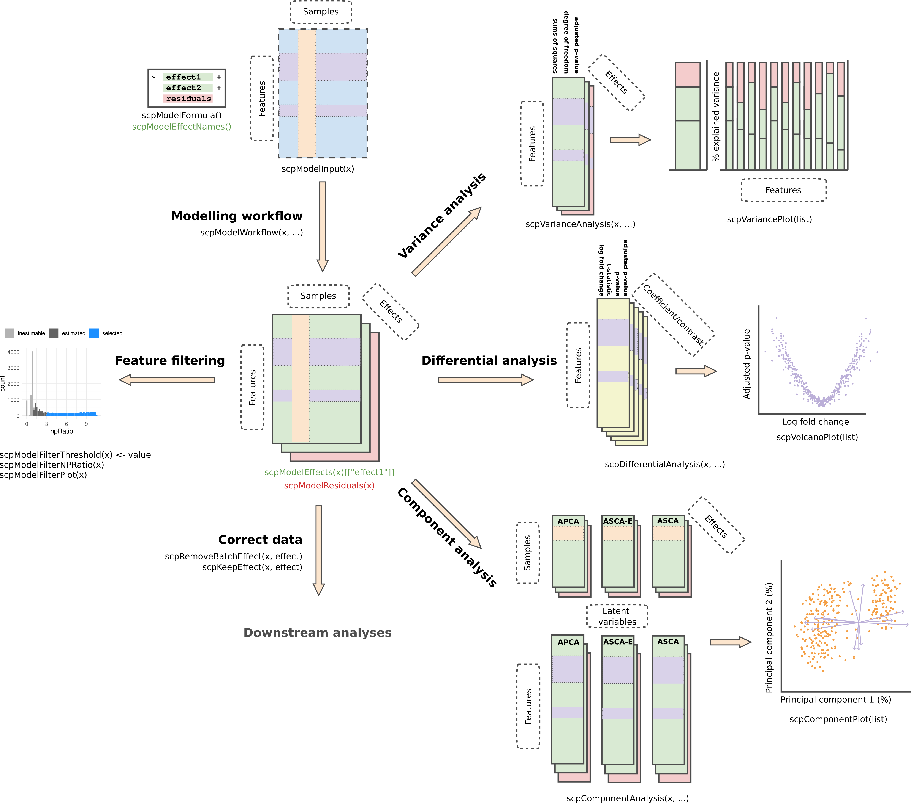

scplainer modelling workflow

The vignette will start with the processed data extracted as a
`SingleCellExperiment` object from a processed `QFeatures` object. Note
that using a `SummarizedExperiment` will also work, it will
automatically be converted to a `SingleCellExperiment` object with
`scpModelWorkflow`. We will not cover data processing as it is covered
in another vignette.

\
[`library`](https://rdrr.io/r/base/library.html)`(`[`"scp"`](https://UCLouvain-CBIO.github.io/scp)`)`\
[`library`](https://rdrr.io/r/base/library.html)`(`[`"SingleCellExperiment"`](https://github.com/drisso/SingleCellExperiment)`)`\
[`library`](https://rdrr.io/r/base/library.html)`(`[`"patchwork"`](https://patchwork.data-imaginist.com)`)`\
[`library`](https://rdrr.io/r/base/library.html)`(`[`"ggplot2"`](https://ggplot2.tidyverse.org)`)`

## Example data set

The example data set is a subset of the `leduc2022_pSCoPE` data set (see
[`?scpdata::leduc2022_pSCoPE`](https://UCLouvain-CBIO.github.io/scpdata/reference/leduc2022_pSCoPE.html)
for more info). The data is acquired using TMT-18 multiplexing and
data-dependent acquisition (DDA). The data has been processed using a
minimal workflow:

- Any zero value has been replaced by NA.
- Any peptide was removed from the data set if it matched to a decoy or
  contaminant peptide, had low spectral purity, had low identification
  confidence, or had a high sample to carrier ratio.
- Any cell was removed from the data set if it had a high coefficient of
  variation, had an abberrant median intensity, or had few identified
  peptides.
- PSM data were combined into peptide data. When multiple PSM match to
  the same peptide, the median intensity was taken.
- Intensities were log2 transformed
- To limit intensive computation, we have limited the data set to 200
  peptides in 73 cells.

We suggest using this minimal processing workflow, although the approach
presented here is agnostic of previous processing and allows for other
custom workflows. The data processing was conducted with `QFeatures` and
`scp`.

\
[`data`](https://rdrr.io/r/utils/data.html)`(``"leduc_minimal"``)`\
`leduc_minimal`\
`#> class: SingleCellExperiment `\
`#> dim: 200 73 `\
`#> metadata(1): model`\
`#> assays(1): ''`\
`#> rownames(200): SAVEDEGLK APNVVVTR ... FLLAVSRDR EASMVITESPAALQLR`\
`#> rowData names(6): Sequence Reverse ... Leading.razor.protein.symbol`\
`#>   gene`\
`#> colnames(73): eAL00219RI5 eAL00219RI6 ... wAL00286RI17 wAL00286RI18`\
`#> colData names(12): Set Channel ... MedianCV passQC`\
`#> reducedDimNames(0):`\
`#> mainExpName: NULL`\
`#> altExpNames(0):`

The data set is formatted as a `SingleCellExperiment` object. The data
set consists of 200 peptides and 73 cells. Peptide annotations can be
retrieved from the `rowData` and cell annotations can be retrieved from
the `colData`. The cell annotation will be used during modelling.

A full reanalysis of Leduc’s nPOP dataset is also available
[here](https://uclouvain-cbio.github.io/SCP.replication/articles/scplainer_leduc2022.html).

## Data modelling

The core of the approach relies on statistical modelling of the data
using linear regression. Under the hood, the model fetches as input the
intensity matrix stored in `assay(leduc_minimal)`. The cell annotations
are retrieved using `colData(leduc_minimal)`. They describe known
technical and biological variables that may influence the acquired
peptide intensities. The annotations are used to build a regression
model with $`p`$ parameters. Then, the model estimates the coefficients.
Coefficients provide the contributions of each parameter to the
expression of each of peptide as well as the uncertainty of the
estimation. These will be explored in the following section.

We’ll start by defining the variables to include in the model. Recall
that the example data set contains TMT-labeled cells. This means that
each MS acquisition run contains multiple cells. Each run is subject to
technical fluctuations that can lead to undesired variation, this is
known as a batch effect.

\
[`table`](https://rdrr.io/r/base/table.html)`(``leduc_minimal``$``Set``)`\
`#> `\
`#> eAL00219 eAL00220 eAL00221 wAL00284 wAL00285 wAL00286 `\
`#>       13       12       12       12       12       12`

The labelling reagent (`Channel`) can also lead to undesired systematic
effects and will also be considered as a source for batch effects.

\
[`table`](https://rdrr.io/r/base/table.html)`(``leduc_minimal``$``Channel``)`\
`#> `\
`#>  TMT126 TMT127N TMT127C TMT128N TMT128C TMT129N TMT129C TMT130N TMT130C TMT131N `\
`#>       0       0       0       0       6       5       6       6       5       4 `\
`#> TMT131C TMT132N TMT132C TMT133N TMT133C TMT134N TMT134C TMT135N `\
`#>       5       5       5       6       5       5       5       5`

Finally, each cell is processed individually and the amount of peptide
material recovered from each cell may lead to undesired variation as
well. This issue is usually solved through normalization, such as
removing the median intensity from each cell. Normalization was
internationally omitted in the minimal data processing so that we can
account for it during modelling. The median intensity were already
computed (`MedianIntensity`).

\
[`hist`](https://rdrr.io/r/graphics/hist.html)`(``leduc_minimal``$``MedianIntensity``, breaks ``=`` ``10``)`

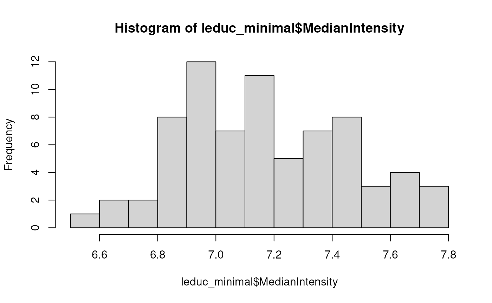

Finally, the biological variable of interest in the example data set is
the cell type that is known because cells come from 2 cell lines
(`SampleType`).

\
[`table`](https://rdrr.io/r/base/table.html)`(``leduc_minimal``$``SampleType``)`\
`#> `\
`#> Melanoma Monocyte `\
`#>       37       36`

We create a `formula` object that will define which variable must be
modelled in our analysis.

\
`f`` ``<-`` ``~`` ``1`` ``+`` ``## intercept`\
`    ``Channel`` ``+`` ``Set`` ``+`` ``## batch variables`\
`    ``MedianIntensity`` ``+`` ``## normalization`\
`    ``SampleType`` ``## biological variable`

Note that the formula can be adapted to the data set. For instance, no
labelling reagents is used for LFQ experiments, so it can be dropped.
Similarly, each cell in an LFQ experiment is acquired in a single run so
MS run cannot be used as a batch effect variable. The day of acquisition
could be used instead.

Once a model is defined, we fit it with
[`scpModelWorkflow()`](https://UCLouvain-CBIO.github.io/scp/reference/ScpModel-Workflow.md).

\
`leduc_minimal`` ``<-`` `[`scpModelWorkflow`](https://UCLouvain-CBIO.github.io/scp/reference/ScpModel-Workflow.md)`(``leduc_minimal``, formula ``=`` ``f``)`\
`#> Warning in scpModelWorkflow(leduc_minimal, formula = f): An element called`\
`#> 'model' is already present in the metadata. The associated content will be`\
`#> overwritten.`

You can always retrieve the formula that was used to fit model using

\
[`scpModelFormula`](https://UCLouvain-CBIO.github.io/scp/reference/ScpModel-class.md)`(``leduc_minimal``)`\
`#> ~1 + Channel + Set + MedianIntensity + SampleType`

The data that is modelled by each variable are contained in the
so-called effect matrices.

\
[`scpModelEffects`](https://UCLouvain-CBIO.github.io/scp/reference/ScpModel-class.md)`(``leduc_minimal``)`\
`#> List of length 4`\
`#> names(4): Channel Set MedianIntensity SampleType`

Similarly, the data that could not be captured by the model are
contained in the residual matrix.

\
[`scpModelResiduals`](https://UCLouvain-CBIO.github.io/scp/reference/ScpModel-class.md)`(``leduc_minimal``)``[``1``:``5``, ``1``:``5``]`\
`#>                eAL00219RI5 eAL00219RI6 eAL00219RI7 eAL00219RI8 eAL00219RI9`\
`#> SAVEDEGLK               NA          NA          NA          NA          NA`\
`#> APNVVVTR        -0.2112685   0.2569749 -0.08076257 -0.03317054  0.06679681`\
`#> IVVVTAGVR               NA          NA          NA          NA          NA`\
`#> GFQEVVTPNIFNSR   0.6375780  -0.3356473  0.34648412 -0.80982152  0.96378484`\
`#> ENAYDLEANLAVLK          NA          NA          NA          NA          NA`

Finally, the input data used to model the can also be retrieved.

\
[`scpModelInput`](https://UCLouvain-CBIO.github.io/scp/reference/ScpModel-class.md)`(``leduc_minimal``)``[``1``:``5``, ``1``:``5``]`\
`#>                eAL00219RI5 eAL00219RI6 eAL00219RI7 eAL00219RI8 eAL00219RI9`\
`#> SAVEDEGLK               NA          NA          NA          NA          NA`\
`#> APNVVVTR          13.56997    13.85389   13.362218   13.110304    14.03041`\
`#> IVVVTAGVR               NA          NA          NA          NA          NA`\
`#> GFQEVVTPNIFNSR    10.78733     9.36700    9.815223    7.878296    11.01890`\
`#> ENAYDLEANLAVLK          NA          NA          NA          NA          NA`

Note that the number of peptides changed. This is the consequence of
peptide filtering.

\
[`dim`](https://rdrr.io/r/base/dim.html)`(`[`scpModelInput`](https://UCLouvain-CBIO.github.io/scp/reference/ScpModel-class.md)`(``leduc_minimal``)``)`\
`#> [1] 140  73`

## Peptide filtering

The proportion of missing values for each features is high in
single-cell proteomics data.

\
[`table`](https://rdrr.io/r/base/table.html)`(``missing ``=`` `[`is.na`](https://rdrr.io/r/base/NA.html)`(`[`assay`](https://rdrr.io/pkg/SummarizedExperiment/man/SummarizedExperiment-class.html)`(``leduc_minimal``)``)``)`\
`#> missing`\
`#> FALSE  TRUE `\
`#>  5954  8646`

Many features can typically contain more coefficients to estimate than
observed values. These features cannot be estimated and will be ignored
during further steps. These features are identified by computing the
ratio between the number of observed values and the number of
coefficients to estimate. We call it the n/p ratio. You can extract the
n/p ratio for each feature:

\
[`head`](https://rdrr.io/r/utils/head.html)`(`[`scpModelFilterNPRatio`](https://UCLouvain-CBIO.github.io/scp/reference/ScpModel-class.md)`(``leduc_minimal``)``)`\
`#>      SAVEDEGLK       APNVVVTR      IVVVTAGVR GFQEVVTPNIFNSR ENAYDLEANLAVLK `\
`#>       1.277778       3.476190       1.411765       2.333333       1.235294 `\
`#>      IGPLGLSPK `\
`#>       1.888889`

Once the model is estimated, use
[`scpModelFilterPlot()`](https://UCLouvain-CBIO.github.io/scp/reference/ScpModel-Workflow.md)
to explore the distribution of n/p ratios across the features.

\
[`scpModelFilterPlot`](https://UCLouvain-CBIO.github.io/scp/reference/ScpModel-Workflow.md)`(``leduc_minimal``)`\
`#> To change the threshold, use:`\
`#> scpModelFilterThreshold(object, name) <- threshold`

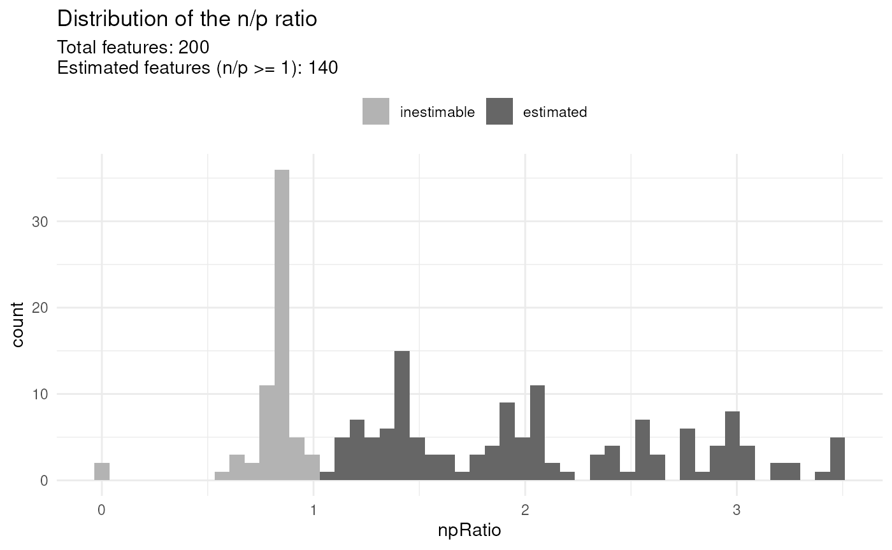

By default, any feature that has an n/p ration greater than 1 is
included in the analysis. However, feature with an n/p ratio close to 1
may lead to unreliable outcome because there are not enough observed
data. You could consider the n/p ratio as the average number of
replicate per coefficient to estimate. Therefore, you may want to
increase the n/p threshold.

\
[`scpModelFilterThreshold`](https://UCLouvain-CBIO.github.io/scp/reference/ScpModel-class.md)`(``leduc_minimal``)`` ``## default is 1`\
`#> [1] 1`\
[`scpModelFilterThreshold`](https://UCLouvain-CBIO.github.io/scp/reference/ScpModel-class.md)`(``leduc_minimal``)`` ``<-`` ``1.5`\
[`scpModelFilterThreshold`](https://UCLouvain-CBIO.github.io/scp/reference/ScpModel-class.md)`(``leduc_minimal``)`` ``## threshold is now 1.5`\
`#> [1] 1.5`

The plot is automatically updated.

\
[`scpModelFilterPlot`](https://UCLouvain-CBIO.github.io/scp/reference/ScpModel-Workflow.md)`(``leduc_minimal``)`\
`#> To change the threshold, use:`\
`#> scpModelFilterThreshold(object, name) <- threshold`

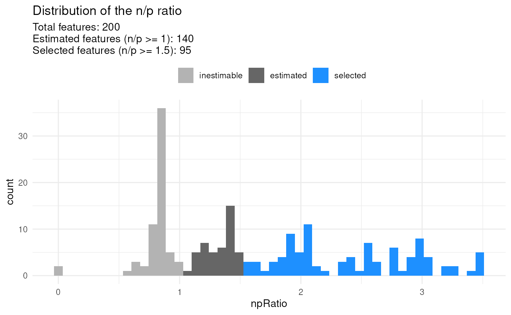

There is no guidelines for defining a suitable threshold. If too low,
you may include noisy peptides that have too few observations. If too
high, you may remove many informative peptides. The definition of the
threshold relies on a trade off between precision and sensitivity.

## Model exploration: analysis of variance

The variance analysis reports the relative amount of information that is
captured by each cell annotation included in the model. The model also
includes the residual information that is not captured by the model.
This offers a first glimpse into what information is contained in the
data.

\
`(``vaRes`` ``<-`` `[`scpVarianceAnalysis`](https://UCLouvain-CBIO.github.io/scp/reference/ScpModel-VarianceAnalysis.md)`(``leduc_minimal``)``)`\
`#> DataFrameList of length 5`\
`#> names(5): Residuals Channel Set MedianIntensity SampleType`

The results are a list of tables, one table for each variable. Each
table reports for each peptide the variance captures (`SS`), the
residual degrees of freedom for estimating the variance (`df`) and the
percentage of total variance explained (`percentExplainedVar`).

\
`vaRes``$``SampleType`\
`#> DataFrame with 95 rows and 4 columns`\
`#>           feature         SS        df percentExplainedVar`\
`#>       <character>  <numeric> <numeric>           <numeric>`\
`#> 1        APNVVVTR 27.8682309        52           33.052188`\
`#> 2   GFQEVVTPNI...  0.1106189        28            0.392004`\
`#> 3       IGPLGLSPK  0.0442532        16            0.242434`\
`#> 4   VAETANEEEV...  0.4973533        11            2.694342`\
`#> 5   IDATSASVLA...  0.9271610        36            2.174504`\
`#> ...           ...        ...       ...                 ...`\
`#> 91  SVPTSTVFYP...    1.88199        48             4.60836`\
`#> 92      HIVENAVQK    1.05939        19             4.80442`\
`#> 93  TDMDNQIVVS...    4.31709         9            24.56762`\
`#> 94       AILGSVER    2.51736        16            15.90057`\
`#> 95     LGAEVYHTLK    2.47027        15            10.14771`

By default, we explore the variance for all peptides combined:

\
[`scpVariancePlot`](https://UCLouvain-CBIO.github.io/scp/reference/ScpModel-VarianceAnalysis.md)`(``vaRes``)`

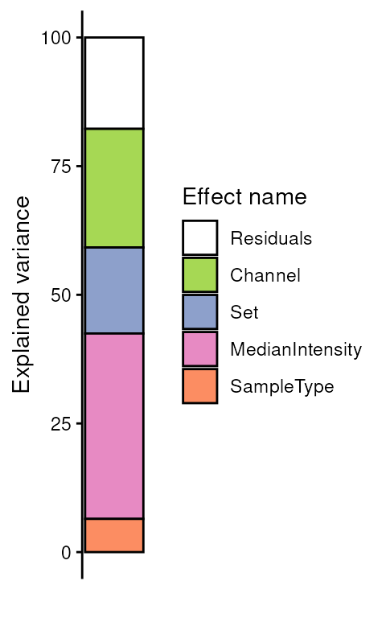

We explore the top 20 peptides that are have the highest percentage of
variance explained by the biological variable (top) or by the batch
variable (bottom).

\
[`scpVariancePlot`](https://UCLouvain-CBIO.github.io/scp/reference/ScpModel-VarianceAnalysis.md)`(`\
`    ``vaRes``, top ``=`` ``10``, by ``=`` ``"percentExplainedVar"``, effect ``=`` ``"SampleType"``,`\
`    decreasing ``=`` ``TRUE``, combined ``=`` ``FALSE`\
`)`` ``+`\
`    `[`scpVariancePlot`](https://UCLouvain-CBIO.github.io/scp/reference/ScpModel-VarianceAnalysis.md)`(`\
`    ``vaRes``, top ``=`` ``10``, by ``=`` ``"percentExplainedVar"``, effect ``=`` ``"Set"``,`\
`    decreasing ``=`` ``TRUE``, combined ``=`` ``FALSE`\
`)`` ``+`\
`    `[`plot_layout`](https://patchwork.data-imaginist.com/reference/plot_layout.html)`(``ncol ``=`` ``1``, guides ``=`` ``"collect"``)`

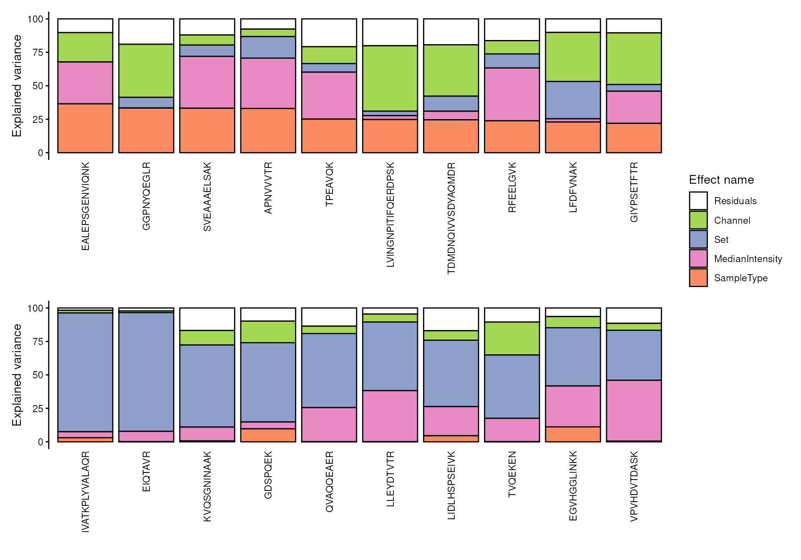

We can also group the peptide by protein. To do so, we first need to add
the peptides annotations available from the `rowData`.

\
`vaRes`` ``<-`` `[`scpAnnotateResults`](https://UCLouvain-CBIO.github.io/scp/reference/scpAnnotateResults.md)`(`\
`    ``vaRes``, `[`rowData`](https://rdrr.io/pkg/SummarizedExperiment/man/SummarizedExperiment-class.html)`(``leduc_minimal``)``, by ``=`` ``"feature"``, by2 ``=`` ``"Sequence"`\
`)`\
`vaRes``$``SampleType`\
`#> DataFrame with 95 rows and 9 columns`\
`#>           feature         SS        df percentExplainedVar     Reverse`\
`#>       <character>  <numeric> <numeric>           <numeric> <character>`\
`#> 1        APNVVVTR 27.8682309        52           33.052188            `\
`#> 2   GFQEVVTPNI...  0.1106189        28            0.392004            `\
`#> 3       IGPLGLSPK  0.0442532        16            0.242434            `\
`#> 4   VAETANEEEV...  0.4973533        11            2.694342            `\
`#> 5   IDATSASVLA...  0.9271610        36            2.174504            `\
`#> ...           ...        ...       ...                 ...         ...`\
`#> 91  SVPTSTVFYP...    1.88199        48             4.60836            `\
`#> 92      HIVENAVQK    1.05939        19             4.80442            `\
`#> 93  TDMDNQIVVS...    4.31709         9            24.56762            `\
`#> 94       AILGSVER    2.51736        16            15.90057            `\
`#> 95     LGAEVYHTLK    2.47027        15            10.14771            `\
`#>     Potential.contaminant Leading.razor.protein.id Leading.razor.protein.symbol`\
`#>               <character>              <character>                  <character>`\
`#> 1                                           P52566                        GDIR2`\
`#> 2                                           P26639                         SYTC`\
`#> 3                                           P30050                         RL12`\
`#> 4                                           P61221                        ABCE1`\
`#> 5                                           P13667                        PDIA4`\
`#> ...                   ...                      ...                          ...`\
`#> 91                                          P29401                          TKT`\
`#> 92                                          O00410                         IPO5`\
`#> 93                                          P50991                         TCPD`\
`#> 94                                          P26639                         SYTC`\
`#> 95                                          P09104                         ENOG`\
`#>            gene`\
`#>     <character>`\
`#> 1       ARHGDIB`\
`#> 2          TARS`\
`#> 3         RPL12`\
`#> 4         ABCE1`\
`#> 5         PDIA4`\
`#> ...         ...`\
`#> 91          TKT`\
`#> 92         IPO5`\
`#> 93         CCT4`\
`#> 94         TARS`\
`#> 95         ENO2`

Then, we draw the same plot, but this time we provide the `fcol`
argument.

\
[`scpVariancePlot`](https://UCLouvain-CBIO.github.io/scp/reference/ScpModel-VarianceAnalysis.md)`(`\
`    ``vaRes``, top ``=`` ``10``, by ``=`` ``"percentExplainedVar"``, effect ``=`` ``"SampleType"``,`\
`    decreasing ``=`` ``TRUE``, combined ``=`` ``FALSE``, fcol ``=`` ``"gene"`\
`)`` ``+`\
`    `[`scpVariancePlot`](https://UCLouvain-CBIO.github.io/scp/reference/ScpModel-VarianceAnalysis.md)`(`\
`    ``vaRes``, top ``=`` ``10``, by ``=`` ``"percentExplainedVar"``, effect ``=`` ``"Set"``,`\
`    decreasing ``=`` ``TRUE``, combined ``=`` ``FALSE``, fcol ``=`` ``"gene"`\
`)`` ``+`\
`    `[`plot_layout`](https://patchwork.data-imaginist.com/reference/plot_layout.html)`(``ncol ``=`` ``1``, guides ``=`` ``"collect"``)`

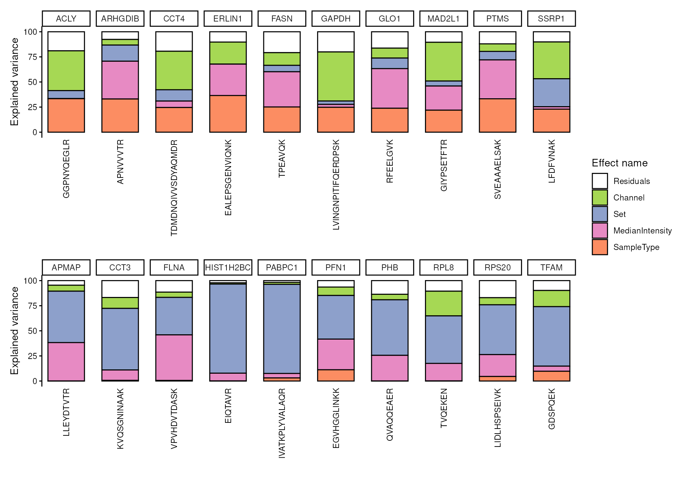

In this example dataset, we retrieve peptides that all belong to a
different protein, however grouping becomes interesting when analyzing
real data sets.

Alternatively, we can generate protein level results by aggregating
peptide level results.

\
`vaProtein`` ``<-`` `[`scpVarianceAggregate`](https://UCLouvain-CBIO.github.io/scp/reference/ScpModel-VarianceAnalysis.md)`(``vaRes``, fcol ``=`` ``"gene"``)`\
[`scpVariancePlot`](https://UCLouvain-CBIO.github.io/scp/reference/ScpModel-VarianceAnalysis.md)`(`\
`    ``vaProtein``, effect ``=`` ``"SampleType"``, top ``=`` ``10``, combined ``=`` ``FALSE`\
`)`

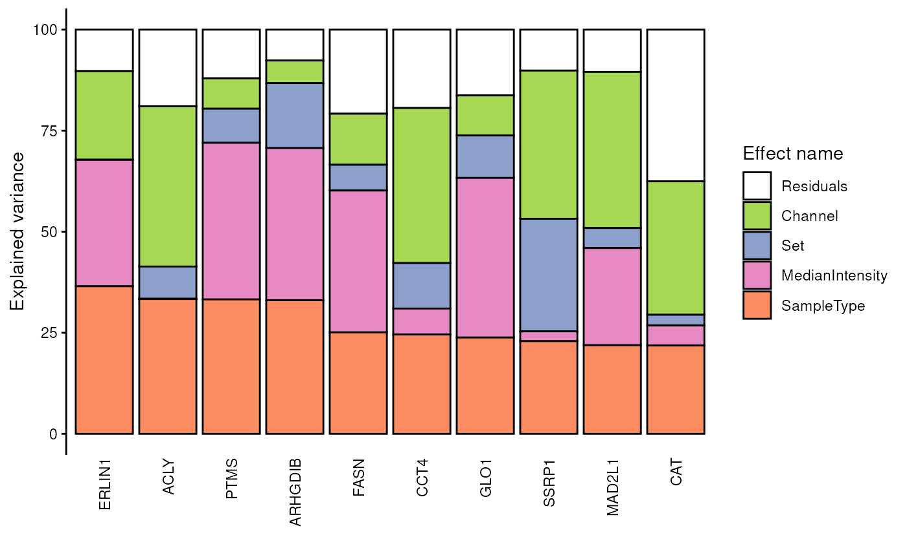

## Model exploration: differential abundance analysis

Differential abundance analysis dives deeper into the exploration of the
data, namely for exploring the biological effects. Given two groups of
interest, such as two cell types or two treatment groups, the
differential analysis derives estimated fold changes from the linear
model’s coefficients. This provides information, for each peptide or
protein, the amount of change between the two groups and the direction
of the change. Moreover, the model provides the uncertainty of the
differences, enabling the assessment of the statistical significance.

The difference of interest is specified using the `contrast` argument.
The first element points to the variable to test and the two following
element are the groups of interest to compare. You can provide multiple
contrast in a list.

\
`(``daRes`` ``<-`` `[`scpDifferentialAnalysis`](https://UCLouvain-CBIO.github.io/scp/reference/ScpModel-DifferentialAnalysis.md)`(`\
`    ``leduc_minimal``,`\
`    contrasts ``=`` `[`list`](https://rdrr.io/r/base/list.html)`(`[`c`](https://rdrr.io/r/base/c.html)`(``"SampleType"``, ``"Melanoma"``, ``"Monocyte"``)``)`\
`)``)`\
`#> DataFrameList of length 1`\
`#> names(1): SampleType_Melanoma_vs_Monocyte`

Similarly to variance analysis, the results are a list of tables, one
table for each contrast. Each table reports for each peptide the
estimated difference between the two groups, the standard error
associated to the estimation, the degrees of freedom, the t-statistics,
the associated p-value and the p-value FDR-adjusted for multiple testing
across all peptides.

\
`daRes``$``SampleType_Melanoma_vs_Monocyte`\
`#> DataFrame with 95 rows and 7 columns`\
`#>           feature   Estimate        SE        Df tstatistic      pvalue`\
`#>       <character>  <numeric> <numeric> <numeric>  <numeric>   <numeric>`\
`#> 1        APNVVVTR  1.2357291  0.140225        52   8.812466 6.77782e-12`\
`#> 2   GFQEVVTPNI... -0.0950269  0.312985        28  -0.303615 7.63666e-01`\
`#> 3       IGPLGLSPK -0.0721544  0.375395        16  -0.192209 8.49997e-01`\
`#> 4   VAETANEEEV... -0.2619169  0.486300        11  -0.538591 6.00898e-01`\
`#> 5   IDATSASVLA... -0.2573437  0.249598        36  -1.031031 3.09404e-01`\
`#> ...           ...        ...       ...       ...        ...         ...`\
`#> 91  SVPTSTVFYP...  -0.330304  0.202807        48  -1.628658    0.109932`\
`#> 92      HIVENAVQK   0.338421  0.495880        19   0.682466    0.503181`\
`#> 93  TDMDNQIVVS...   0.814964  1.103851         9   0.738292    0.479146`\
`#> 94       AILGSVER   0.544206  0.368422        16   1.477127    0.159054`\
`#> 95     LGAEVYHTLK   0.547198  0.521144        15   1.049995    0.310344`\
`#>            padj`\
`#>       <numeric>`\
`#> 1   6.43893e-10`\
`#> 2   8.91820e-01`\
`#> 3   9.06232e-01`\
`#> 4   8.64161e-01`\
`#> 5   6.81383e-01`\
`#> ...         ...`\
`#> 91     0.521039`\
`#> 92     0.810207`\
`#> 93     0.789070`\
`#> 94     0.521039`\
`#> 95     0.681383`

We then visualize the results using a volcano plot. The function below
return a volcano plot for each contrast.

\
[`scpVolcanoPlot`](https://UCLouvain-CBIO.github.io/scp/reference/ScpModel-DifferentialAnalysis.md)`(``daRes``)`\
`#> $SampleType_Melanoma_vs_Monocyte`

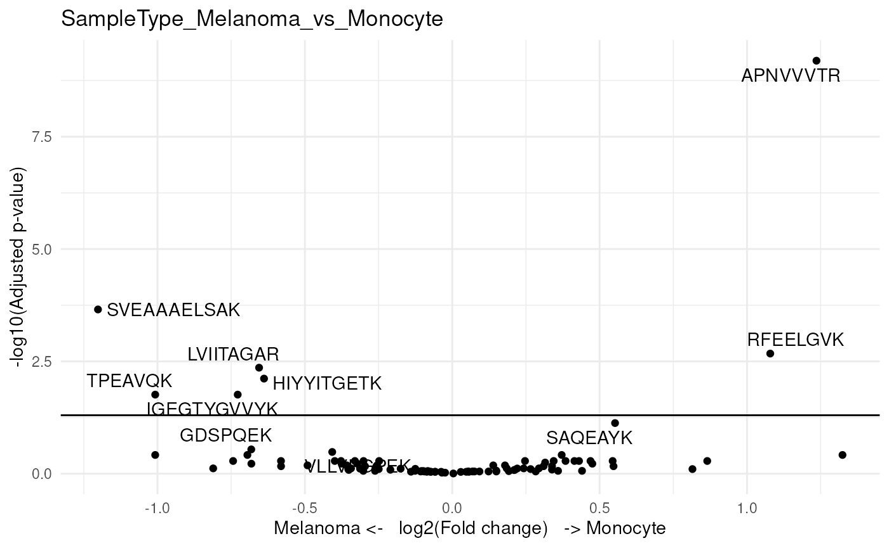

Since we subset the data set for only a few cell, we lack statistical
power. Still, two peptides come out as significant. Again, to better
explore the results, we add peptide annotations available from the
`rowData`, but we also add the n/p ratio as annotation.

\
`daRes`` ``<-`` `[`scpAnnotateResults`](https://UCLouvain-CBIO.github.io/scp/reference/scpAnnotateResults.md)`(`\
`    ``daRes``, `[`rowData`](https://rdrr.io/pkg/SummarizedExperiment/man/SummarizedExperiment-class.html)`(``leduc_minimal``)``,`\
`    by ``=`` ``"feature"``, by2 ``=`` ``"Sequence"`\
`)`\
`np`` ``<-`` `[`scpModelFilterNPRatio`](https://UCLouvain-CBIO.github.io/scp/reference/ScpModel-class.md)`(``leduc_minimal``)`\
`daRes`` ``<-`` `[`scpAnnotateResults`](https://UCLouvain-CBIO.github.io/scp/reference/scpAnnotateResults.md)`(`\
`    ``daRes``, `[`data.frame`](https://rdrr.io/r/base/data.frame.html)`(``feature ``=`` `[`names`](https://rdrr.io/r/base/names.html)`(``np``)``, npRatio ``=`` ``np``)``,`\
`    by ``=`` ``"feature"`\
`)`

We plot the same volcano plot, but instead of labeling points with the
peptide sequence, we will show the associated gene symbol. Also, we can
control for point aesthetics by providing a list of
[`ggplot2::geom_point()`](https://ggplot2.tidyverse.org/reference/geom_point.html)
arguments. For example, we can colour each point based on the n/p ratio,
and adjust point size and shape.

\
[`scpVolcanoPlot`](https://UCLouvain-CBIO.github.io/scp/reference/ScpModel-DifferentialAnalysis.md)`(`\
`    ``daRes``, top ``=`` ``30``, textBy ``=`` ``"gene"``,`\
`    pointParams ``=`` `[`list`](https://rdrr.io/r/base/list.html)`(`[`aes`](https://ggplot2.tidyverse.org/reference/aes.html)`(``colour ``=`` ``npRatio``)``, size ``=`` ``1.5``, shape ``=`` ``3``)`\
`)`\
`#> $SampleType_Melanoma_vs_Monocyte`

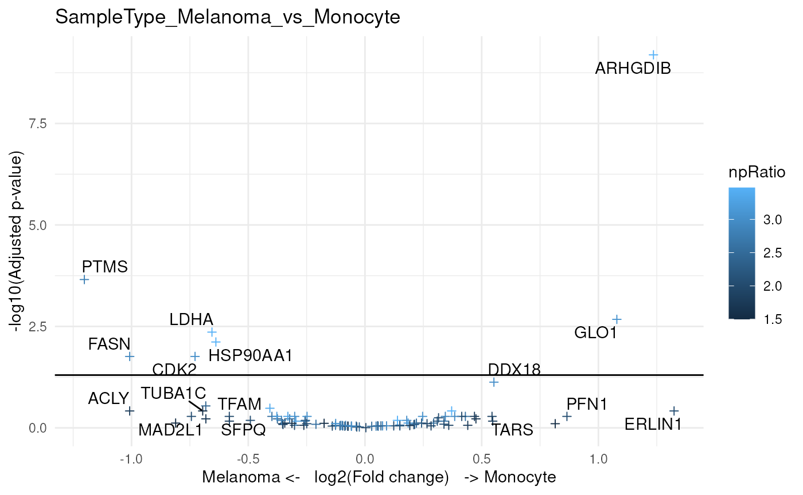

We can also provide protein-level results. To do so, the
[`scpDifferentialAggregate()`](https://UCLouvain-CBIO.github.io/scp/reference/ScpModel-DifferentialAnalysis.md)
relies on the `metapod` package. We here combine the statistical test
results for peptides that belong to the same protein using Simes’
method. Simes’ method will reject the combined null hypothesis (that is
the mean **protein** intensities are identical between two groups) if
any of the peptide nulls are rejected.

\
`byProteinDA`` ``<-`` `[`scpDifferentialAggregate`](https://UCLouvain-CBIO.github.io/scp/reference/ScpModel-DifferentialAnalysis.md)`(`\
`    ``daRes``, fcol ``=`` ``"gene"``, method ``=`` ``"simes"`\
`)`\
`byProteinDA``$``SampleType_Melanoma_vs_Monocyte`\
`#> DataFrame with 86 rows and 10 columns`\
`#>         feature   Estimate    pvalue      padj     Reverse`\
`#>     <character>  <numeric> <numeric> <numeric> <character>`\
`#> 1         ABCE1 -0.2619169 0.6008984  0.856797            `\
`#> 2          ACLY -1.0078958 0.0564024  0.404217            `\
`#> 3         ACTN4 -0.0576889 0.8105808  0.910420            `\
`#> 4         AIFM1  0.4300612 0.1488197  0.530259            `\
`#> 5         APMAP  0.0683780 0.7445601  0.901862            `\
`#> ...         ...        ...       ...       ...         ...`\
`#> 82         TPP2 -0.2494580 0.4703385  0.812359            `\
`#> 83       TUBA1C -0.6951016 0.0492061  0.384702            `\
`#> 84         VAT1 -0.4073205 0.0691403  0.457390            `\
`#> 85        XRCC6  0.0289353 0.8832055  0.915129            `\
`#> 86        YWHAG -0.0979855 0.6550366  0.873363            `\
`#>     Potential.contaminant Leading.razor.protein.id Leading.razor.protein.symbol`\
`#>               <character>              <character>                  <character>`\
`#> 1                                           P61221                        ABCE1`\
`#> 2                                           P53396                         ACLY`\
`#> 3                                           O43707                        ACTN4`\
`#> 4                                           O95831                        AIFM1`\
`#> 5                                           Q9HDC9                        APMAP`\
`#> ...                   ...                      ...                          ...`\
`#> 82                                          P29144                         TPP2`\
`#> 83                                          Q9BQE3                        TBA1C`\
`#> 84                                          Q99536                         VAT1`\
`#> 85                                          P12956                        XRCC6`\
`#> 86                                          P61981                        1433G`\
`#>            gene        .n`\
`#>     <character> <integer>`\
`#> 1         ABCE1         1`\
`#> 2          ACLY         1`\
`#> 3         ACTN4         1`\
`#> 4         AIFM1         1`\
`#> 5         APMAP         1`\
`#> ...         ...       ...`\
`#> 82         TPP2         1`\
`#> 83       TUBA1C         1`\
`#> 84         VAT1         2`\
`#> 85        XRCC6         1`\
`#> 86        YWHAG         1`

## Model exploration: component analysis

Variance and differential analysis are not specific to single-cell
applications and explore the data without considering cellular
heterogeneity. The purpose of the component analysis is to dive into the
cellular heterogeneity by representing highly dimensional data in a few
informative dimensions for visual exploration. We integrate the
component analysis with the linear regression model thanks to the APCA+
(extended ANOVA-simultaneous component analysis) framework developed by
[Thiel et al. 2017](http://dx.doi.org/10.1002/cem.2895). Briefly, APCA+
explores the reconstructed data that is captured by each variable
separately in the presence of the unmodelled data. The advantage of this
framework is it is generic and works for any linear model. Also, this
approach is well suited for single-cell applications as it enables the
visualization and exploration of the effects of a known variable along
the unmodelled information that contains cellular heterogeneity.

\
`(``caRes`` ``<-`` `[`scpComponentAnalysis`](https://UCLouvain-CBIO.github.io/scp/reference/ScpModel-ComponentAnalysis.md)`(`\
`    ``leduc_minimal``, ncomp ``=`` ``20``, method ``=`` ``"APCA"``, effect ``=`` ``"SampleType"`\
`)``)`\
`#> List of length 2`\
`#> names(2): bySample byFeature`

The results are contained in a list with 2 elements. `bySample` contains
the PC scores, that is the component results in cell space. `byFeature`
contains the eigenvectors, that is the component results in peptide
space. Each of the two elements contains components results for the data
before modelling (`unmodelled`), for the residuals or for the APCA on
the sample type variable (`APCA_SampleType`).

\
`(``caResCells`` ``<-`` ``caRes``$``bySample``)`\
`#> List of length 3`\
`#> names(3): unmodelled residuals APCA_SampleType`\
`caResCells``[[``1``]``]`\
`#> DataFrame with 73 rows and 21 columns`\
`#>                    PC1       PC2       PC3       PC4        PC5       PC6`\
`#>              <numeric> <numeric> <numeric> <numeric>  <numeric> <numeric>`\
`#> eAL00219RI5   1.653516  3.698366  -4.18217 -1.077512  0.0956654  1.411502`\
`#> eAL00219RI6   0.124226  5.142065  -5.45494  0.183611 -0.3273944  1.050448`\
`#> eAL00219RI7  -1.354375  6.025857  -5.02287  0.375317 -2.1400461  0.268444`\
`#> eAL00219RI8  -2.698798  4.472541  -5.31702  0.550704 -1.5251900 -0.327222`\
`#> eAL00219RI9   2.546058  0.578461  -5.31225  0.722614 -0.1303379  4.501154`\
`#> ...                ...       ...       ...       ...        ...       ...`\
`#> wAL00286RI12  -7.98783 -1.854968  0.753841  2.716489   0.423979  1.680389`\
`#> wAL00286RI14  -8.20364 -0.743809  1.540723 -1.594997   2.782569  0.459709`\
`#> wAL00286RI16  -1.81335 -2.412619  3.965124 -1.738014   0.108868 -0.706461`\
`#> wAL00286RI17  -2.86818 -3.396436 -1.531958 -1.528856  -2.417139  0.188805`\
`#> wAL00286RI18  -2.26068 -4.274327  0.985728 -0.145893  -1.420106 -1.263054`\
`#>                    PC7       PC8       PC9       PC10      PC11       PC12`\
`#>              <numeric> <numeric> <numeric>  <numeric> <numeric>  <numeric>`\
`#> eAL00219RI5   -1.42379 -0.559392  1.787672  -0.461175 -3.407914  -0.267646`\
`#> eAL00219RI6   -2.04069  0.255092  2.250991   0.758978 -1.303712   0.482308`\
`#> eAL00219RI7   -1.26926 -1.930094 -0.252928   0.784961 -1.829851   2.680438`\
`#> eAL00219RI8   -1.31622 -0.881211 -0.791599   2.275076  2.013713   0.738281`\
`#> eAL00219RI9    1.26033  0.781721 -0.551692  -0.643164 -0.635137  -0.925461`\
`#> ...                ...       ...       ...        ...       ...        ...`\
`#> wAL00286RI12  1.104572 -0.819371 -0.220998 -0.4937036  1.078082 -1.0226599`\
`#> wAL00286RI14  0.979761 -0.935739  3.859382 -1.0425268  0.344886  0.0285479`\
`#> wAL00286RI16  3.797855 -1.642257  1.376276 -1.5364477 -0.845131  2.4891612`\
`#> wAL00286RI17  1.884786 -0.696615 -0.625867  0.0431676 -0.457697  1.9781557`\
`#> wAL00286RI18  1.589950 -1.010616 -0.129642  0.8688906 -0.069454  0.9878668`\
`#>                    PC13       PC14      PC15      PC16       PC17      PC18`\
`#>               <numeric>  <numeric> <numeric> <numeric>  <numeric> <numeric>`\
`#> eAL00219RI5   1.2890313 -0.6485149  0.289585 -0.350677  0.2642067 -0.106733`\
`#> eAL00219RI6  -0.0587720  0.0381351 -0.997905 -0.618020 -0.0984977  0.406899`\
`#> eAL00219RI7   0.1479570 -0.9992501 -1.299092  0.374856 -1.2807823 -0.216289`\
`#> eAL00219RI8  -0.0578910 -0.1310913 -0.335205 -1.628715  0.9607245  0.703061`\
`#> eAL00219RI9  -0.0696541  0.9102068  0.191626 -1.458565  0.1942829  0.469171`\
`#> ...                 ...        ...       ...       ...        ...       ...`\
`#> wAL00286RI12  1.2709097  -0.928431  0.818676  0.599505  0.0380280  0.367976`\
`#> wAL00286RI14 -1.4598356  -0.981437  1.372659  0.475191 -1.1814224  1.157990`\
`#> wAL00286RI16 -0.0812096   0.524766  0.318686 -1.276372  0.8213895 -0.204658`\
`#> wAL00286RI17 -2.3614528  -0.779987 -0.562138 -0.621833 -0.4923335  0.626003`\
`#> wAL00286RI18  0.2930262   0.864876 -0.306852  1.078100 -0.0351616 -0.100406`\
`#>                   PC19      PC20          cell`\
`#>              <numeric> <numeric>   <character>`\
`#> eAL00219RI5   0.231371 -0.513063 eAL00219RI...`\
`#> eAL00219RI6   0.117836  0.141045 eAL00219RI...`\
`#> eAL00219RI7   0.376891  0.783066 eAL00219RI...`\
`#> eAL00219RI8  -0.192060 -0.566277 eAL00219RI...`\
`#> eAL00219RI9   1.037655  1.121613 eAL00219RI...`\
`#> ...                ...       ...           ...`\
`#> wAL00286RI12  0.261747 1.4610846 wAL00286RI...`\
`#> wAL00286RI14 -0.613931 0.0859265 wAL00286RI...`\
`#> wAL00286RI16  1.097018 0.3416867 wAL00286RI...`\
`#> wAL00286RI17 -0.964126 0.8053553 wAL00286RI...`\
`#> wAL00286RI18 -2.154496 0.3140352 wAL00286RI...`

Let’s explore the component analysis in cell space. Similarly to the
previous explorations, we annotate the results.

\
`leduc_minimal``$``cell`` ``<-`` `[`colnames`](https://rdrr.io/r/base/colnames.html)`(``leduc_minimal``)`\
`caResCells`` ``<-`` `[`scpAnnotateResults`](https://UCLouvain-CBIO.github.io/scp/reference/scpAnnotateResults.md)`(`\
`    ``caResCells``, `[`colData`](https://rdrr.io/pkg/SummarizedExperiment/man/SummarizedExperiment-class.html)`(``leduc_minimal``)``, by ``=`` ``"cell"`\
`)`

We then generate the component plot. Providing the `pointParams`
argument, we can shape the points by `SampleType`. To assess the impact
of batch effects, we also colour the points according to the MS
acquisition run.

\
[`scpComponentPlot`](https://UCLouvain-CBIO.github.io/scp/reference/ScpModel-ComponentAnalysis.md)`(`\
`    ``caResCells``,`\
`    pointParams ``=`` `[`list`](https://rdrr.io/r/base/list.html)`(`[`aes`](https://ggplot2.tidyverse.org/reference/aes.html)`(``shape ``=`` ``SampleType``, colour ``=`` ``Set``)``)`\
`)`` ``|>`\
`    `[`wrap_plots`](https://patchwork.data-imaginist.com/reference/wrap_plots.html)`(``ncol ``=`` ``1``, guides ``=`` ``"collect"``)`

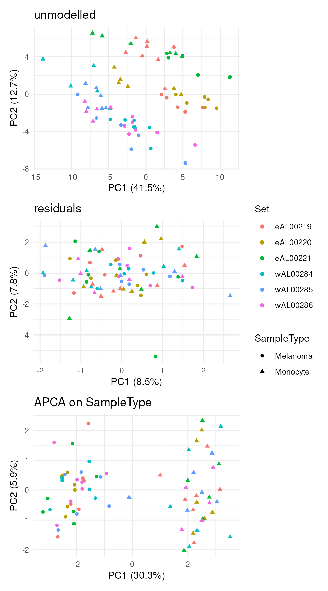

While the data before modelling is mainly driven by batch effects, the
APCA clearly separates the two cell populations. The plot can however
only show 2 components at a time. We can explore more components using a
subsequent dimension reduction, such as t-SNE. The `scater` package
offers a comprehensive set of tools for dimension reduction on data
contained in a `SingleCellExperiment` object and requires the components
to be stored in the `reducedDim` slot. This is streamlined thanks to
[`addReducedDims()`](https://UCLouvain-CBIO.github.io/scp/reference/addReducedDims.md).

\
`leduc_minimal`` ``<-`` `[`addReducedDims`](https://UCLouvain-CBIO.github.io/scp/reference/addReducedDims.md)`(``leduc_minimal``, ``caResCells``)`\
[`reducedDims`](https://rdrr.io/pkg/SingleCellExperiment/man/reducedDims.html)`(``leduc_minimal``)`\
`#> List of length 3`\
`#> names(3): unmodelled residuals APCA_SampleType`

We can now explore the `SampleType` effects for the 20 computed
components through t-SNE.

\
[`library`](https://rdrr.io/r/base/library.html)`(`[`"scater"`](http://bioconductor.org/packages/scater/)`)`\
`#> Loading required package: scuttle`\
`leduc_minimal`` ``<-`` `[`runTSNE`](https://rdrr.io/pkg/scater/man/runTSNE.html)`(``leduc_minimal``, dimred ``=`` ``"APCA_SampleType"``)`\
[`plotTSNE`](https://rdrr.io/pkg/scater/man/plot_reddim.html)`(``leduc_minimal``, colour_by ``=`` ``"Set"``, shape_by ``=`` ``"SampleType"``)`` ``+`\
`    `[`ggtitle`](https://ggplot2.tidyverse.org/reference/labs.html)`(``"t-SNE on 20 APCA components"``)`

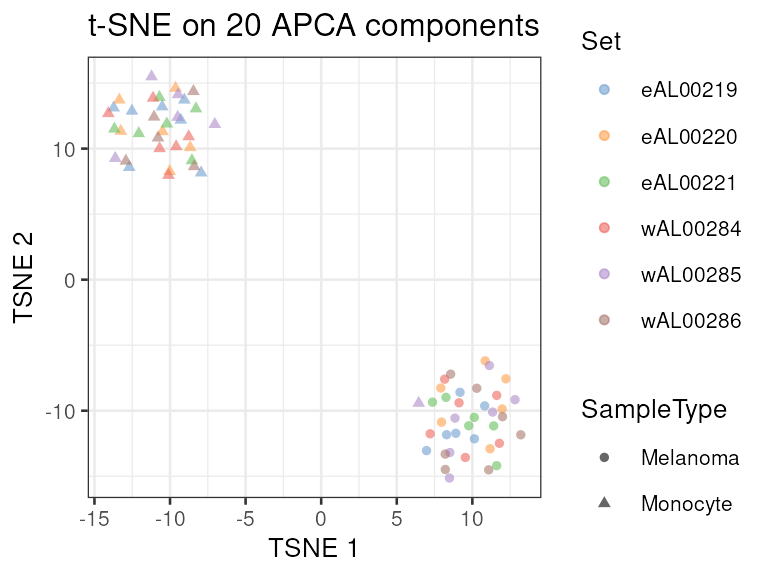

The two cell populations remain clearly separated with an excellent
mixing of the acquisition runs, even when considering the 20 first APCA
components.

We use the same approach to explore the component results in peptide
space.

\
`caResPeps`` ``<-`` ``caRes``$``byFeature`\
`caResPeps`` ``<-`` `[`scpAnnotateResults`](https://UCLouvain-CBIO.github.io/scp/reference/scpAnnotateResults.md)`(`\
`    ``caResPeps``, `[`rowData`](https://rdrr.io/pkg/SummarizedExperiment/man/SummarizedExperiment-class.html)`(``leduc_minimal``)``, by ``=`` ``"feature"``, by2 ``=`` ``"Sequence"`\
`)`\
[`scpComponentPlot`](https://UCLouvain-CBIO.github.io/scp/reference/ScpModel-ComponentAnalysis.md)`(`\
`    ``caResPeps``, pointParams ``=`` `[`list`](https://rdrr.io/r/base/list.html)`(``size ``=`` ``0.8``, alpha ``=`` ``0.4``)`\
`)`` ``|>`\
`    `[`wrap_plots`](https://patchwork.data-imaginist.com/reference/wrap_plots.html)`(``ncol ``=`` ``1``)`

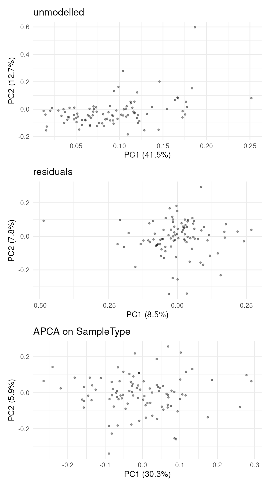

This exploration may identify groups of covarying peptides, although no
clear patterns appear in the example data set.

We can also combine the exploration of the components in cell and
peptide space. This is possible thanks to biplots.

\
[`scpComponentBiplot`](https://UCLouvain-CBIO.github.io/scp/reference/ScpModel-ComponentAnalysis.md)`(`\
`    ``caResCells``, ``caResPeps``,`\
`    pointParams ``=`` `[`list`](https://rdrr.io/r/base/list.html)`(`[`aes`](https://ggplot2.tidyverse.org/reference/aes.html)`(``colour ``=`` ``SampleType``)``)``,`\
`    labelParams ``=`` `[`list`](https://rdrr.io/r/base/list.html)`(``size ``=`` ``1.5``, max.overlaps ``=`` ``15``)``,`\
`    textBy ``=`` ``"gene"``, top ``=`` ``10`\
`)`` ``|>`\
`    `[`wrap_plots`](https://patchwork.data-imaginist.com/reference/wrap_plots.html)`(``ncol ``=`` ``1``, guides ``=`` ``"collect"``)`

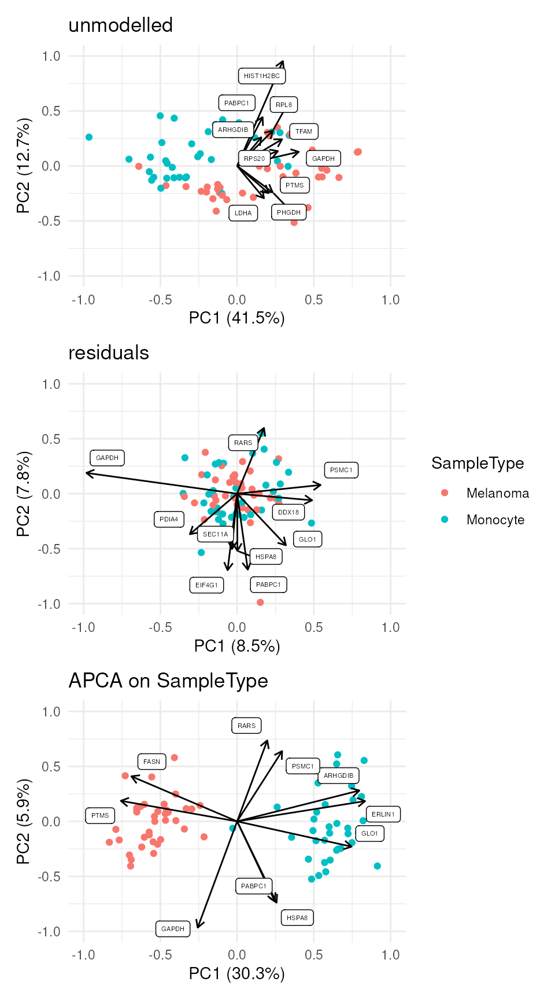

Finally, we offer functionality to aggregate the results at the protein
level instead of the peptide level.

\
`caResProts`` ``<-`` `[`scpComponentAggregate`](https://UCLouvain-CBIO.github.io/scp/reference/ScpModel-ComponentAnalysis.md)`(``caResPeps``, fcol ``=`` ``"gene"``)`\
`#> Components may no longer be orthogonal after aggregation.`\
`caResProts``$``APCA_SampleType`\
`#> DataFrame with 86 rows and 26 columns`\
`#>                PC1        PC2        PC3        PC4         PC5          PC6`\
`#>          <numeric>  <numeric>  <numeric>  <numeric>   <numeric>    <numeric>`\
`#> ABCE1   -0.0523868 -0.0107614  0.0915703  0.1700845   0.0662170    0.0496202`\
`#> ACLY    -0.2189566  0.0243845 -0.2483628 -0.0532033  -0.1110092    0.0451648`\
`#> ACTN4   -0.0118549  0.0405639  0.2747914 -0.0803185  -0.0975626   -0.1249975`\
`#> AIFM1    0.1006312 -0.0339555  0.1980053  0.0289710  -0.1750299    0.0646453`\
`#> APMAP    0.0194976  0.0237283  0.0449902  0.0646326   0.0633247    0.1032321`\
`#> ...            ...        ...        ...        ...         ...          ...`\
`#> TPP2   -0.05523720 -0.0312842  0.0426800 -0.1031275 -0.08179016 -1.53014e-02`\
`#> TUBA1C -0.14525764 -0.0160165  0.0199667  0.0212538 -0.02182402 -1.26982e-05`\
`#> VAT1   -0.08477712 -0.0813306  0.1182944  0.0597851 -0.00634129 -1.26818e-02`\
`#> XRCC6   0.00294306  0.0634618  0.1679245  0.0286502 -0.02912084  8.44033e-04`\
`#> YWHAG  -0.00908566  0.1101649 -0.2957877  0.0912574 -0.12539568  1.09162e-02`\
`#>               PC7        PC8        PC9        PC10       PC11       PC12`\
`#>         <numeric>  <numeric>  <numeric>   <numeric>  <numeric>  <numeric>`\
`#> ABCE1   0.0273637  0.0152499 -0.0118696  -0.0155091  0.0467360 -0.0498367`\
`#> ACLY    0.0737049 -0.1009764 -0.0292278  -0.0729394  0.0784255  0.1141748`\
`#> ACTN4  -0.0792401  0.0792694 -0.0937530  -0.2623350 -0.0906389  0.2531783`\
`#> AIFM1   0.0445864 -0.1736808  0.0289516   0.0902909 -0.0462027  0.1542865`\
`#> APMAP  -0.0861935  0.0427935 -0.0305422  -0.1349859  0.0779739 -0.0504814`\
`#> ...           ...        ...        ...         ...        ...        ...`\
`#> TPP2   0.01408624  0.0624262 -0.0652707 -0.02332122 -0.0707355  0.0364165`\
`#> TUBA1C 0.02621080 -0.0178920  0.0108227 -0.00974189 -0.0318659  0.0141365`\
`#> VAT1   0.00703644 -0.0518256 -0.0195249 -0.13052631  0.1956646  0.0207889`\
`#> XRCC6  0.10821406 -0.0703597 -0.0777127  0.24227114  0.1112782  0.0329050`\
`#> YWHAG  0.01681447 -0.0633650 -0.0953365  0.19064684  0.0710503  0.1170840`\
`#>               PC13       PC14        PC15       PC16         PC17        PC18`\
`#>          <numeric>  <numeric>   <numeric>  <numeric>    <numeric>   <numeric>`\
`#> ABCE1  -0.00394421  0.0347495   0.0303548  0.0982125  0.019299546 -0.03013423`\
`#> ACLY    0.20065855  0.1364943  -0.1759971  0.1280834  0.052763772  0.00976251`\
`#> ACTN4  -0.12194271  0.0147283  -0.0651876 -0.0808981 -0.085513390  0.19312491`\
`#> AIFM1  -0.07237979 -0.0502076  -0.1118599  0.0333500  0.000500339 -0.07907947`\
`#> APMAP  -0.00676663 -0.1388373  -0.0860066 -0.0403921 -0.118051300  0.17706459`\
`#> ...            ...        ...         ...        ...          ...         ...`\
`#> TPP2    0.07735670  0.0548014 -0.00487750 -0.0110905   0.04611403  0.05194009`\
`#> TUBA1C -0.03046278 -0.0212624 -0.00753262  0.0558039  -0.00479281 -0.00166901`\
`#> VAT1   -0.05231374 -0.0825779 -0.01499988  0.0953951  -0.17652919 -0.06063066`\
`#> XRCC6  -0.00530058  0.0267324  0.10607865 -0.0597192   0.08006765  0.01904627`\
`#> YWHAG   0.03732562  0.0622166 -0.05209873  0.0791305  -0.13065489  0.00702455`\
`#>               PC19       PC20     Reverse Potential.contaminant`\
`#>          <numeric>  <numeric> <character>           <character>`\
`#> ABCE1  -0.04681240 -0.0577301                                  `\
`#> ACLY    0.10943598 -0.0329600                                  `\
`#> ACTN4   0.11377646  0.0846503                                  `\
`#> AIFM1  -0.27119436  0.1122359                                  `\
`#> APMAP   0.00468129  0.1576563                                  `\
`#> ...            ...        ...         ...                   ...`\
`#> TPP2   -0.00117663  0.0536378                                  `\
`#> TUBA1C -0.02624260  0.0271434                                  `\
`#> VAT1    0.05049360  0.1286583                                  `\
`#> XRCC6   0.06752257 -0.0488317                                  `\
`#> YWHAG  -0.10053252  0.1027183                                  `\
`#>        Leading.razor.protein.id Leading.razor.protein.symbol        gene`\
`#>                     <character>                  <character> <character>`\
`#> ABCE1                    P61221                        ABCE1       ABCE1`\
`#> ACLY                     P53396                         ACLY        ACLY`\
`#> ACTN4                    O43707                        ACTN4       ACTN4`\
`#> AIFM1                    O95831                        AIFM1       AIFM1`\
`#> APMAP                    Q9HDC9                        APMAP       APMAP`\
`#> ...                         ...                          ...         ...`\
`#> TPP2                     P29144                         TPP2        TPP2`\
`#> TUBA1C                   Q9BQE3                        TBA1C      TUBA1C`\
`#> VAT1                     Q99536                         VAT1        VAT1`\
`#> XRCC6                    P12956                        XRCC6       XRCC6`\
`#> YWHAG                    P61981                        1433G       YWHAG`\
`#>               .n`\
`#>        <integer>`\
`#> ABCE1          1`\
`#> ACLY           1`\
`#> ACTN4          1`\
`#> AIFM1          1`\
`#> APMAP          1`\
`#> ...          ...`\
`#> TPP2           1`\
`#> TUBA1C         1`\
`#> VAT1           2`\
`#> XRCC6          1`\
`#> YWHAG          1`

Note that the aggregated tables in `caResProts` can be explored with the
visualisation function
[`scpComponentPlot()`](https://UCLouvain-CBIO.github.io/scp/reference/ScpModel-ComponentAnalysis.md).

## Batch correction

Based on the estimated model, we generate batch-corrected data, that is
data with only the effect of cell type and the residual data. We also
remove the intercept.

\
`(``leduc_batchCorrect`` ``<-`` `[`scpRemoveBatchEffect`](https://UCLouvain-CBIO.github.io/scp/reference/ScpModel-DataCorrection.md)`(`\
`    ``leduc_minimal``, effects ``=`` `[`c`](https://rdrr.io/r/base/c.html)`(``"Set"``, ``"Channel"``, ``"MedianIntensity"``)``,`\
`    intercept ``=`` ``TRUE`\
`)``)`\
`#> class: SingleCellExperiment `\
`#> dim: 95 73 `\
`#> metadata(0):`\
`#> assays(1): ''`\
`#> rownames(95): APNVVVTR GFQEVVTPNIFNSR ... AILGSVER LGAEVYHTLK`\
`#> rowData names(6): Sequence Reverse ... Leading.razor.protein.symbol`\
`#>   gene`\
`#> colnames(73): eAL00219RI5 eAL00219RI6 ... wAL00286RI17 wAL00286RI18`\
`#> colData names(13): Set Channel ... passQC cell`\
`#> reducedDimNames(0):`\
`#> mainExpName: NULL`\
`#> altExpNames(0):`

Note that the batch-corrected data still contain missing values. The
`leduc_batchCorrect` object can be used for downstream analysis.

## Session information

    R version 4.6.1 (2026-06-24)
    Platform: x86_64-pc-linux-gnu
    Running under: Ubuntu 24.04.5 LTS

    Matrix products: default
    BLAS:   /usr/lib/x86_64-linux-gnu/openblas-pthread/libblas.so.3 
    LAPACK: /usr/lib/x86_64-linux-gnu/openblas-pthread/libopenblasp-r0.3.26.so;  LAPACK version 3.12.0

    locale:
     [1] LC_CTYPE=en_US.UTF-8       LC_NUMERIC=C              
     [3] LC_TIME=en_US.UTF-8        LC_COLLATE=en_US.UTF-8    
     [5] LC_MONETARY=en_US.UTF-8    LC_MESSAGES=en_US.UTF-8   
     [7] LC_PAPER=en_US.UTF-8       LC_NAME=C                 
     [9] LC_ADDRESS=C               LC_TELEPHONE=C            
    [11] LC_MEASUREMENT=en_US.UTF-8 LC_IDENTIFICATION=C       

    time zone: UTC
    tzcode source: system (glibc)

    attached base packages:
    [1] stats4    stats     graphics  grDevices utils     datasets  methods  
    [8] base     

    other attached packages:
     [1] scater_1.41.3               scuttle_1.23.2             
     [3] ggplot2_4.0.3               patchwork_1.3.2            
     [5] SingleCellExperiment_1.35.2 scp_1.23.4                 
     [7] QFeatures_1.23.2            MultiAssayExperiment_1.39.1
     [9] SummarizedExperiment_1.43.0 Biobase_2.73.2             
    [11] GenomicRanges_1.65.4        Seqinfo_1.3.2              
    [13] IRanges_2.47.5              S4Vectors_0.51.10          
    [15] BiocGenerics_0.59.12        generics_0.1.4             
    [17] MatrixGenerics_1.25.0       matrixStats_1.5.0          
    [19] BiocStyle_2.41.0           

    loaded via a namespace (and not attached):
     [1] gridExtra_2.3.1         fdrtool_1.2.18          rlang_1.3.0            
     [4] magrittr_2.0.5          clue_0.3-68             otel_0.2.0             
     [7] compiler_4.6.1          systemfonts_1.3.2       vctrs_0.7.3            
    [10] reshape2_1.4.5          nipals_1.2              stringr_1.6.0          
    [13] ProtGenerics_1.45.0     pkgconfig_2.0.3         fastmap_1.2.0          
    [16] XVector_0.53.0          labeling_0.4.3          rmarkdown_2.32         
    [19] ggbeeswarm_0.7.3        ragg_1.5.2              purrr_1.2.2            
    [22] xfun_0.62               cachem_1.1.0            beachmat_2.29.3        
    [25] jsonlite_2.0.0          DelayedArray_0.39.8     BiocParallel_1.47.0    
    [28] irlba_2.4.1             parallel_4.6.1          cluster_2.1.8.3        
    [31] R6_2.6.1                bslib_0.12.0            stringi_1.8.9          
    [34] RColorBrewer_1.1-3      jquerylib_0.1.4         Rcpp_1.1.2             
    [37] bookdown_0.48           knitr_1.52              Matrix_1.7-6           
    [40] igraph_2.3.4            tidyselect_1.2.1        abind_1.4-8            
    [43] yaml_2.3.12             viridis_0.6.5           codetools_0.2-20       
    [46] lattice_0.23-1          tibble_3.3.1            plyr_1.8.9             
    [49] withr_3.0.3             S7_0.2.2                Rtsne_0.17             
    [52] evaluate_1.0.5          desc_1.4.3              IHW_1.41.0             
    [55] pillar_1.11.1           BiocManager_1.30.27     lpsymphony_1.41.0      
    [58] scales_1.4.0            glue_1.8.1              slam_0.1-56            
    [61] metapod_1.21.0          lazyeval_0.2.3          tools_4.6.1            
    [64] BiocNeighbors_2.7.3     ScaledMatrix_1.21.0     fs_2.1.0               
    [67] grid_4.6.1              tidyr_1.3.2             MsCoreUtils_1.25.4     
    [70] beeswarm_0.4.0          BiocSingular_1.29.2     vipor_0.4.7            
    [73] cli_3.6.6               rsvd_1.0.6              textshaping_1.0.5      
    [76] S4Arrays_1.13.2         viridisLite_0.4.3       dplyr_1.2.1            
    [79] AnnotationFilter_1.37.0 gtable_0.3.6            sass_0.4.10            
    [82] digest_0.6.39           SparseArray_1.13.4      ggrepel_0.9.8          
    [85] htmlwidgets_1.6.4       farver_2.1.2            htmltools_0.5.9        
    [88] pkgdown_2.2.1.9000      lifecycle_1.0.5         MASS_7.3-66            

## License

This vignette is distributed under a [CC BY-SA
license](https://creativecommons.org/licenses/by-sa/4.0/).

## Reference

Vanderaa, Christophe, and Laurent Gatto. 2024. “scplainer: Using Linear
Models to Understand Mass Spectrometry-Based Single-Cell Proteomics
Data.” *bioRxiv*, ahead of print.
<https://doi.org/10.1101/2023.12.14.571792>.
