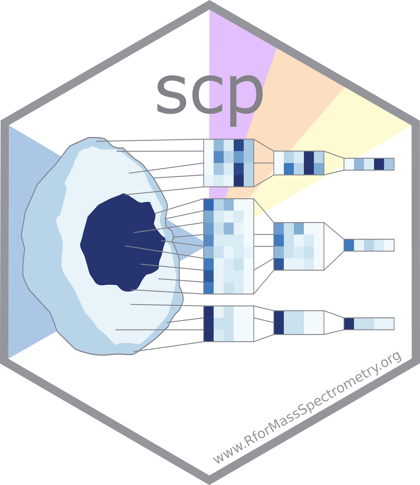

# Single cell proteomics data processing

The `scp` package is used to process and analyse mass spectrometry-based
single cell proteomics data. It relies on the
[`QFeatures`](https://rformassspectrometry.github.io/QFeatures/) package
to manage and process
[`SingleCellExperiment`](http://bioconductor.org/packages/release/bioc/html/SingleCellExperiment.md)
or
[`SummarizedExperiment`](http://bioconductor.org/packages/release/bioc/html/SummarizedExperiment.md)
objects.

## Installation

To install the **stable version** from Bioconductor:

\
`if`` ``(``!`[`requireNamespace`](https://rdrr.io/r/base/ns-load.html)`(``"BiocManager"``)``)`\
`    `[`install.packages`](https://rdrr.io/r/utils/install.packages.html)`(``"BiocManager"``)`\
`BiocManager``::`[`install`](https://bioconductor.github.io/BiocManager/reference/install.html)`(``"scp"``)`

To install the **devel version** from GitHub, you first need to ensure
that you are using the `devel` release of Bioconductor and make sure
your installed libraries are valid.

\
`BiocManager``::`[`install`](https://bioconductor.github.io/BiocManager/reference/install.html)`(``version ``=`` ``"devel"``)`\
[`stopifnot`](https://rdrr.io/r/base/stopifnot.html)`(``BiocManager``::`[`valid`](https://bioconductor.github.io/BiocManager/reference/valid.html)`(``)``)`

Then, you can install `scp` from Github.

\
`BiocManager``::`[`install`](https://bioconductor.github.io/BiocManager/reference/install.html)`(``"UCLouvain-CBIO/scp"``)`

## Citation

To cite the `scp` package in publications use:

> Vanderaa, Christophe, and Laurent Gatto. 2025. [Scplainer: Using
> Linear Models to Understand Mass Spectrometry-Based Single-Cell
> Proteomics
> Data](https://link.springer.com/article/10.1186/s13059-025-03713-4).
> Genome Biology 26 (1): 237.

> Vanderaa, Christophe, and Laurent Gatto. 2023. [Revisiting the Thorny
> Issue of Missing Values in Single-Cell
> Proteomics](https://pubs.acs.org/doi/10.1021/acs.jproteome.3c00227).
> Journal of Proteome Research 22 (9): 2775–84.

> Vanderaa Christophe and Laurent Gatto. The current state of
> single-cell proteomics data analysis. Current Protocols 3 (1): e658.;
> doi: <https://doi.org/10.1002/cpz1.658> (2023).

> Vanderaa Christophe and Laurent Gatto. [Replication of Single-Cell
> Proteomics Data Reveals Important Computational
> Challenges](https://www.tandfonline.com/doi/full/10.1080/14789450.2021.1988571).
> Expert Review of Proteomics, 1–9 (2021).

## Asking for help

Feel free to use [Github
issues](https://github.com/UCLouvain-CBIO/scp/issues) or the
[Bioconductor support site](https://support.bioconductor.org/) to ask
question or report problems with `scp`.

## License

The `scp` code is provided under a
[GPL-3.0](https://opensource.org/license/gpl-3.0) license. The
documentation, including the manual pages and the vignettes, are
distributed under a [CC BY-SA
license](https://creativecommons.org/licenses/by-sa/2.0/).

## Contributions

Contributions are welcome, and should ideally be provdied through a
Github pull request. Feel free to discuss any more non-trivial
suggestions or changes first in an issue.

### Contributors

- [Micha Birklbauer](https://github.com/michabirklbauer): [fix grep
  pattern in example for
  readSingleCellExperiment](https://github.com/UCLouvain-CBIO/scp/pull/94).
